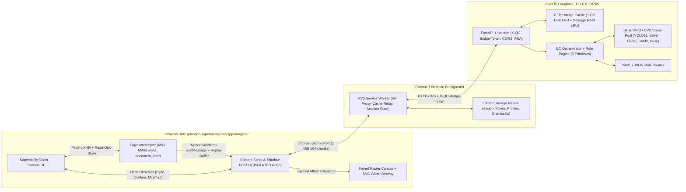

# Supervisely Hybrid QC Assistant — Master Architecture, System & UI Design Plan

**Approach:** **Approach C (Hybrid)** — Chrome Extension (Manifest V3) + Local Python FastAPI Daemon (`http://127.0.0.1:8765`)  
**Target Workspace:** `https://quantigo.supervisely.com/app/images2/` (and `/labeling/*`) on macOS (Apple Silicon MPS / CPU)  
**Project Directory:** `/Users/mrongsubho/Documents/Termninal/SuerpvicelyQC/`  
**Locked User Configuration:**
- **Default AI Mode:** **`standard`** (`YOLO11s` + Bokeh Blur Gate + Depth Anything V2 Small, `< 1s`, `~680–880 MB` RSS)
- **Trigger Behavior:** **Manual execution** (`Run QC` button / `Option + Q` / Pre-Confirm Guard; `autoRunOnImageSwitch = false`, `autoRunAfterSync = false`)
**Verification Status:** `FINAL VERDICT: PASS` (2 RUG verification rounds across 4 audited design specifications)

> [!NOTE]
> Full module-level specifications, Pydantic/TypeScript schemas, mathematical formulas, and test matrices live in [`docs/plan/`](./docs/plan/):
> - [01-architecture.md](./docs/plan/01-architecture.md) — Hybrid architecture, MV3 world isolation, API contracts, security & repo layout
> - [02-qc-engine.md](./docs/plan/02-qc-engine.md) — Deterministic 5-primitive rule engine, MPS AI pipeline & YAML profiles
> - [03-ui-ux-design.md](./docs/plan/03-ui-ux-design.md) — Top-bar widget, QC Inspector drawer, SVG/Canvas overlays, Confirm guard & pure-TS offline engine
> - [04-qa-verification.md](./docs/plan/04-qa-verification.md) — Cross-spec RUG audit log, edge-case gates, master test plan & risk register
> - [05-scene-simulation-plan.md](./docs/plan/05-scene-simulation-plan.md) — *(Incremental v2 Plan)* Pre-Annotation Scene Simulation & Annotation Blueprint ("Simulate & Guide")

---

## 1. High-Level Hybrid Architecture

The system splits live browser telemetry and UI rendering (Chrome Extension MV3) from heavy geometric analysis and local vision inference (Python FastAPI on loopback), guaranteeing zero Supervisely credential leakage and graceful offline operation.



### Key Architectural Guarantees
1. **3-Tier Non-Invasive State Extraction:**
   - **`MAIN` world (`document_start`)** wraps `fetch`/`XHR` with an early-boot `__slyQcReplayBuffer` + `SLY_QC_BRIDGE_READY` handshake (so initial ontology/job payloads are never missed) and reads live unsaved React/Redux store figures before `Synchronize` is clicked.
   - **Degradation Ladder:** `store` (full live geometry) -> `network_interceptor` (last server snapshot + deltas) -> `dom_fallback` (`figures: []`, `partialGeometry: true`, passing `Objects By Classes` counts via `domFigureSummaries` so workflow, tag-scope, class-allowlist, and vision checks stay active without `422` errors).
2. **MV3 CORS, PNA & Binary Transfer Safety:**
   - Content scripts never call `127.0.0.1` directly; all loopback HTTP/WS calls proxy through the MV3 Service Worker (`host_permissions`).
   - Same-site `*.supervisely.com` image URLs fetch in the Service Worker (`credentials: "include", cache: "force-cache"`). External presigned S3/CDN URLs fetch with `credentials: "omit"` (avoiding `ACAO: *` rejections), streaming via 1 MiB base64 chunks over `chrome.runtime.Port` when relayed from content script.
   - Full-res images (e.g., `5472×3648`) transfer **once** per `(imageId, imageHash)` via `HEAD` -> `PUT` into `~/.cache/supervisely-qc/images/` (`1 GB / 24h` disk LRU + `<= 2` decoded RGB arrays in RAM).
3. **Loopback Security:**
   - Strictly bound to `127.0.0.1` with a 256-bit `X-QC-Bridge-Token` (`~/.config/supervisely-qc/bridge_token`, `0600`), verified via `hmac.compare_digest` on all `/api/v1/qc/*` and `/api/v1/profiles*` routes (`GET /api/v1/health` remains an unauthenticated minimal status probe).

---

## 2. Canonical API & Multi-Primitive Data Contract

Shared across `shared/types/qc-contract.ts` and `backend/app/schemas/qc.py` (`CamelModel` with `extra="forbid"`, JSON Schema parity verified in CI):

| Method & Route | Purpose | Key Payload / Behavior |
|---|---|---|
| `GET /api/v1/health` | Probe readiness, MPS/CPU device, loaded models, cache usage | Unauthenticated `HealthResponse` |
| `HEAD / PUT /api/v1/qc/images/{imageId}` | Deduplicated full-res image byte cache | Checks `(imageId, imageHash)`; validates MIME, size `<= 100 MB`, and decoded `W×H` |
| `POST /api/v1/qc/analyze` | Run QC on current snapshot (`rules \| standard \| deep`; default `standard`) | Returns `200 OK` (`rules`/`standard`), `202 Accepted` + `jobId` (`deep`), or `424 IMAGE_CACHE_MISS` |
| `GET /api/v1/qc/jobs/{jobId}` & `WS /ws/{clientId}` | Async progress & result delivery | Resumable across MV3 SW 30s sleep via `chrome.storage.session` |
| `GET / PUT / DELETE /api/v1/profiles[/{id}]` | Rule Profile CRUD & auto-matching | Matches priority: explicit `profileId` -> `datasetIds` -> `projectIds` -> `jobTitleRegex` -> `default` |

**All 5 Supervisely Annotation Primitives Covered (`FigureGeometry`):**
- **Bounding Box (`rectangle`):** `points.exterior: [p1, p2]` (normalized `[minX, minY, maxX, maxY]`)
- **Polygon (`polygon`):** `points.exterior` + `points.interior` hole rings
- **Brush (`bitmap`):** `bitmap.data` (`base64(zlib(png))`) + `bitmap.origin`
- **Line (`polyline`):** Ordered open `points.exterior`
- **Keypoint (`point` & `graph`):** Standalone points + `nodes` map validated against `ClassDefinition.geometryConfig` (`nodes`, `edges`)

---

## 3. QC Engine: Deterministic Rules + Apple Silicon Vision

### Layer 1: Deterministic Rule Engine (`<50 ms` typical, `<300 ms` SLA)
Runs both on the Python backend (`rules` mode & Stage 1 of `standard`/`deep`) **and** in pure TypeScript (`offlineQcEngine.ts`) when the backend is offline:

- **Workflow & Tag Scope:**
  - `WORKFLOW_UNSAVED_SYNC` (`blocker`): Flags yellow `Synchronize` button before navigation/confirm.
  - `WORKFLOW_EMPTY_UNCONFIRMED` (`warning`): Flags unconfirmed empty images.
  - `TAG_SCOPE_IMAGE_MISPLACED` (`blocker`): Catches `"Occlusion"` attached to `CURRENT IMAGE TAGS` instead of an occluded object.
  - `TAG_SCOPE_OBJECT_MISPLACED` / `TAG_CLASS_INCOMPATIBLE` / `TAG_VALUE_INVALID` / `TAG_REQUIRED_MISSING`.
  - `CLASS_DISABLED_OR_OFF_JOB` (`warning`): Flags disabled or out-of-job classes (e.g., `Car1` or `Bus` in a `Human`-only job).
- **Scale-Invariant Global Geometry:** Duplicate detection (`IoU >= 0.90` / Chamfer / node distance), micro-click floor ($s_{\min} = \min(15, \max(8, 0.025 \cdot \min(W, H)))$), canvas-wide outliers (`> 90%`), and `[-1, W+1] × [-1, H+1]` bounds tolerance.
- **Per-Primitive Rules:**
  - **Bounding Box:** Asymmetric `IoU >= 0.10` / `IoS >= 0.15` occlusion detection (`BBOX_OCCLUSION_MISSING_TAG`), foreground false-positive check (`BBOX_FOREGROUND_OCCLUSION_FP`), near-miss border gaps (`BBOX_BORDER_TRUNCATION`), aspect outliers.
  - **Polygon:** Winding-independent Shoelace area, Shapely self-intersection witness focus, redundant collinear vertices, `< 10°` needle spikes, interior hole validation (`POLY_HOLE_INVALID`).
  - **Brush (`bitmap`):** Pre-decode PNG `IHDR` bomb guard + streaming `32 MB` zlib cap; connected-component stray dots (`BITMAP_DISCONNECTED_ISLANDS`), 1px-padded `binary_fill_holes` pinholes (`BITMAP_UNEXPECTED_INTERNAL_HOLES`), jaggedness ratio `> 1.38`, and cross-figure spill (`BITMAP_SPILLED_MASK`).
  - **Line (`polyline`):** Minimum vertices, zero-length/micro segments, acute `< 25°` backtrack spikes, self-crossings, collinear & T-junction endpoint gaps (`3–35 px`).
  - **Keypoint (`point` & `graph`):** Missing/sentinel `[0, 0]` template nodes, parent container containment (`KP_OUTSIDE_PARENT_BOX`), **facing-direction-aware** bilateral L/R inversion check (skipping non-bilateral classes like `Fruit`), bone proportion outliers, and occlusion visibility mismatches.

### Layer 2: Vision Pipeline (`macOS` 8 GB Apple Silicon MPS / CPU)

| Mode | Peak RSS | Target Latency | Pipeline & Quantigo Pain Points Solved |
|---|---|---|---|
| **`rules`** | `~65–95 MB` | `< 50 ms` | Layer 1 only; zero image upload; identical to TS offline mode. |
| **`standard` (Default)** | `~680–880 MB` | `450–900 ms` | **YOLO11s** (`1280px` + `2×2` 20%-overlap tiling for `W >= 2400` catches off-viewport pedestrians) + **Native 1:1 Tenengrad/Laplacian Bokeh Gate** (suppresses blurred background `Building` false positives) + **Depth Anything V2 Small** (definitive foreground vs occluded depth ordering). |
| **`deep`** | `< 1.45 GB` | `1.8–3.2 s` | Sequential slot (`max_heavy_models = 1`, `snapshotSeq` coalescing): adds **YOLO-Worldv2-s** / **Grounding DINO-Tiny** (open-vocab), **SAM 2.1 Hiera-Tiny** (`+8%` expanded-prompt box/mask tightness & clipping recall `< 0.88`), and **YOLO11s-pose** (semantic label-mapped L/R pose cross-check). |

Memory guardrails enforce `float32 -> float16` MPS casting, CPU NMS, `180s` idle model unload, and `psutil` preflight auto-downgrade (`< 900 MB` free -> `standard`; `< 450 MB` free -> `rules`).

---

## 4. Chrome Extension UI/UX Design

All extension UI renders inside **Shadow DOM roots** (`all: initial`, dark-theme tokens matched to `#181B22` / `#1E232D` / `#252B37`) with non-blocking pointer isolation (`pointer-events: none` on canvas overlays) and `KeyboardEvent.code`-based macOS `Option` chords (`⌥Q` Run QC, `⌥⇧Q` Drawer, `⌥O` Toggle Overlay, `⌥[` / `⌥]` Step Findings) so Supervisely's `R/V/B/E/P/L/[/]/Space/Esc` shortcuts stay untouched.

```text
+---------------------------------------------------------------------------------------------------+
| [Logo] > Dataset > [0% | Job] > [<-] [NEXT] [✓ CONFIRM ->] [Synchronize*] [⚡ Run QC ⌥Q | ● 2B]    |
+----+---------------+-------------------------------------------------------+----------------------+
|    | Definitions   |  [file_tab.jpg]           Opacity 50%  ...  16% v     | Objects By Classes   |
|    |  Human / Car1 |  [Tag: Occlusion]                        +---------+  |   Human (6)          |
|    |               |      + - - - - - - - - - +               | Minimap |  |----------------------|
|    | CURRENT TAGS  |      | AI: Human 89%     |  [QC Drawer]  | * [Red] |  | Images (5)           |
|    | [x] Occlusion |      + - - - - - - - - - +  (Docked Safe +---------+  |                      |
|    |               |                     [1 Human Off-Screen →] Below Map) |                      |
+----+---------------+-------------------------------------------------------+----------------------+
```

- **Top-Bar Widget (`TopBarWidget.tsx`):** `Run QC [⌥Q]` split button (defaults to `standard` mode, manual execution) + live readiness pill (`Idle`, `Checking`, `Ready · 96`, `Review · 2W`, `Blocked · 2B`, `Edited · Re-run`, `Offline · Rules`), auto-adapting to narrow `< 1320px` viewports.
- **Minimap-Safe QC Inspector Drawer (`QcDrawer.tsx`):** Docks cleanly below the top-right Minimap (or over the right sidebar / floating draggable), showing score ring, profile selector, severity/category filters, plain-English finding cards with fingerprint-persisted `Dismiss`, and safe `QuickFixAction` buttons.
- **Dual-Layer Canvas Overlay (`CanvasOverlay.tsx`):** Paired transparent `<canvas>` (for CSP-safe `bitmap` mask halo rendering via `createImageBitmap`) + `<svg>` (`vector-effect="non-scaling-stroke"`) synchronized to Supervisely's CSS-pixel pan/zoom transform (`store` -> `minimap + zoomPercent` -> `fallback_full`). Displays diagonal hatch overlap zones (`"24% IoU"`), dashed cyan AI Ghost Boxes (`[✨ Human 89% · Sharp]`), clamped edge direction badges, and `5px` Minimap radar dots for off-viewport detections.
- **Pre-Confirm Intercept Guard (`ConfirmGuard.tsx`):** Persistent window-level capture listener on `CONFIRM ->` that pops a quick review modal if unresolved blockers or yellow `Synchronize` exist (`Cancel & Fix`, `Re-Run QC`, `Confirm Anyway ->`).
- **Popup & Options Rule Studio (`Popup.tsx`, `Options.tsx`):** Backend health/MPS status, bridge token test, mode selector (`standard` default), manual trigger defaults (`Auto-run` unchecked), and full 1:1 editor/YAML import-export for `RuleProfile` and per-class overrides (`Building`, `Bus`, `Human`, `Car1`, etc.).

---

## 5. Phased Implementation & Verification Roadmap

After opening `/Users/mrongsubho/Documents/Termninal/SuerpvicelyQC/` as your active workspace, implementation will proceed through 5 verified phases (built & validated with SWE + QA subagents):

1. **Phase 1 — Workspace Scaffold & Canonical Contracts:** Initialize project tree, `shared/types/qc-contract.ts`, `backend/app/schemas/qc.py`, `scripts/sync_contracts.py`, and contract parity tests.
2. **Phase 2 — FastAPI Backend, Caching & Layer 1 Deterministic Engine:** Implement loopback token auth/PNA middleware, 2-tier `ImageCacheService`, `ProfileStore` + built-in YAML profiles, and all 5-primitive deterministic rule modules (`global`, `bbox`, `polygon`, `bitmap`, `polyline`, `keypoint`) with Pytest suite.
3. **Phase 3 — Layer 2 Apple Silicon CV Pipeline:** Implement `ModelManager` (`mps` + `cpu` fallback, `scripts/download_models.py`, RAM guard), `tiling.py`, `blur_bokeh.py`, `occlusion_depth.py`, `tightness_auditor.py`, and `pose_auditor.py` + `JobManager` (`snapshotSeq` coalescing, WebSocket events).
4. **Phase 4 — Chrome Extension MV3 & UI Components:** Implement `MAIN` interceptor + `__slyQcReplayBuffer`, `ISOLATED` DOM observer + 3-tier viewport math, Service Worker relay, `offlineQcEngine.ts`, Shadow DOM components (`TopBarWidget`, `QcDrawer`, `CanvasOverlay`, `ConfirmGuard`, `Popup`, `Options`), and Vitest suite.
5. **Phase 5 — End-to-End Mock-Supervisely Playwright Suite & macOS Benchmarks:** Launch Chromium with unpacked extension against a mock Supervisely workspace + live FastAPI server to verify all 5 primitives, off-screen missed-object flow, `ConfirmGuard` re-render resilience, offline fallback, and `< 1.45 GB` RSS on Apple Silicon.
