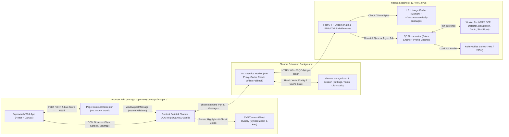
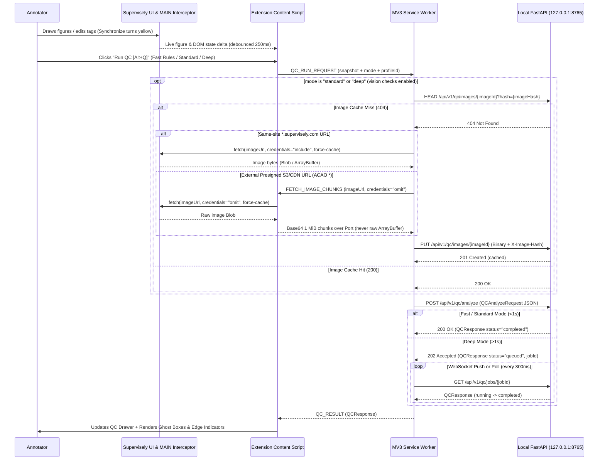

# 01 — System Architecture & Canonical Contracts: Supervisely Hybrid QC Assistant

**Document Role:** Master Architecture & Canonical API Contract (Single Source of Truth)  
**Target Platform:** `https://quantigo.supervisely.com/app/images2/` (and `/labeling/*` job views)  
**Architecture Approach:** **Approach C (Hybrid)** — Chrome Extension (Manifest V3) + Local Python FastAPI Backend (`127.0.0.1`) on macOS (Apple Silicon MPS / CPU)  
**Supported Primitives:** Bounding Box (`rectangle`), Polygon (`polygon` + holes), Brush (`bitmap`), Line (`polyline`), Keypoint (`point` and `graph` skeleton)

---

## 1. High-Level Hybrid Architecture

The system splits responsibilities cleanly across two cooperating runtimes:

1. **Chrome Extension (MV3)** — Runs inside the user's authenticated browser session:
   - Captures Supervisely's internal network responses, live unsaved editor state, DOM signals (`Synchronize`, `CONFIRM ->`, active viewport/minimap zoom), and authenticated image bytes via Chrome's HTTP cache.
   - Renders non-invasive native-feeling controls, the QC Inspector drawer, and a zoom/pan-synchronized SVG/Canvas ghost overlay.
   - Executes **Client-Side Fast Deterministic Rules** directly in TypeScript if the local Python daemon is offline.
2. **Local Python FastAPI Backend (`http://127.0.0.1:8765`)** — Runs natively on macOS:
   - Executes deep geometric validation (Shapely polygon/line topology, bitmap connected-component analysis, keypoint skeleton graph validation) and local Computer Vision inference on Apple Silicon (`torch.device("mps")` with automatic `cpu` fallback).
   - Maintains an in-memory + disk-backed LRU cache of full-resolution images (`5472x3648` etc.) keyed by `(imageId, imageHash)` so images are transferred over loopback at most once per editing session.
   - Manages versioned JSON/YAML Rule Profiles matched automatically to Supervisely project/job titles.

### 1.1 System Context & Data Flow Diagram



### 1.2 End-to-End Request Sequence (Vision-Enabled QC Run)



---

## 2. Live Data Extraction Strategy in Supervisely Web Editor

Brittle scraping of `<canvas>` pixels or DOM text labels cannot reliably reconstruct nested polygon holes, zlib-compressed brush masks, graph skeleton node UUIDs, or exact sub-pixel coordinates on a `5472x3648` photo viewed at `16%` zoom. Instead, the extension uses a **three-layer non-invasive extraction pipeline**.

### 2.1 Layer 1: CSP-Safe Page-Context Interceptor (`MAIN` world)

Supervisely serves strict Content Security Policy (`CSP`) headers that block inline `<script>` injection (`script-src` without `'unsafe-inline'`).

- **MV3 Solution:** Register the page-context interceptor in `manifest.json` using Chrome MV3's native `"world": "MAIN"` content script execution environment:
  ```json
  {
    "content_scripts": [
      {
        "matches": [
          "https://*.supervisely.com/app/images2/*",
          "https://*.supervisely.com/labeling/*"
        ],
        "js": ["src/page/interceptor.js"],
        "run_at": "document_start",
        "world": "MAIN"
      },
      {
        "matches": [
          "https://*.supervisely.com/app/images2/*",
          "https://*.supervisely.com/labeling/*"
        ],
        "js": ["src/content/index.js"],
        "run_at": "document_idle",
        "world": "ISOLATED"
      }
    ]
  }
  ```
- **What `interceptor.js` wraps before React boots (`document_start`):**
  1. `window.fetch` proxy (cloning `Response` via `response.clone().json()` asynchronously without blocking Supervisely's UI).
  2. `XMLHttpRequest.prototype.open` / `send` proxy (`load` listener parsing JSON responses when `responseType` is `""` or `"json"`).
  3. **Early-Boot Replay Buffer (`__slyQcReplayBuffer`):** Because `interceptor.js` runs at `document_start` (`MAIN` world) while the UI content script (`content/index.js`, `ISOLATED` world) boots at `document_idle`, Supervisely's initial `projects.meta`, `labeling-jobs.info`, `images.list`, and `annotations.info` fetches often complete **before** `ISOLATED` attaches listeners. `interceptor.js` retains the latest captured payload per category (`ontology`, `jobInfo`, `imagesList`, `annotationsByImageId`) plus a bounded 50-event ring buffer, and replays the full buffered state immediately upon receiving the **`SLY_QC_BRIDGE_READY`** handshake from `ISOLATED` (alternatively, `content/bridge.js` may also mount at `document_start` to mirror events early).
- **Duck-Typed Payload Recognition (Resilient to Supervisely API Path Changes):**
  Rather than assuming hardcoded API routes, `interceptor.js` inspects URL path hints AND JSON response structure:
  - **URL context:** Parses query parameters from `window.location.search`: `datasetId`, `jobId`, `imageId`, `entityId`.
  - **Project Meta / Ontology:** Responses containing `classes` (with `id`, `title`, `shape`, `color`, optional `geometry_config`) and `tags` (with `id`, `name`, `value_type`, `applicable_type`: `"imagesOnly" | "objectsOnly" | "all"`, `classes`, `values`).
  - **Labeling Job & Image Queue:** Responses containing `entities` or `images` list (`id`, `name`, `meta.width`, `meta.height`, `fullStorageUrl` / `link`, `hash`, `reviewStatus`) and job restrictions (`classesToLabel`, `tagsToLabel`, `meta`).
  - **Server-Persisted Annotations:** Responses containing `objects` / `figures` (`id`, `classId`, `classTitle`, `geometryType`, `geometry`, `tags`) and `tags` (image-level tags).
  - **Outgoing Save / Synchronize Interception:** Watches outgoing `POST`/`PUT` annotation mutations so the extension knows immediately when local edits are flushed to the server.

### 2.2 Layer 2: Unsaved Live State Capture (Pre-Synchronize Buffer)

In live Supervisely sessions, newly drawn or edited figures live inside Supervisely's client-side state **before** the user clicks the yellow **`Synchronize`** button. Intercepting network traffic alone would miss all unsaved figures.

- **Read-Only Store / Controller Bridge:**
  - `interceptor.js` locates the active React root (`#root` / `#app` React Fiber container or Redux/MobX state store) via a non-mutating, `try/catch`-guarded adapter (`slyStoreAdapter.ts`).
  - Whenever pointer interaction (`pointerup` on canvas), keyboard shortcut (`keydown`), or a `MutationObserver` on the **`Objects By Classes`** panel fires (debounced at `200ms`), `interceptor.js` reads the active image's current **in-memory figures**, **active image tags**, and **selected figure ID**.
- **Fallback Chain (`stateSource` tracking):**
  1. **`"store"`** (highest fidelity): Full live unsaved geometries + tags for all 5 primitives directly from Supervisely's in-memory annotation store, merged with server-fetched `ProjectOntology`.
  2. **`"network_interceptor"`**: Last intercepted server annotation snapshot + outgoing mutation deltas (used if a Supervisely UI build changes internal fiber keys).
  3. **`"dom_fallback"`**: Parses `Objects By Classes` (class name, figure count, tagged count, visibility eye state), `CURRENT IMAGE TAGS` checkboxes (`☑ Occlusion`), and image filename/dimensions from the `Images` list (`5472 x 3648`). Under `"dom_fallback"`, `uiState.partialGeometry` MUST be `true` and `QCAnalyzeRequest.figures` MUST be `[]` (empty — coordinate-less stub figures are never sent, avoiding `422` schema rejection in `AnnotationFigure`); class/count metadata is instead passed via `QCAnalyzeRequest.domFigureSummaries`, while workflow, image-tag-scope, class-allowlist, and AI vision missed-object checks continue operating normally.

### 2.3 Layer 3: Deterministic DOM & Viewport Telemetry (`ISOLATED` world)

The isolated content script observes UI elements that live purely in the DOM:

1. **Workflow / Save-Gating Signals:**
   - **`Synchronize` Button:** Detects active dirty state (`synchronizeDirty: true`) via button enabled/warning styling (yellow highlight class/computed background color in `#f59e0b`/`#eab308` range and non-disabled state) + `Last save:` footer timestamp delta.
   - **`CONFIRM ->` Button:** Detects `confirmButtonEnabled` and whether the active image in the `Images` sidebar carries the confirmed check vs unconfirmed `zZz` badge (`isConfirmed`).
   - **Pre-Confirm Intercept Hook:** Captures click events (in capture phase) on `CONFIRM ->` when the user enables the Pre-Confirm Guard, holding confirmation if `blocker` findings or `synchronizeDirty === true` exist.
2. **Viewport & Zoom / Pan Coordinate Extraction (`5472x3648` at `16%` zoom):**
   - **Zoom Percentage:** Parsed directly from the toolbar zoom indicator (e.g. `16%` -> `zoomPercent: 16`).
   - **Primary Viewport Method (Minimap Red Box):** Supervisely renders a top-right minimap thumbnail with a red viewport bounding box (`border-color` red) overlaid on the thumbnail image. Measuring `getBoundingClientRect()` of the red viewport box relative to the minimap thumbnail image yields exact normalized bounds `[xMin, yMin, xMax, yMax]` in `[0.0, 1.0]`!
   - **Secondary Viewport Method (Canvas Transform):** If the user toggles the minimap off, computes visible image bounds from the main canvas element's bounding rect, `zoomPercent`, and CSS `transform` / scroll offsets relative to the workspace viewport container.
   - **Fallback (`"fallback_full"`):** Assumes `[0.0, 0.0, 1.0, 1.0]` if neither minimap nor transform is readable.
   - **Conversion to Full-Resolution Image Coordinates:**
     $$\text{visiblePixelRect} = [\lfloor x_{\min} \cdot W \rfloor, \lfloor y_{\min} \cdot H \rfloor, \lceil x_{\max} \cdot W \rceil, \lceil y_{\max} \cdot H \rceil]$$
     where $(W, H)$ are the true full-resolution dimensions (e.g. `5472 x 3648`).
3. **Cross-World Message Security (`MAIN` -> `ISOLATED`):**
   - When `content/index.js` initializes in the `ISOLATED` world, it generates a per-tab random session nonce and dispatches a `SLY_QC_BRIDGE_READY` `window.postMessage` handshake to `MAIN`, triggering immediate replay of all buffered early network payloads (`ontology`, `jobInfo`, `imagesList`, `annotations`).
   - Every message crossing `MAIN <-> ISOLATED` validates `event.source === window`, `event.origin === window.location.origin`, and `namespace === "SLY_QC_BRIDGE_V1"`. No executable code or credentials ever cross this boundary.

### 2.4 Chrome MV3 CORS, Private Network Access (PNA), Service Worker Lifecycle & Image Caching

| MV3 Constraint | Root Cause & Risk | Architectural Mitigation |
|---|---|---|
| **PNA & CORS on `127.0.0.1`** | Modern Chrome enforces Private Network Access preflights (`Access-Control-Request-Private-Network`) and strict CSP `connect-src` when `https://quantigo.supervisely.com` calls `http://127.0.0.1`. | **Content scripts NEVER call `127.0.0.1` directly.** All HTTP/WS requests to FastAPI are routed through the **MV3 Background Service Worker**, which holds `host_permissions` for `["http://127.0.0.1/*", "https://*.supervisely.com/*"]`, bypassing page CSP `connect-src` and PNA page prompts. FastAPI also includes PNA + extension-origin CORS headers as defense-in-depth. |
| **MV3 30-Second Service Worker Termination** | Chrome terminates idle service workers after ~30s, which could abort slow Deep Mode CV inference or drop an open WebSocket. | 1. Keep SW state stateless across restarts (`chrome.storage.session` stores `activeJobs` and backend health).<br>2. Content script opens a `chrome.runtime.connect({ name: "sly-qc-port" })` long-lived port during active analysis.<br>3. Heavy Deep Mode returns `202 Accepted` + `jobId` immediately, allowing SW to wake cleanly on `chrome.alarms` / WS reconnect / poll `GET /api/v1/qc/jobs/{jobId}`. |
| **Authenticated Image Access & Binary IPC (`5472x3648`)** | 1. Supervisely image URLs may be same-site (`*.supervisely.com`) OR external presigned S3/CDN URLs (`Access-Control-Allow-Origin: *`, which rejects `credentials: "include"` per Fetch spec).<br>2. `chrome.runtime.sendMessage` / `Port.postMessage` JSON-serialize payloads, turning raw `ArrayBuffer` objects into `{}`. | **Origin-Aware Cache Check + Safe Binary Relay:**<br>1. SW calls `HEAD /api/v1/qc/images/{imageId}?hash={imageHash}`.<br>2. On `404` cache miss, **same-site `*.supervisely.com` URLs** are fetched directly in **SW** (`fetch(url, { credentials: "include", cache: "force-cache" })` via `host_permissions`) — zero IPC copy.<br>3. **External presigned S3/CDN URLs** use `credentials: "omit", cache: "force-cache"` (never `"include"` on `ACAO: *`): either SW fetches directly via `optional_host_permissions` (`https://*/*`), or CS reads from page HTTP cache and streams **1 MiB base64 chunks** over `chrome.runtime.Port` (`sly-qc-port`), which SW decodes to `Uint8Array` before `PUT /api/v1/qc/images/{imageId}`.<br>4. Fast Mode (`rules`) skips image transfer completely. |

---

## 3. Canonical JSON API Contract & Data Models

### 3.1 Wire Conventions

- **Base URL:** `http://127.0.0.1:8765` (configurable port in `8000–9999` range; strictly bound to `127.0.0.1`).
- **JSON Naming Convention:** **`camelCase`** across all JSON request/response payloads.
- **Coordinate System:** All figure geometries, `focusRect`, and `missedObjects[].bbox` use **full-resolution pixel coordinates** `(x, y)` with `(0, 0)` at top-left and `(image.width, image.height)` at bottom-right.
- **Image Hash Derivation (`imageHash`):** Derived deterministically as `"sly:" + meta.hash` when Supervisely API metadata provides a content hash, otherwise `"meta:" + sha256(imageId + ":" + fileName + ":" + width + "x" + height)` (never reliant on ephemeral signed query tokens).
- **Authentication Header:** `GET /api/v1/health` is an unauthenticated minimal readiness probe (returning zero image IDs, file paths, or secrets). All `/api/v1/qc/*` and `/api/v1/profiles*` routes strictly require `X-QC-Bridge-Token: <64-char-hex-secret>` (or `?token=` query param for `WS /api/v1/qc/ws/{clientId}`).

### 3.2 Endpoints Overview

| Method & Path | Purpose | Request Body / Params | Success Response | Error / Special Status |
|---|---|---|---|---|
| `GET /api/v1/health` | Probe backend availability, MPS/CPU device, loaded models, cache usage | None | `200 OK` -> `HealthResponse` | `503` if starting up |
| `HEAD /api/v1/qc/images/{imageId}` | Check whether full-res image bytes for `(imageId, hash)` are cached | Query: `hash`, `width`, `height` | `200 OK` (headers `X-Cache-Hit: true`) | `404 Not Found` (miss) |
| `PUT /api/v1/qc/images/{imageId}` | Upload raw image bytes once into backend LRU cache | `application/octet-stream` or `multipart/form-data`; Headers `X-Image-Hash`, `X-Image-Width`, `X-Image-Height`, `Content-Type` | `201 Created` -> `ImageCacheAck` | `400` invalid image, `413` >100 MB |
| `POST /api/v1/qc/analyze` | Run QC validation on active image snapshot | `QCAnalyzeRequest` (JSON) | `200 OK` -> `QCResponse` (`status: "completed"`) or `202 Accepted` (`status: "queued"`, `jobId`) | `424 Failed Dependency` (`IMAGE_CACHE_MISS`), `422` validation error |
| `GET /api/v1/qc/jobs/{jobId}` | Poll status & result of async Deep Mode QC job | Path: `jobId` | `200 OK` -> `QCResponse` (`queued` \| `running` \| `completed` \| `failed`) | `404` job expired/unknown |
| `WS /api/v1/qc/ws/{clientId}` | Optional real-time progress stream (`stage`, `progressPct`, final `QCResponse`) | Query: `token` (same bridge secret) | JSON frames `WsEvent` | Close `4001` unauthorized |
| `GET /api/v1/profiles` | List all configured QC Rule Profiles | Optional query: `projectId`, `datasetId`, `jobTitle` | `200 OK` -> `ProfileListResponse` | `401` unauthorized |
| `GET /api/v1/profiles/{profileId}` | Fetch a single Rule Profile | Path: `profileId` | `200 OK` -> `RuleProfile` | `404` not found |
| `PUT /api/v1/profiles/{profileId}` | Create or update a Rule Profile (persisted as YAML/JSON) | `RuleProfile` (JSON) | `200 OK` -> `RuleProfile` | `422` invalid thresholds |
| `DELETE /api/v1/profiles/{profileId}` | Delete a custom Rule Profile (`default` cannot be deleted) | Path: `profileId` | `204 No Content` | `400` cannot delete built-in |

### 3.3 Canonical TypeScript Schemas (`shared/types/qc-contract.ts`)

```typescript
// ============================================================================
// Primitives & Supervisely Geometry Union (All 5 Annotation Primitives)
// ============================================================================

export type Point2D = [number, number]; // [x, y] in full-res image pixels
export type BoundingBoxTuple = [number, number, number, number]; // [xMin, yMin, xMax, yMax]
export type NormRectTuple = [number, number, number, number]; // [xMin, yMin, xMax, yMax] in 0..1

export interface RectangleGeometry {
  geometryType: "rectangle";
  /** Exactly 2 points: [[xMin, yMin], [xMax, yMax]] */
  points: {
    exterior: [Point2D, Point2D];
    interior: [];
  };
}

export interface PolygonGeometry {
  geometryType: "polygon";
  /** exterior: outer ring (>=3 points); interior: 0 or more hole rings */
  points: {
    exterior: Point2D[];
    interior: Point2D[][];
  };
}

export interface BitmapGeometry {
  geometryType: "bitmap";
  /** Supervisely native format: zlib-compressed base64 PNG mask + [x, y] top-left origin */
  bitmap: {
    data: string;
    origin: Point2D;
  };
}

export interface PolylineGeometry {
  geometryType: "polyline";
  /** Open path (>=2 ordered vertices) */
  points: {
    exterior: Point2D[];
    interior: [];
  };
}

export interface PointGeometry {
  geometryType: "point";
  points: {
    exterior: [Point2D];
    interior: [];
  };
}

export interface GraphNodeValue {
  loc: Point2D;
  disabled?: boolean;
}

export interface GraphGeometry {
  geometryType: "graph";
  /** Keyed by node template UUID from ClassDefinition.geometryConfig.nodes */
  nodes: Record<string, GraphNodeValue>;
}

export type FigureGeometry =
  | RectangleGeometry
  | PolygonGeometry
  | BitmapGeometry
  | PolylineGeometry
  | PointGeometry
  | GraphGeometry;

export type GeometryType = FigureGeometry["geometryType"];

// ============================================================================
// Tags, Ontology & Active Annotations
// ============================================================================

export interface TagValue {
  tagId: number | string;
  name: string;
  value: string | number | boolean | null;
}

export type AnnotationFigure = FigureGeometry & {
  figureId: string;
  classId: number | string;
  classTitle: string;
  tags: TagValue[];
  /** Optional UI ordering / label index shown in Objects By Classes (e.g. #1..#6) */
  labelIndex?: number;
  visible?: boolean;
  createdAt?: string;
  updatedAt?: string;
};

export interface GraphNodeTemplate {
  label: string;
  loc?: Point2D;
  color?: string;
  disabled?: boolean;
}

export interface GraphEdgeTemplate {
  src: string;
  dst: string;
  color?: string;
}

export interface ClassDefinition {
  classId: number | string;
  title: string;
  shape: GeometryType;
  color: string;
  geometryConfig?: {
    nodes?: Record<string, GraphNodeTemplate>;
    edges?: GraphEdgeTemplate[];
  };
}

export interface TagDefinition {
  tagId: number | string;
  name: string;
  valueType: "none" | "any_number" | "any_string" | "oneof_string";
  applicableType: "imagesOnly" | "objectsOnly" | "all";
  classes: string[]; // empty = all classes
  values: string[];
}

export interface ProjectOntology {
  projectId: number | string;
  projectName?: string;
  classes: ClassDefinition[];
  tags: TagDefinition[];
  /** Subset of classes/tags explicitly assigned in this labeling job, if restricted */
  jobClassesToLabel?: string[];
  jobTagsToLabel?: string[];
}

// ============================================================================
// Viewport, UI State & Request Envelope
// ============================================================================

export interface ImageContext {
  imageId: string;
  entityId?: string;
  datasetId: string;
  jobId?: string;
  jobTitle?: string;
  fileName: string;
  width: number;
  height: number;
  /** Stable content hash or URL-derived fingerprint for cache lookup */
  imageHash: string;
  imageUrl?: string;
}

export interface ViewportMetadata {
  zoomPercent: number;
  visibleNormRect: NormRectTuple;
  visiblePixelRect: BoundingBoxTuple;
  canvasSize: { width: number; height: number };
  source: "minimap" | "transform" | "fallback_full";
}

export interface UiStateSnapshot {
  synchronizeDirty: boolean;
  confirmButtonEnabled: boolean;
  isConfirmed: boolean;
  activeTool: string | null;
  activeClassTitle: string | null;
  stateSource: "store" | "network_interceptor" | "dom_fallback";
  partialGeometry: boolean;
}

export interface DomFigureSummary {
  classTitle: string;
  figureCount: number;
  taggedCount: number;
  visible: boolean;
}

export type QCMode = "rules" | "standard" | "deep";

export interface QCAnalyzeRequest {
  requestId: string;
  snapshotSeq: number;
  mode: QCMode;
  profileId?: string;
  asyncIfHeavy?: boolean;
  image: ImageContext;
  ontology: ProjectOntology;
  imageTags: TagValue[];
  /** Must be [] when uiState.stateSource === "dom_fallback" (never coordinate-less stubs) */
  figures: AnnotationFigure[];
  /** Optional Objects-By-Classes summary populated under dom_fallback */
  domFigureSummaries?: DomFigureSummary[];
  viewport: ViewportMetadata;
  uiState: UiStateSnapshot;
}

// ============================================================================
// QC Response, Findings, Ghost Overlays & Quick Fixes
// ============================================================================

export type QCSeverity = "blocker" | "warning" | "info";
export type QCCategory =
  | "workflow"
  | "tags"
  | "geometry"
  | "missed_objects"
  | "classification"
  | "keypoints";

export type QuickFixActionType =
  | "highlight_synchronize"
  | "move_tag_image_to_object"
  | "add_object_tag"
  | "remove_object_tag"
  | "remove_image_tag"
  | "focus_viewport"
  | "inspect_figure"
  | "confirm_delete_figure"
  | "toggle_class_visibility";

export interface QuickFixAction {
  actionId: string;
  label: string;
  actionType: QuickFixActionType;
  /** Non-destructive UI guidance vs explicit annotator action prompt */
  targetFigureIds?: string[];
  tagName?: string;
  tagValue?: string | number | boolean | null;
  focusRect?: BoundingBoxTuple;
}

export interface QCFinding {
  findingId: string;
  ruleId: string;
  severity: QCSeverity;
  category: QCCategory;
  title: string;
  message: string;
  figureIds: string[];
  imageTagNames: string[];
  missedObjectIds: string[];
  outsideViewport: boolean;
  focusRect: BoundingBoxTuple | null;
  confidence: number; // 0.0 .. 1.0 (1.0 for deterministic rules)
  suggestedFixes: QuickFixAction[];
  /** Stable deterministic fingerprint so dismissed findings survive unrelated edits */
  fingerprint: string;
}

export type ViewportEdgeDirection =
  | "left"
  | "right"
  | "top"
  | "bottom"
  | "top-left"
  | "top-right"
  | "bottom-left"
  | "bottom-right";

export interface MissedObjectOverlay {
  missedId: string;
  classTitle: string;
  geometryType: "rectangle" | "polygon" | "bitmap";
  bbox: BoundingBoxTuple; // [xMin, yMin, xMax, yMax] full-res pixels
  /** Optional simplified contour polygons for Standard/Deep mask hints */
  polygonPoints?: Point2D[][];
  confidence: number;
  sharpnessScore: number; // Laplacian variance score proving non-bokeh foreground
  outsideViewport: boolean;
  viewportEdgeDirection?: ViewportEdgeDirection;
  detectorModel: string;
}

export interface QCResponse {
  analysisId: string;
  requestId: string;
  jobId: string | null;
  status: "completed" | "queued" | "running" | "failed";
  imageId: string;
  snapshotSeq: number;
  mode: QCMode;
  profileId: string;
  overallScore: number; // 0 .. 100
  readiness: "ready" | "needs_review" | "blocked";
  summaryCounts: {
    blocker: number;
    warning: number;
    info: number;
  };
  findings: QCFinding[];
  missedObjects: MissedObjectOverlay[];
  timingMs: Record<string, number>;
  engineCapabilities: {
    device: "mps" | "cpu" | "none";
    modelsUsed: string[];
    degradedReason?: string | null;
  };
  error?: {
    code: string;
    message: string;
  } | null;
}

// ============================================================================
// Health, Image Cache, WS & Rule Profiles
// ============================================================================

export interface HealthResponse {
  status: "ok" | "degraded";
  version: string;
  device: "mps" | "cpu";
  loadedModels: string[];
  cacheStats: {
    imageCount: number;
    diskBytes: number;
    maxDiskBytes: number;
  };
  uptimeSeconds: number;
}

export interface ImageCacheAck {
  imageId: string;
  imageHash: string;
  width: number;
  height: number;
  bytesStored: number;
  cached: true;
}

export interface WsEvent {
  eventType: "job_progress" | "job_completed" | "job_failed" | "ping";
  jobId?: string;
  stage?: string;
  progressPct?: number;
  result?: QCResponse;
  error?: string;
}

export interface ClassRuleOverride {
  enabled: boolean;
  minAreaPx?: number;
  minSharpness?: number;
  detectorConfidence?: number;
  requiredTags?: string[];
  forbiddenTags?: string[];
  suppressMissedObjectPrompts?: boolean;
}

export interface RuleProfile {
  profileId: string;
  name: string;
  description: string;
  isBuiltin: boolean;
  matchers: {
    jobTitleRegex?: string | null;
    projectIds: Array<number | string>;
    datasetIds: Array<number | string>;
  };
  workflowRules: {
    blockOnUnsavedSync: boolean;
    warnOnEmptyImageWithoutConfirm: boolean;
  };
  tagRules: {
    imageOnlyTags: string[];
    objectOnlyTags: string[]; // e.g. ["Occlusion"]
    occlusionOverlapIouThreshold: number; // e.g. 0.10
    occlusionCoverRatioThreshold: number; // e.g. 0.15
    flagForegroundOcclusionFalsePositive: boolean;
  };
  geometryRules: {
    minBoxAreaPx: number;
    minPolygonVertices: number;
    minPolylineVertices: number;
    minMaskAreaPx: number;
    maxDisconnectedMaskComponents: number;
    edgeSnapMarginPx: number;
    minBoxIouTightness: number;
    requireRequiredGraphNodes: boolean;
  };
  visionRules: {
    missedObjectMinConfidence: number;
    minLaplacianSharpness: number; // rejects out-of-focus bokeh background Buildings
    ignoreBackgroundBokeh: boolean;
    enableDepthOcclusionOrdering: boolean;
  };
  classOverrides: Record<string, ClassRuleOverride>;
}

export interface ProfileListResponse {
  profiles: RuleProfile[];
  matchedProfileId?: string | null;
}

export interface ApiErrorEnvelope {
  error: {
    code:
      | "UNAUTHORIZED"
      | "IMAGE_CACHE_MISS"
      | "INVALID_PAYLOAD"
      | "PROFILE_NOT_FOUND"
      | "JOB_NOT_FOUND"
      | "MODEL_EXECUTION_ERROR";
    message: string;
    details?: Record<string, unknown>;
  };
}
```

### 3.4 Canonical Pydantic v2 Models (`backend/app/schemas/qc.py`)

All Pydantic models inherit from a single base class configured with `alias_generator=to_camel` and `populate_by_name=True`, and FastAPI routes serialize with `response_model_by_alias=True` so wire JSON matches the TypeScript contract **100% identically**.

```python
from __future__ import annotations

from typing import Annotated, Any, Literal, Union
from pydantic import BaseModel, ConfigDict, Field, TypeAdapter, model_validator
from pydantic.alias_generators import to_camel


class CamelModel(BaseModel):
    model_config = ConfigDict(
        alias_generator=to_camel,
        populate_by_name=True,
        extra="forbid",
    )


Point2D = tuple[float, float]
BoundingBoxTuple = tuple[float, float, float, float]
NormRectTuple = tuple[float, float, float, float]


class RectanglePoints(CamelModel):
    exterior: tuple[Point2D, Point2D]
    interior: list[list[Point2D]] = Field(default_factory=list, max_length=0)


class RectangleGeometry(CamelModel):
    geometry_type: Literal["rectangle"]
    points: RectanglePoints


class PolygonPoints(CamelModel):
    exterior: list[Point2D] = Field(min_length=3)
    interior: list[list[Point2D]] = Field(default_factory=list)


class PolygonGeometry(CamelModel):
    geometry_type: Literal["polygon"]
    points: PolygonPoints


class BitmapData(CamelModel):
    data: str  # zlib-compressed base64 PNG mask
    origin: Point2D


class BitmapGeometry(CamelModel):
    geometry_type: Literal["bitmap"]
    bitmap: BitmapData


class PolylinePoints(CamelModel):
    exterior: list[Point2D] = Field(min_length=2)
    interior: list[list[Point2D]] = Field(default_factory=list, max_length=0)


class PolylineGeometry(CamelModel):
    geometry_type: Literal["polyline"]
    points: PolylinePoints


class SinglePointContainer(CamelModel):
    exterior: tuple[Point2D]
    interior: list[list[Point2D]] = Field(default_factory=list, max_length=0)


class PointGeometry(CamelModel):
    geometry_type: Literal["point"]
    points: SinglePointContainer


class GraphNodeValue(CamelModel):
    loc: Point2D
    disabled: bool = False


class GraphGeometry(CamelModel):
    geometry_type: Literal["graph"]
    nodes: dict[str, GraphNodeValue]


FigureGeometry = Annotated[
    Union[
        RectangleGeometry,
        PolygonGeometry,
        BitmapGeometry,
        PolylineGeometry,
        PointGeometry,
        GraphGeometry,
    ],
    Field(discriminator="geometry_type"),
]

GeometryType = Literal["rectangle", "polygon", "bitmap", "polyline", "point", "graph"]


class TagValue(CamelModel):
    tag_id: int | str
    name: str
    value: str | int | float | bool | None = None


class AnnotationFigure(CamelModel):
    figure_id: str
    class_id: int | str
    class_title: str
    geometry_type: GeometryType
    points: dict | None = None
    bitmap: BitmapData | None = None
    nodes: dict[str, GraphNodeValue] | None = None
    tags: list[TagValue] = Field(default_factory=list)
    label_index: int | None = None
    visible: bool = True
    created_at: str | None = None
    updated_at: str | None = None

    @model_validator(mode="after")
    def _validate_geometry_union(self) -> "AnnotationFigure":
        # Enforces exact geometry shape parity per geometryType at request boundary
        self.to_geometry()
        return self

    def to_geometry(self) -> FigureGeometry:
        payload: dict[str, Any] = {"geometryType": self.geometry_type}
        if self.geometry_type == "bitmap":
            if self.bitmap is None or self.points is not None or self.nodes is not None:
                raise ValueError("bitmap geometry requires 'bitmap' and forbids 'points'/'nodes'")
            payload["bitmap"] = self.bitmap
        elif self.geometry_type == "graph":
            if self.nodes is None or self.points is not None or self.bitmap is not None:
                raise ValueError("graph geometry requires 'nodes' and forbids 'points'/'bitmap'")
            payload["nodes"] = self.nodes
        else:
            if self.points is None or self.bitmap is not None or self.nodes is not None:
                raise ValueError(f"{self.geometry_type} geometry requires 'points' and forbids 'bitmap'/'nodes'")
            payload["points"] = self.points
        return TypeAdapter(FigureGeometry).validate_python(payload)


class GraphNodeTemplate(CamelModel):
    label: str
    loc: Point2D | None = None
    color: str | None = None
    disabled: bool = False


class GraphEdgeTemplate(CamelModel):
    src: str
    dst: str
    color: str | None = None


class GraphConfig(CamelModel):
    nodes: dict[str, GraphNodeTemplate] = Field(default_factory=dict)
    edges: list[GraphEdgeTemplate] = Field(default_factory=list)


class ClassDefinition(CamelModel):
    class_id: int | str
    title: str
    shape: GeometryType
    color: str
    geometry_config: GraphConfig | None = None


class TagDefinition(CamelModel):
    tag_id: int | str
    name: str
    value_type: Literal["none", "any_number", "any_string", "oneof_string"]
    applicable_type: Literal["imagesOnly", "objectsOnly", "all"]
    classes: list[str] = Field(default_factory=list)
    values: list[str] = Field(default_factory=list)


class ProjectOntology(CamelModel):
    project_id: int | str
    project_name: str | None = None
    classes: list[ClassDefinition]
    tags: list[TagDefinition]
    job_classes_to_label: list[str] | None = None
    job_tags_to_label: list[str] | None = None


class ImageContext(CamelModel):
    image_id: str
    entity_id: str | None = None
    dataset_id: str
    job_id: str | None = None
    job_title: str | None = None
    file_name: str
    width: int = Field(gt=0)
    height: int = Field(gt=0)
    image_hash: str
    image_url: str | None = None


class CanvasSize(CamelModel):
    width: float = Field(gt=0)
    height: float = Field(gt=0)


class ViewportMetadata(CamelModel):
    zoom_percent: float = Field(gt=0)
    visible_norm_rect: NormRectTuple
    visible_pixel_rect: BoundingBoxTuple
    canvas_size: CanvasSize
    source: Literal["minimap", "transform", "fallback_full"]


class UiStateSnapshot(CamelModel):
    synchronize_dirty: bool
    confirm_button_enabled: bool
    is_confirmed: bool
    active_tool: str | None = None
    active_class_title: str | None = None
    state_source: Literal["store", "network_interceptor", "dom_fallback"]
    partial_geometry: bool = False


class DomFigureSummary(CamelModel):
    class_title: str
    figure_count: int = Field(ge=0)
    tagged_count: int = Field(ge=0)
    visible: bool = True


QCMode = Literal["rules", "standard", "deep"]
QCSeverity = Literal["blocker", "warning", "info"]
QCCategory = Literal[
    "workflow", "tags", "geometry", "missed_objects", "classification", "keypoints"
]


class QCAnalyzeRequest(CamelModel):
    request_id: str
    snapshot_seq: int = Field(ge=0)
    mode: QCMode = "standard"
    profile_id: str | None = None
    async_if_heavy: bool = True
    image: ImageContext
    ontology: ProjectOntology
    image_tags: list[TagValue] = Field(default_factory=list)
    figures: list[AnnotationFigure] = Field(default_factory=list)
    dom_figure_summaries: list[DomFigureSummary] = Field(default_factory=list)
    viewport: ViewportMetadata
    ui_state: UiStateSnapshot

    @model_validator(mode="after")
    def _validate_dom_fallback_figures(self) -> "QCAnalyzeRequest":
        if self.ui_state.state_source == "dom_fallback" and self.figures:
            raise ValueError(
                "dom_fallback must send figures=[] and pass counts via domFigureSummaries"
            )
        return self


class QuickFixAction(CamelModel):
    action_id: str
    label: str
    action_type: Literal[
        "highlight_synchronize",
        "move_tag_image_to_object",
        "add_object_tag",
        "remove_object_tag",
        "remove_image_tag",
        "focus_viewport",
        "inspect_figure",
        "confirm_delete_figure",
        "toggle_class_visibility",
    ]
    target_figure_ids: list[str] | None = None
    tag_name: str | None = None
    tag_value: str | int | float | bool | None = None
    focus_rect: BoundingBoxTuple | None = None


class QCFinding(CamelModel):
    finding_id: str
    rule_id: str
    severity: QCSeverity
    category: QCCategory
    title: str
    message: str
    figure_ids: list[str] = Field(default_factory=list)
    image_tag_names: list[str] = Field(default_factory=list)
    missed_object_ids: list[str] = Field(default_factory=list)
    outside_viewport: bool = False
    focus_rect: BoundingBoxTuple | None = None
    confidence: float = Field(ge=0.0, le=1.0)
    suggested_fixes: list[QuickFixAction] = Field(default_factory=list)
    fingerprint: str


class MissedObjectOverlay(CamelModel):
    missed_id: str
    class_title: str
    geometry_type: Literal["rectangle", "polygon", "bitmap"]
    bbox: BoundingBoxTuple
    polygon_points: list[list[Point2D]] | None = None
    confidence: float = Field(ge=0.0, le=1.0)
    sharpness_score: float = Field(ge=0.0)
    outside_viewport: bool
    viewport_edge_direction: Literal[
        "left", "right", "top", "bottom",
        "top-left", "top-right", "bottom-left", "bottom-right",
    ] | None = None
    detector_model: str


class SummaryCounts(CamelModel):
    blocker: int = 0
    warning: int = 0
    info: int = 0


class EngineCapabilities(CamelModel):
    device: Literal["mps", "cpu", "none"]
    models_used: list[str] = Field(default_factory=list)
    degraded_reason: str | None = None


class QCErrorDetail(CamelModel):
    code: str
    message: str


class QCResponse(CamelModel):
    analysis_id: str
    request_id: str
    job_id: str | None = None
    status: Literal["completed", "queued", "running", "failed"]
    image_id: str
    snapshot_seq: int
    mode: QCMode
    profile_id: str
    overall_score: int = Field(ge=0, le=100)
    readiness: Literal["ready", "needs_review", "blocked"]
    summary_counts: SummaryCounts
    findings: list[QCFinding] = Field(default_factory=list)
    missed_objects: list[MissedObjectOverlay] = Field(default_factory=list)
    timing_ms: dict[str, float] = Field(default_factory=dict)
    engine_capabilities: EngineCapabilities
    error: QCErrorDetail | None = None


class CacheStats(CamelModel):
    image_count: int = 0
    disk_bytes: int = 0
    max_disk_bytes: int = 1_073_741_824


class HealthResponse(CamelModel):
    status: Literal["ok", "degraded"]
    version: str
    device: Literal["mps", "cpu"]
    loaded_models: list[str] = Field(default_factory=list)
    cache_stats: CacheStats
    uptime_seconds: float = Field(ge=0.0)


class ImageCacheAck(CamelModel):
    image_id: str
    image_hash: str
    width: int = Field(gt=0)
    height: int = Field(gt=0)
    bytes_stored: int = Field(gt=0)
    cached: Literal[True] = True


class WsEvent(CamelModel):
    event_type: Literal["job_progress", "job_completed", "job_failed", "ping"]
    job_id: str | None = None
    stage: str | None = None
    progress_pct: float | None = Field(default=None, ge=0.0, le=100.0)
    result: QCResponse | None = None
    error: str | None = None


class ClassRuleOverride(CamelModel):
    enabled: bool = True
    min_area_px: int | None = Field(default=None, ge=0)
    min_sharpness: float | None = Field(default=None, ge=0.0)
    detector_confidence: float | None = Field(default=None, ge=0.0, le=1.0)
    required_tags: list[str] | None = None
    forbidden_tags: list[str] | None = None
    suppress_missed_object_prompts: bool | None = None


class ProfileMatchers(CamelModel):
    job_title_regex: str | None = None
    project_ids: list[int | str] = Field(default_factory=list)
    dataset_ids: list[int | str] = Field(default_factory=list)


class WorkflowRulesConfig(CamelModel):
    block_on_unsaved_sync: bool = True
    warn_on_empty_image_without_confirm: bool = True


class TagRulesConfig(CamelModel):
    image_only_tags: list[str] = Field(default_factory=list)
    object_only_tags: list[str] = Field(default_factory=lambda: ["Occlusion"])
    occlusion_overlap_iou_threshold: float = Field(default=0.10, ge=0.0, le=1.0)
    occlusion_cover_ratio_threshold: float = Field(default=0.15, ge=0.0, le=1.0)
    flag_foreground_occlusion_false_positive: bool = True


class GeometryRulesConfig(CamelModel):
    min_box_area_px: int = Field(default=64, ge=1)
    min_polygon_vertices: int = Field(default=3, ge=3)
    min_polyline_vertices: int = Field(default=2, ge=2)
    min_mask_area_px: int = Field(default=32, ge=1)
    max_disconnected_mask_components: int = Field(default=8, ge=1)
    edge_snap_margin_px: int = Field(default=3, ge=0)
    min_box_iou_tightness: float = Field(default=0.72, ge=0.0, le=1.0)
    require_required_graph_nodes: bool = True


class VisionRulesConfig(CamelModel):
    missed_object_min_confidence: float = Field(default=0.45, ge=0.0, le=1.0)
    min_laplacian_sharpness: float = Field(default=35.0, ge=0.0)
    ignore_background_bokeh: bool = True
    enable_depth_occlusion_ordering: bool = True


class RuleProfile(CamelModel):
    profile_id: str
    name: str
    description: str
    is_builtin: bool = False
    matchers: ProfileMatchers = Field(default_factory=ProfileMatchers)
    workflow_rules: WorkflowRulesConfig = Field(default_factory=WorkflowRulesConfig)
    tag_rules: TagRulesConfig = Field(default_factory=TagRulesConfig)
    geometry_rules: GeometryRulesConfig = Field(default_factory=GeometryRulesConfig)
    vision_rules: VisionRulesConfig = Field(default_factory=VisionRulesConfig)
    class_overrides: dict[str, ClassRuleOverride] = Field(default_factory=dict)


class ProfileListResponse(CamelModel):
    profiles: list[RuleProfile]
    matched_profile_id: str | None = None


ApiErrorCode = Literal[
    "UNAUTHORIZED",
    "IMAGE_CACHE_MISS",
    "INVALID_PAYLOAD",
    "PROFILE_NOT_FOUND",
    "JOB_NOT_FOUND",
    "MODEL_EXECUTION_ERROR",
]


class ApiErrorDetail(CamelModel):
    code: ApiErrorCode
    message: str
    details: dict[str, Any] | None = None


class ApiErrorEnvelope(CamelModel):
    error: ApiErrorDetail
```

*(Note on `AnnotationFigure` serialization: Because Supervisely figures share outer metadata keys plus geometry-specific keys `points`, `bitmap`, or `nodes` at the same flat object level, `AnnotationFigure.to_geometry()` validates the exact discriminated union per `geometryType` on request ingestion while keeping flat JSON wire parity with Supervisely's native figure objects.)*

### 3.5 Canonical Wire Payload Examples

**Sample `POST /api/v1/qc/analyze` Snippet (Illustrating All 5 Primitives + Pain Points):**
```json
{
  "requestId": "req_9f2a10",
  "snapshotSeq": 14,
  "mode": "standard",
  "profileId": "quantigo-street-bbox-v1",
  "asyncIfHeavy": true,
  "image": {
    "imageId": "21672930",
    "entityId": "21672930",
    "datasetId": "38357",
    "jobId": "95492",
    "jobTitle": "Bounding Box_Task1_Nov 12",
    "fileName": "a1bc2acd631e394d2fd0141131b7edfe.jpg",
    "width": 5472,
    "height": 3648,
    "imageHash": "sly:81b2f3d9a4c0e1",
    "imageUrl": "https://quantigo.supervisely.com/h5un6l2bnaz13/images/original/..."
  },
  "ontology": {
    "projectId": "11402",
    "classes": [
      { "classId": 101, "title": "Human", "shape": "rectangle", "color": "#2ce1b4" },
      { "classId": 102, "title": "Building", "shape": "rectangle", "color": "#6b4eff" },
      { "classId": 103, "title": "Bus", "shape": "rectangle", "color": "#38bdf8" },
      { "classId": 104, "title": "Car1", "shape": "bitmap", "color": "#ec4899" },
      {
        "classId": 105,
        "title": "Fruit",
        "shape": "graph",
        "color": "#4ade80",
        "geometryConfig": {
          "nodes": { "n_stem": { "label": "stem" }, "n_center": { "label": "center" } },
          "edges": [{ "src": "n_stem", "dst": "n_center" }]
        }
      }
    ],
    "tags": [
      {
        "tagId": 501,
        "name": "Occlusion",
        "valueType": "none",
        "applicableType": "all",
        "classes": [],
        "values": []
      }
    ]
  },
  "imageTags": [{ "tagId": 501, "name": "Occlusion", "value": null }],
  "figures": [
    {
      "figureId": "fig_5",
      "classId": 101,
      "classTitle": "Human",
      "geometryType": "rectangle",
      "points": { "exterior": [[3310, 1280], [3780, 2940]], "interior": [] },
      "tags": [],
      "labelIndex": 5
    },
    {
      "figureId": "fig_poly_demo",
      "classId": 201,
      "classTitle": "Car",
      "geometryType": "polygon",
      "points": {
        "exterior": [[100, 100], [400, 100], [400, 300], [100, 300]],
        "interior": [[[150, 140], [220, 140], [220, 200], [150, 200]]]
      },
      "tags": []
    },
    {
      "figureId": "fig_brush_demo",
      "classId": 104,
      "classTitle": "Car1",
      "geometryType": "bitmap",
      "bitmap": { "data": "eJwBg...", "origin": [620, 1180] },
      "tags": []
    },
    {
      "figureId": "fig_line_demo",
      "classId": 301,
      "classTitle": "LaneLine",
      "geometryType": "polyline",
      "points": { "exterior": [[120, 3200], [1450, 2800], [2800, 2500]], "interior": [] },
      "tags": []
    },
    {
      "figureId": "fig_kp_demo",
      "classId": 105,
      "classTitle": "Fruit",
      "geometryType": "graph",
      "nodes": {
        "n_stem": { "loc": [810, 420], "disabled": false },
        "n_center": { "loc": [835, 480], "disabled": false }
      },
      "tags": []
    }
  ],
  "viewport": {
    "zoomPercent": 16,
    "visibleNormRect": [0.0, 0.0, 1.0, 1.0],
    "visiblePixelRect": [0, 0, 5472, 3648],
    "canvasSize": { "width": 980, "height": 653 },
    "source": "minimap"
  },
  "uiState": {
    "synchronizeDirty": true,
    "confirmButtonEnabled": true,
    "isConfirmed": false,
    "activeTool": "rectangle",
    "activeClassTitle": "Human",
    "stateSource": "store",
    "partialGeometry": false
  }
}
```

**Sample `QCResponse`:**
```json
{
  "analysisId": "qc_74d1b2",
  "requestId": "req_9f2a10",
  "jobId": null,
  "status": "completed",
  "imageId": "21672930",
  "snapshotSeq": 14,
  "mode": "standard",
  "profileId": "quantigo-street-bbox-v1",
  "overallScore": 58,
  "readiness": "blocked",
  "summaryCounts": { "blocker": 2, "warning": 2, "info": 1 },
  "findings": [
    {
      "findingId": "f_01",
      "ruleId": "WORKFLOW_UNSAVED_SYNC",
      "severity": "blocker",
      "category": "workflow",
      "title": "Unsaved Annotations (Yellow Synchronize)",
      "message": "Unsaved edits exist in the editor. Click Synchronize before confirming this image.",
      "figureIds": [],
      "imageTagNames": [],
      "missedObjectIds": [],
      "outsideViewport": false,
      "focusRect": null,
      "confidence": 1.0,
      "suggestedFixes": [
        {
          "actionId": "fix_sync",
          "label": "Highlight Synchronize Button",
          "actionType": "highlight_synchronize"
        }
      ],
      "fingerprint": "WORKFLOW_UNSAVED_SYNC:21672930"
    },
    {
      "findingId": "f_02",
      "ruleId": "TAG_SCOPE_IMAGE_MISPLACED",
      "severity": "blocker",
      "category": "tags",
      "title": "Object Tag Attached to Image",
      "message": "\"Occlusion\" is attached to CURRENT IMAGE TAGS instead of occluded object figure(s).",
      "figureIds": ["fig_5"],
      "imageTagNames": ["Occlusion"],
      "missedObjectIds": [],
      "outsideViewport": false,
      "focusRect": [3310, 1280, 3780, 2940],
      "confidence": 1.0,
      "suggestedFixes": [
        {
          "actionId": "fix_mv_tag",
          "label": "Inspect Occluded Object #5",
          "actionType": "inspect_figure",
          "targetFigureIds": ["fig_5"],
          "tagName": "Occlusion"
        }
      ],
      "fingerprint": "TAG_SCOPE_IMAGE_MISPLACED:Occlusion:21672930"
    }
  ],
  "missedObjects": [],
  "timingMs": { "rules": 12.4, "vision": 284.1, "total": 298.0 },
  "engineCapabilities": {
    "device": "mps",
    "modelsUsed": ["yolo11m-coco", "laplacian-bokeh-v1", "depth-anything-v2-small"],
    "degradedReason": null
  },
  "error": null
}
```

---

## 4. Target Project Repository Layout

The implementation repository lives under `/Users/mrongsubho/Documents/Termninal/SuerpvicelyQC/`:

```text
SuerpvicelyQC/
├── Makefile                          # Dev bootstrap, lint, test, build, start-backend
├── pyproject.toml                    # Ruff, Pytest, Mypy workspace settings
├── package.json                      # Extension build/test scripts (Vite/CRXJS + Vitest)
├── shared/
│   ├── schemas/                      # Exported JSON Schemas generated from Pydantic v2
│   │   └── qc-contract.schema.json
│   └── types/
│       └── qc-contract.ts            # Canonical TS interfaces (verified against schema)
├── extension/
│   ├── manifest.json                 # Chrome MV3 manifest (MAIN + ISOLATED + SW + host_permissions)
│   ├── tsconfig.json
│   ├── vite.config.ts
│   ├── public/icons/
│   └── src/
│       ├── page/
│       │   ├── interceptor.ts        # MAIN world fetch/XHR proxy + store delta reader
│       │   └── slyStoreAdapter.ts    # Read-only Supervisely React/Redux state adapter
│       ├── content/
│       │   ├── index.ts              # ISOLATED world orchestrator & message bridge
│       │   ├── domObserver.ts        # Synchronize, Confirm, Minimap viewport & DOM fallback
│       │   ├── imageFetcher.ts       # Cache-first external-URL reader (base64 chunks over Port)
│       │   ├── offlineQcEngine.ts    # Pure-TS deterministic fallback rules
│       │   └── ui/
│       │       ├── shadowHost.ts     # Shadow DOM root isolating styles/shortcuts
│       │       ├── TopBarWidget.tsx  # "Run QC [Alt+Q]" + readiness pill near Synchronize
│       │       ├── QcDrawer.tsx      # Dockable QC Inspector + Quick Fixes + Dismiss
│       │       ├── CanvasOverlay.tsx # Zoom/pan-synced SVG ghost boxes & edge badges
│       │       └── ConfirmGuard.tsx  # Pre-Confirm modal when Blockers/Dirty Sync exist
│       ├── background/
│       │   ├── serviceWorker.ts      # FastAPI HTTP/WS proxy, token header, PNA avoidance
│       │   └── imageCacheRelay.ts    # HEAD/PUT image deduplication & SW session storage
│       ├── popup/
│       │   └── Popup.tsx             # Quick status, backend health, mode toggle
│       └── options/
│           └── Options.tsx           # Port, bridge token, profile YAML/JSON editor
├── backend/
│   ├── pyproject.toml                # FastAPI, Uvicorn, Pydantic v2, Shapely, OpenCV, Torch/YOLO
│   ├── main.py                       # Entrypoint: uvicorn on 127.0.0.1:8765
│   ├── app/
│   │   ├── config.py                 # Env/settings, cache path, loopback & token generation
│   │   ├── security.py               # X-QC-Bridge-Token auth, strict CORS & PNA middleware
│   │   ├── api/
│   │   │   ├── routes_health.py
│   │   │   ├── routes_images.py      # HEAD / PUT image byte LRU cache
│   │   │   ├── routes_qc.py          # POST /analyze, GET /jobs/{id}, WS /ws/{clientId}
│   │   │   └── routes_profiles.py    # GET / PUT / DELETE rule profiles
│   │   ├── schemas/
│   │   │   └── qc.py                 # Canonical Pydantic v2 models
│   │   ├── services/
│   │   │   ├── image_cache.py        # Memory + disk LRU cache (SHA256-keyed, 1 GB cap)
│   │   │   ├── profile_store.py      # Built-in + user YAML/JSON profiles
│   │   │   ├── qc_orchestrator.py    # Sync/async execution, score calculation, fingerprints
│   │   │   └── job_manager.py        # Thread/process pool & WebSocket event broadcaster
│   │   ├── rules/                    # Deterministic geometric & ontology rules (5 primitives)
│   │   └── vision/                   # MPS/CPU CV detectors, bokeh blur check, depth ordering
│   └── profiles/                     # Built-in default & Quantigo street/polygon/keypoint YAML profiles
├── scripts/
│   ├── sync_contracts.py             # Generates qc-contract.schema.json & verifies TS parity
│   └── install_launchagent.sh        # Optional macOS LaunchAgent to auto-start backend
├── docs/
│   └── architecture.md               # User setup & troubleshooting guide
└── tests/
    ├── contract/                     # Pydantic <-> TypeScript JSON Schema parity tests
    ├── backend/                      # Pytest unit/integration tests for all 5 primitives & CV
    └── extension/                    # Vitest + Playwright mock-Supervisely E2E tests
```

---

## 5. Security, Privacy, Auth Handling & Failure/Offline Modes

### 5.1 Security & Privacy Boundaries

1. **Zero Supervisely Credential Leakage:**
   - The Python backend **never** receives, stores, or parses `quantigo.supervisely.com` session cookies, passwords, or JWTs.
   - Image bytes are fetched strictly inside the Chrome Extension (`SW` uses `credentials: "include", cache: "force-cache"` only for same-site `*.supervisely.com` URLs; external presigned S3/CDN URLs strictly use `credentials: "omit", cache: "force-cache"` via `SW` or base64-chunked `Port` relay from `CS`) and sent over `127.0.0.1` loopback when missing from cache.
2. **Loopback Isolation & Bridge Token Authentication:**
   - Uvicorn binds strictly to `127.0.0.1` (never `0.0.0.0`).
   - On first run, the backend generates a random 256-bit `X-QC-Bridge-Token` stored in `~/.config/supervisely-qc/bridge_token` (`0600` permissions) and displayed during setup for entry in the Extension Options page.
   - Every mutation/analysis/profile/WS endpoint requires valid `X-QC-Bridge-Token` verified in constant time (`hmac.compare_digest`), blocking malicious localhost CSRF or arbitrary browser tabs from probing cached work images.
   - CORS allows only `chrome-extension://<EXTENSION_ID>` (and explicit dev extension IDs during unpacked development) and emits `Access-Control-Allow-Private-Network: true`.
3. **Local Cache Hygiene & Offline Privacy:**
   - Cached full-res images live in `~/.cache/supervisely-qc/images/` (`0700` directory), capped at `1 GB` LRU with automatic `24h` TTL eviction on disk (while Extension Settings provides local dismissal history clearing via `chrome.storage.local`).
   - Zero cloud LLM/CV telemetry: all inference runs locally on macOS Apple Silicon MPS or CPU using locally cached model weights.

### 5.2 Failure & Offline Degradation Modes

| Failure Scenario | Detection Mechanism | System Degradation Behavior | User-Visible Signal |
|---|---|---|---|
| **Local Python Backend Offline / Stopped** | `GET /api/v1/health` fails or times out (`800ms` timeout) | Service Worker switches transparently to **Extension Offline Fast Mode** (`offlineQcEngine.ts`), returning a schema-identical `QCResponse` (`mode: "rules"`, `engineCapabilities: { device: "none", modelsUsed: [], degradedReason: "LOCAL_BACKEND_OFFLINE" }`) with deterministic checks (yellow `Synchronize`, image vs object tag scope, box overlap, bounds, empty rings, missing graph nodes). | Status pill changes to `Offline (Rules Only)`; CV vision features gracefully disabled with one-click copy command to start backend. |
| **Apple Silicon MPS Unavailable or OOM** | PyTorch MPS check fails or catches memory/kernel error | Backend falls back to `cpu` or downgrades `deep` -> `standard` -> `rules` with `engineCapabilities.degradedReason` populated. | Drawer header shows `CPU Fallback` or `Rules Fallback` badge without losing deterministic findings. |
| **Supervisely Frontend Update Breaks Store Hook** | `slyStoreAdapter.ts` fails validation or returns null | Automatically falls back to `network_interceptor` (last synced/intercepted JSON) + `dom_fallback` (`figures: []`, `partialGeometry: true`, passing `Objects By Classes` counts via `domFigureSummaries`, `CURRENT IMAGE TAGS`, and `Images` metadata). | Subtle `Partial State (Sync to refresh geometries)` badge; workflow, image-tag, class-allowlist, and AI missed-object checks stay operational. |
| **Minimap Hidden by Annotator** | Minimap DOM node absent | `domObserver.ts` falls back to main canvas transform + `zoomPercent`, or `"fallback_full"` if zoom transform is unreadable. | Off-viewport directional badges degrade conservatively without false off-screen alerts. |
| **MV3 Service Worker Suspended Mid-Job** | SW wakes on Port/Alarm/Click | `chrome.storage.session` restores active `jobId`; SW immediately calls `GET /api/v1/qc/jobs/{jobId}` to retrieve completed backend `QCResponse`. | Brief spinner resumes cleanly without forcing a duplicate inference run. |
| **Backend Request Timeout (>15s in Deep Mode)** | Job timeout / cancellation | Backend aborts CV worker cleanly, returns `status: "failed"`, `error.code: "MODEL_EXECUTION_ERROR"`, and keeps deterministic Fast Mode findings available. | Non-blocking toast offers instant retry in `Standard` mode. |
