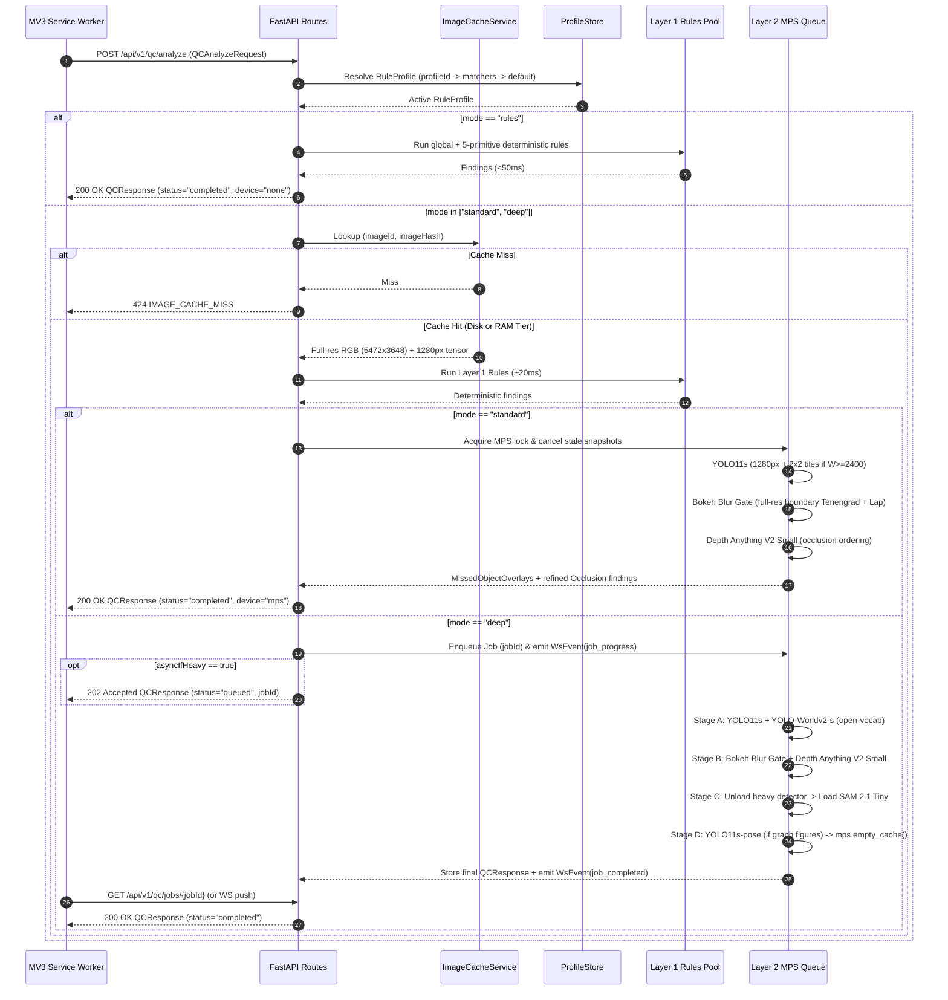

# 02 — QC Engine, Deterministic Rules & AI Vision Pipeline

**Document Role:** Backend QC Engine, Geometric Rule Engine & Computer Vision Design  
**Aligned Contract:** [`01-architecture.md`](./01-architecture.md) (`QCAnalyzeRequest`, `QCResponse`, `RuleProfile`, `HealthResponse`, `ImageCacheAck`)  
**Target Hardware Baseline:** macOS Apple Silicon (`arm64`, 8 GB+ Unified Memory, `torch.device("mps")` with automatic `cpu` fallback)  
**Supported Primitives:** Bounding Box (`rectangle`), Polygon (`polygon` + `interior` holes), Brush (`bitmap`), Line (`polyline`), Keypoint (`point` and `graph` skeleton)

---

## 1. FastAPI Backend Service Design & Contract Alignment

The backend runs as a local loopback service at `http://127.0.0.1:8765` inside `/Users/mrongsubho/Documents/Termninal/SuerpvicelyQC/backend/`. Every request and response model inherits from `CamelModel` (`alias_generator=to_camel`, `populate_by_name=True`, `extra="forbid"`), guaranteeing strict `camelCase` JSON parity with `shared/types/qc-contract.ts`.

### 1.1 Backend Module Architecture

```text
backend/
├── main.py                              # Uvicorn runner (127.0.0.1:8765, lifespan startup/shutdown)
├── profiles/                            # Built-in YAML RuleProfiles (loaded on startup)
│   ├── default.yaml
│   ├── quantigo-street-bbox-v1.yaml
│   ├── quantigo-polygon-seg-v1.yaml
│   ├── quantigo-brush-mask-v1.yaml
│   ├── quantigo-polyline-v1.yaml
│   └── quantigo-keypoint-pose-v1.yaml
└── app/
    ├── config.py                        # EngineSettings (ports, cache caps, RAM ceilings, EngineTunables)
    ├── security.py                      # Constant-time X-QC-Bridge-Token verification, CORS, PNA headers
    ├── schemas/
    │   └── qc.py                        # Canonical Pydantic v2 models (defined in 01-architecture.md §3.4)
    ├── api/
    │   ├── routes_health.py             # GET /api/v1/health (unauthenticated probe)
    │   ├── routes_images.py             # HEAD / PUT /api/v1/qc/images/{imageId}
    │   ├── routes_qc.py                 # POST /api/v1/qc/analyze, GET /jobs/{jobId}, WS /ws/{clientId}
    │   └── routes_profiles.py           # GET / PUT / DELETE /api/v1/profiles[/{profileId}]
    ├── services/
    │   ├── image_cache.py               # 2-tier cache: Disk LRU (1 GB / 24h) + Decoded RAM LRU (<=128 MB)
    │   ├── profile_store.py             # YAML/JSON profile loader, regex matcher, CRUD validator
    │   ├── qc_orchestrator.py           # Pipeline coordinator, scoring, readiness, stable fingerprints
    │   └── job_manager.py               # Async job registry, revision coalescing, WS event broadcaster
    ├── rules/                           # Layer 1 — Deterministic Rule Engine (<50ms typical, <300ms ceiling)
    │   ├── context.py                   # Normalized geometries, scale-invariant metrics, pair precompute
    │   ├── global_rules.py              # Sync dirty, tag scope, duplicates, size outliers, OOB, classes
    │   ├── bbox_rules.py                # Pairwise IoU/IoS occlusion heuristics, border truncation, aspect
    │   ├── polygon_rules.py             # Shapely validity, vertex density, collinearity, spikes, holes
    │   ├── bitmap_rules.py              # Safe zlib+b64 PNG decode, islands, pinholes, jaggedness, spill
    │   ├── polyline_rules.py            # Min vertices, zero-length, acute backtrack spikes, endpoint gaps
    │   └── keypoint_rules.py            # Point & graph template nodes, parent box containment, L/R flip
    └── vision/                          # Layer 2 — AI Vision Pipeline (Apple Silicon MPS / CPU)
        ├── model_manager.py             # Lazy loader, single-heavy-model slot, MPS->CPU fallback, TTL unload
        ├── tiling.py                    # 1280px full-frame + 20%-overlap 2x2 tiling + CPU NMS merger
        ├── detector.py                  # YOLO11s/m (Standard) & YOLO-Worldv2-s / Grounding DINO (Deep)
        ├── blur_bokeh.py                # Normalized Laplacian variance + Tenengrad edge ring bokeh gate
        ├── occlusion_depth.py           # Depth Anything V2 Small relative inverse-depth ordering
        ├── tightness_auditor.py         # SAM 2.1 Hiera-Tiny expanded-prompt box/mask IoU & clip audit
        └── pose_auditor.py              # YOLO11s-pose / RTMPose-s keypoint drift & L/R cross-check
```

### 1.2 Async Execution, Thread Pools & MPS Serialization

FastAPI's `asyncio` event loop must stay non-blocking so `GET /api/v1/health`, `HEAD /api/v1/qc/images/{imageId}`, and `WS /api/v1/qc/ws/{clientId}` heartbeats remain responsive during heavy CV runs.

| Workload | Executor Strategy | Concurrency Policy | Why |
|---|---|---|---|
| **Layer 1 Rules** (`rules` mode & Stage 1 of `standard`/`deep`) | `anyio.to_thread.run_sync` (`ThreadPoolExecutor(max_workers=4)`) | Concurrent across requests | Shapely (`libgeos`), NumPy, and OpenCV release the CPython GIL during vector/mask math; avoids `ProcessPool` pickling overhead for large bitmaps. |
| **Image Decode / Resize** | Bounded `ThreadPoolExecutor(max_workers=2)` | Max 2 concurrent decodes | Caps transient `5472x3648` RGB decoding memory spikes (`~60 MB` each) to `<= 120 MB`. |
| **Layer 2 MPS Inference** (`standard` / `deep`) | Dedicated **single-worker serial executor** (`ThreadPoolExecutor(max_workers=1)`) + `asyncio.Lock` | Strictly **1 active inference job** on MPS | Apple Silicon Metal/MPS command queues fail or swap-thrash under parallel PyTorch MPS execution on 8 GB Unified Memory. |

**Latest-Snapshot Coalescing & Cancellation (`snapshotSeq`):**
When an annotator drags multiple boxes or clicks `NEXT ->` rapidly while a `deep` job is queued:
1. `JobManager` tracks `latest_snapshot_seq[imageId]` and a per-job `threading.Event` (`cancel_event`).
2. If a newer `QCAnalyzeRequest` arrives for the same `imageId` with higher `snapshotSeq` (or a new `imageId` is requested by the same active session), queued-but-not-started jobs for the stale snapshot are immediately marked cancelled before consuming GPU cycles.
3. Between Layer 2 sub-stages (e.g., Detector -> Depth -> SAM 2.1), the worker polls `cancel_event.is_set()` and aborts cleanly.

### 1.3 Two-Tier Image Fetching & Caching (`ImageCacheService`)

High-resolution Quantigo images (e.g., `a1bc2acd...jpg` at `5472 x 3648`, 4–12 MB JPEG) must **never** be re-downloaded from Supervisely or re-transferred over loopback on every QC trigger.

1. **Endpoint Handshake (aligned with `01-architecture.md` §3.2):**
   - When `mode` is `"rules"`, the backend needs **zero** pixels and skips image lookup completely.
   - When `mode` is `"standard"` or `"deep"`, the extension calls `HEAD /api/v1/qc/images/{imageId}?hash={imageHash}&width={w}&height={h}`.
   - On `404`, the Service Worker fetches same-site `*.supervisely.com` image URLs directly with `{ credentials: "include", cache: "force-cache" }` (or fetches external presigned S3/CDN URLs strictly with `{ credentials: "omit", cache: "force-cache" }`, falling back to 1 MiB base64 chunks over `chrome.runtime.Port` from CS if needed) and uploads once via `PUT /api/v1/qc/images/{imageId}` with `X-Image-Hash`, `X-Image-Width`, `X-Image-Height`.
   - If `POST /api/v1/qc/analyze` runs in `"standard"` or `"deep"` mode and `(imageId, imageHash)` is absent from cache, the route returns **`424 Failed Dependency`** with `ApiErrorEnvelope(error={"code": "IMAGE_CACHE_MISS", ...})`.
2. **Backend Two-Tier Storage Layout:**
   - **Tier 1 — Disk Compressed Byte LRU (`~/.cache/supervisely-qc/images/`, permissions `0700`):**
     - Keyed by `{imageId}__{sha256(imageHash)[:16]}.bin` + JSON sidecar metadata (`width`, `height`, `contentType`, `storedAt`, `lastAccessAt`).
     - Hard limits matching `CacheStats` (`max_disk_bytes = 1_073_741_824` = **1 GB**, `ttl = 24 hours`).
     - On `PUT`, validates MIME/magic bytes, checks encoded size `<= 100 MB` (`413` if exceeded), validates decoded `(W, H)` matches `X-Image-Width`/`X-Image-Height` (`400` on mismatch or decode failure), writes atomically (`tmp` + `os.replace`), and evicts LRU entries if total size > 1 GB.
   - **Tier 2 — Hot Decoded RGB Array LRU (In-Memory, `max_items = 2`, `max_bytes = 150 MB`):**
     - A single uncompressed `5472 x 3648 x 3` `uint8` array occupies `5472 * 3648 * 3 = 59,888,640` bytes (**~57.1 MiB**). Keeping 10 images decoded in RAM would consume ~571 MiB needlessly.
     - Therefore, Tier 2 holds at most **2** decoded full-res `np.ndarray` images (`<= 120 MiB`), plus a cached `1280px` resized letterbox RGB copy (`~3.7 MiB`) and cached per-image vision intermediates (`depth_map_518` `~1 MiB`, optional SAM image embedding cleared when switching images).
     - Re-decoding a 6 MB JPEG from Tier 1 NVMe disk via OpenCV/TurboJPEG takes only ~45–65 ms on Apple Silicon.

---

## 2. Layer 1 — Deterministic Rule Engine (`<300 ms`)

Layer 1 executes purely on `QCAnalyzeRequest` (`image`, `ontology`, `imageTags`, `figures`, `viewport`, `uiState`) with **zero neural network inference**. Target p95 latency: **< 50 ms** (hard SLA `< 300 ms` even with 150+ dense figures or multiple bitmap masks).

### 2.1 Preprocessing, Scale Normalization & `partialGeometry` Guard

Before evaluating rules, `RuleContext.build(request, profile, tunables)` constructs normalized representations:

1. **`partialGeometry` & `dom_fallback` Guard (`uiState.stateSource == "dom_fallback"` or `uiState.partialGeometry == True`):**
   - Per `01-architecture.md` §3.4, under `"dom_fallback"`, `request.figures` is strictly `[]` (`AnnotationFigure` rejects coordinate-less stubs), and class/figure counts come from `request.domFigureSummaries` (`DomFigureSummary[]`).
   - `RuleContext` still runs **Workflow Rules** (`WORKFLOW_*`, evaluating empty-image check against `sum(s.figureCount for s in domFigureSummaries)` when `stateSource == "dom_fallback"`), **Image Tag Scope Rules** (`TAG_SCOPE_*`), **Class Allowlist Checks** (`CLASS_DISABLED_OR_OFF_JOB` over `domFigureSummaries`), and Layer 2 **Missed Object Checks**, while cleanly skipping coordinate-dependent geometry checks (`GEOM_*`, `BBOX_*`, `POLY_*`, `BITMAP_*`, `LINE_*`, `KP_*`).
2. **Coordinate Normalization (handling inverted coordinates):**
   - For `"rectangle"`, `points.exterior = [[x1, y1], [x2, y2]]` is normalized via `x_min = min(x1, x2)`, `y_min = min(y1, y2)`, `x_max = max(x1, x2)`, `y_max = max(y1, y2)`. If `x1 > x2` or `y1 > y2`, a `info` note flags non-canonical corner order while geometry checks proceed accurately.
   - Every figure computes an axis-aligned `bbox: [xMin, yMin, xMax, yMax]` (`float` pixels) for unified O(N²) spatial filtering, `focusRect` assignment, and viewport visibility checks.
3. **Scale-Invariant Thresholding (540x360 vs 5472x3648):**
   - Live Quantigo jobs mix `540x360` web thumbnails with `5472x3648` DSLR photos (a 10.1x linear / 102.7x pixel-area ratio!).
   - Effective area threshold for figure $f$:
     $$A_{\min}(f) = \max\big(\text{profile.minBoxAreaPx},\; \text{override}(f).\text{minAreaPx},\; \text{tunables.minRelativeArea} \cdot W \cdot H\big)$$
     where `tunables.minRelativeArea = 1e-5` (on `5472x3648`, `1e-5 * W * H ≈ 200 px²`; on `540x360`, clamped to `profile.minBoxAreaPx = 64 px²`).
   - Effective micro-click side floor: $s_{\min} = \min(\text{tunables.microClickMinSidePx},\; \max(8.0,\; 0.025 \cdot \min(W, H)))$ where `tunables.microClickMinSidePx = 15.0 px` (so standard/HD/4K/5K images use `15.0 px`, while tiny `<= 600px` web thumbnails scale down proportionally to `~9–15 px` so valid distant objects aren't over-flagged).
4. **Viewport Visibility Mapping (`outsideViewport` & `viewportEdgeDirection`):**
   - Given `visiblePixelRect = [vx1, vy1, vx2, vy2]` and figure `bbox = [bx1, by1, bx2, by2]`:
     - Compute overlap fraction `vis_ratio = Area(bbox ∩ visiblePixelRect) / max(Area(bbox), 1e-6)`.
     - `outsideViewport = True` when `viewport.zoomPercent < 98` (or `visibleNormRect != [0, 0, 1, 1]`) **and** `vis_ratio < 0.15`.
     - `viewportEdgeDirection` combines `(cx < vx1 -> "left", cx > vx2 -> "right")` and `(cy < vy1 -> "top", cy > vy2 -> "bottom")` into the 8 canonical compass directions (`"top-left"`, `"right"`, etc.).

---

### 2.2 Global & Workflow Rules (`global_rules.py`)

| Rule ID | Severity | Category | Trigger Condition & Exact Logic | Suggested Fix ActionType(s) |
|---|---|---|---|---|
| `WORKFLOW_UNSAVED_SYNC` | `blocker` | `workflow` | `profile.workflowRules.blockOnUnsavedSync` is `True` **and** `uiState.synchronizeDirty` is `True`. Prevents losing unsaved labels when navigating or clicking `CONFIRM ->`. | `highlight_synchronize` |
| `WORKFLOW_EMPTY_UNCONFIRMED` | `warning` | `workflow` | `profile.workflowRules.warnOnEmptyImageWithoutConfirm` is `True`, `not uiState.isConfirmed`, and effective object count is `0` (`len(figures) == 0` normally, or `sum(s.figureCount) == 0` under `dom_fallback` so DOM-visible objects aren't falsely flagged). | *(none — prompt annotator to label or confirm empty)* |
| `TAG_SCOPE_IMAGE_MISPLACED` | `blocker` | `tags` | Image-level tag `t` in `imageTags` matches `profile.tagRules.objectOnlyTags` (e.g., `"Occlusion"`) **or** `ontology.tags[t].applicableType == "objectsOnly"`. Catches `"Occlusion"` wrongly attached to `CURRENT IMAGE TAGS`. | `move_tag_image_to_object` (if occluded candidate exists), `remove_image_tag` |
| `TAG_SCOPE_OBJECT_MISPLACED` | `blocker` | `tags` | Object figure `f` carries tag `t` in `profile.tagRules.imageOnlyTags` **or** `ontology.tags[t].applicableType == "imagesOnly"`. | `remove_object_tag`, `inspect_figure` |
| `TAG_CLASS_INCOMPATIBLE` | `blocker` | `tags` | Figure `f` of class `C` carries tag `t` where `ontology.tags[t].classes` is non-empty and `C not in ontology.tags[t].classes`, or `t in classOverride[C].forbiddenTags`. | `remove_object_tag`, `inspect_figure` |
| `TAG_VALUE_INVALID` | `blocker` | `tags` | `ontology.tags[t].valueType == "oneof_string"` and `tag.value not in ontology.tags[t].values`; or `valueType == "any_number"` and `tag.value` is non-numeric. | `inspect_figure` |
| `TAG_REQUIRED_MISSING` | `warning` | `tags` | Class `C` defines `classOverrides[C].requiredTags` and figure `f` is missing any required tag name. | `add_object_tag`, `inspect_figure` |
| `CLASS_DISABLED_OR_OFF_JOB` | `warning` | `classification` | `classOverrides[C].enabled == False` **or** (`ontology.jobClassesToLabel` is non-empty and `C not in ontology.jobClassesToLabel`) across `figures` (or `domFigureSummaries` with `figureCount > 0` under `dom_fallback`). Catches accidental labeling of disabled ontology classes (e.g. `Car1` or `Bus` in a `Human`-only task). | `inspect_figure`, `confirm_delete_figure` |
| `GEOM_DUPLICATE_FIGURE` | `blocker` (same class) / `warning` (diff class) | `geometry` | Pairwise duplicate check across compatible geometries:<br>• Rect/Poly: `IoU >= 0.90` (`shapely` intersection / union).<br>• Bitmap: pixel-grid mask `IoU >= 0.90`.<br>• Polyline: bidirectional Chamfer mean distance `<= 4.0 px` & length ratio `>= 0.90`.<br>• Graph/Point: mean matched-node distance `<= 6.0 px`. | `inspect_figure`, `confirm_delete_figure` |
| `GEOM_EXTREME_MICRO_CLICK` | `blocker` | `geometry` | Non-point figure has `bbox_w < s_min` or `bbox_h < s_min` (`15px` on HD/5K images), or geometry area `< A_min(f)` (for `rectangle`/`polygon`/`bitmap`). Catches stray accidental single-clicks. | `focus_viewport`, `confirm_delete_figure` |
| `GEOM_CANVAS_WIDE_OUTLIER` | `warning` | `geometry` | Figure bbox/mask area covers `> 0.90 * W * H` (`90%` of full canvas) for classes not exempted as background/scene classes (e.g., `Building`, `Road`, `Sky` if configured). | `inspect_figure` |
| `GEOM_OUT_OF_BOUNDS` | `blocker` | `geometry` | Any vertex, bbox corner, polyline node, bitmap bound `[x0, y0, x0+w, y0+h]`, or non-disabled graph node lies outside `[-1.0, W + 1.0] x [-1.0, H + 1.0]`. | `focus_viewport`, `inspect_figure` |

---

### 2.3 Primitive 1: Bounding Box (`rectangle`) Rules (`bbox_rules.py`)

Bounding box quality in Quantigo street/indoor scenes hinges on **occlusion tagging accuracy** and **edge boundary hygiene**.

1. **`BBOX_OCCLUSION_MISSING_TAG` & `BBOX_FOREGROUND_OCCLUSION_FP`:**
   - **Why both IoU and Asymmetric IoS?** Consider screenshot `a1bc2acd...` (`5472x3648`): occluded pedestrian `#5` behind large foreground man `#6` has a small `IoU ≈ 0.18` (because `#6` is wide), yet **>42%** of `#5`'s area is covered by `#6`! Computing both metrics catches asymmetric occlusion:
     $$\text{IoU}(A, B) = \frac{\text{Area}(A \cap B)}{\text{Area}(A \cup B)}, \qquad \text{IoS}(A \mid B) = \frac{\text{Area}(A \cap B)}{\text{Area}(A)}$$
   - **Pairwise Overlap Criterion:** Candidate pair $(A, B)$ triggers overlap evaluation if:
     $$\text{IoU}(A, B) \ge \text{tagRules.occlusionOverlapIouThreshold}\;(0.10) \quad \text{OR} \quad \max\big(\text{IoS}(A \mid B),\; \text{IoS}(B \mid A)\big) \ge \text{tagRules.occlusionCoverRatioThreshold}\;(0.15)$$
   - **Layer 1 Perspective / Depth Heuristic (`_estimate_foreground_score`):**
     When Layer 2 `Depth Anything V2` is unavailable (`rules` mode, or before Vision runs), Layer 1 scores which box is closer to the camera using three weighted geometric cues (validated when objects sit on a perspective ground plane or share class):
     1. **Lower Bottom Edge (`y_max`):** Closer ground-plane objects extend lower down the image: $\Delta y = (y_{\max, B} - y_{\max, A}) / H$ (weight `0.55`).
     2. **Larger Projected Scale (same-class pairs):** Larger height/area indicates closer proximity: $\Delta s = \log(\text{Area}_B / \text{Area}_A)$ clipped to `[-1, 1]` (weight `0.35`).
     3. **Higher IoS Asymmetry:** If $\text{IoS}(A \mid B) \gg \text{IoS}(B \mid A)$, the smaller covered box $A$ is far more likely tucked behind $B$ (weight `0.10`).
     - If combined foreground score difference $|\Delta F| \ge 0.12$, the higher-scoring box is labeled `presumed_foreground` and the lower-scoring box `presumed_occluded`. (When `mode` is `"standard"` or `"deep"` and `enableDepthOcclusionOrdering=True`, **Layer 2 Depth Anything V2 overrides this heuristic** with true pixel-level relative depth!).
   - **Findings Emitted:**
     - `BBOX_OCCLUSION_MISSING_TAG` (`warning`, category `"tags"`): `presumed_occluded` box $A$ has overlap above threshold with $B$ and lacks `Occlusion` tag -> message cites `#A`, `#B`, exact `IoU%`/`cover%`, and offers `add_object_tag("Occlusion")` + `inspect_figure`.
     - `BBOX_FOREGROUND_OCCLUSION_FP` (`warning`, category `"tags"`): Enabled by `tagRules.flagForegroundOcclusionFalsePositive`. Box $B$ carries `"Occlusion"` tag, yet either: (a) $B$ has **zero** overlapping boxes and does not touch image border, OR (b) every box overlapping $B$ has strictly lower foreground depth/score (`presumed_occluded` behind $B$). Catches the exact error where foreground `#6` is mistakenly tagged `Occlusion` while occluded `#5` behind it has none!
2. **`BBOX_BORDER_TRUNCATION` (`info` / `warning`, category `"geometry"`):**
   - Detects boxes within `edge = profile.geometryRules.edgeSnapMarginPx` (`3px`) of image borders (`xMin <= edge`, `yMin <= edge`, `xMax >= W - edge`, `yMax >= H - edge`).
   - Also detects **"near-miss border gaps"**: boxes whose edge stops between `edge + 1` and `max(12px, 0.005 * min(W, H))` from the image boundary without touching `0` or `W/H` (common sloppy zoom-cropped box bug where an annotator meant to snap to the image border!). Emits `warning` `"Box stops 7px short of right image boundary — snap to edge if object is truncated"`.
3. **`BBOX_ASPECT_RATIO_OUTLIER` (`warning`, category `"geometry"`):**
   - Flags extreme slivers `max(w/h, h/w) > 16.0` (configurable per class in `EngineTunables`; exempts classes like `Pole`, `TrafficLight`, `LaneLine`), catching mis-dragged boxes.

---

### 2.4 Primitive 2: Polygon (`polygon`) Rules (`polygon_rules.py`)

Supervisely represents polygons with `points.exterior: Point2D[]` (unclosed vertex list, auto-closed from `p[-1]` to `p[0]`) and `points.interior: Point2D[][]` (0 or more hole rings).

1. **Preprocessing:** Strip consecutive duplicate vertices (`||p_i - p_{i-1}|| < 0.5 px`) and remove explicit duplicate closing vertex (`p[-1] == p[0]`) before counting vertices; build `shapely.geometry.Polygon(exterior, holes)`.
2. **Rules Implemented:**
   - **`POLY_INSUFFICIENT_VERTICES` (`blocker`, `"geometry"`):** `len(dedup_exterior) < max(3, profile.geometryRules.minPolygonVertices)`.
   - **`POLY_SELF_INTERSECTION` (`blocker`, `"geometry"`):** `not poly.is_valid` (checked via `shapely.is_valid_reason(poly)`). Parses GEOS witness coordinate `(wx, wy)` from `explain_validity` (or `shapely.ops.unary_union` ring intersection points) to set `focusRect` tightly around the bowtie/crossing segment (`[wx-40, wy-40, wx+40, wy+40]`).
   - **`POLY_DEGENERATE_AREA` (`blocker`, `"geometry"`):** `poly.area < A_min(f)`.
   - **`POLY_LOW_VERTEX_DENSITY` (`warning`, `"geometry"`):** Catches lazy triangular/quadrilateral approximations on large organic objects (e.g., 4-vertex diamond around a `Car` or `Human`). If `perimeter > 250 px` and `len(exterior) < 6` (for non-quadrilateral classes), or vertex density `len(exterior) / (perimeter / 100.0) < 0.8` with convexity gap `(convex_hull.area - poly.area) == 0` when perimeter > 400px, emit `warning`.
   - **`POLY_COLLINEAR_REDUNDANT_VERTICES` (`info`, `"geometry"`):** For each cyclic vertex triple `(p_{i-1}, p_i, p_{i+1})`, compute perpendicular point-to-segment distance $d_\perp(p_i; \overline{p_{i-1}p_{i+1}})$. If `>= 3` vertices (or `> 30%` of vertices) have $d_\perp < 0.75\;\text{px}$, emit `info` recommending simplification.
   - **`POLY_ACUTE_NEEDLE_SPIKE` (`warning`, `"geometry"`):** Interior angle $\theta_i < 10^\circ$ where adjacent edge lengths `> 6 px` creates a razor spike artifact (common when converting brush masks or mis-clicking). Sets `focusRect` around `p_i`.
   - **`POLY_HOLE_INVALID` (`blocker`, `"geometry"`):** Validates every hole ring $h_k \in \text{points.interior}$:
     - `< 3` distinct vertices or self-intersecting (`not LinearRing(h_k).is_valid`).
     - Hole lies partially or wholly outside exterior (`not exterior_poly.covers(hole_poly)` or `exterior_ring.crosses(hole_ring)`).
     - Overlapping or nested holes (`hole_j.intersects(hole_k)`).
   - **`POLY_MICRO_HOLE` (`warning`, `"geometry"`):** Hole area `< 16 px²` (accidental interior click while subtracting mask/hole).

---

### 2.5 Primitive 3: Brush / Bitmap (`bitmap`) Rules (`bitmap_rules.py`)

Supervisely represents brush annotations as `{ origin: [x0, y0], data: "<base64_string>" }` where `data` is **base64 -> zlib-compressed -> PNG bytes**.

1. **Safe Supervisely Bitmap Decoding & Pre-Decode Bomb Protection (`decode_supervisely_bitmap`):**
   - Reject encoded strings `> 16 MB` (`BITMAP_PAYLOAD_TOO_LARGE`, `blocker`).
   - `raw_zlib = base64.b64decode(bitmap.data, validate=True)`
   - **Streaming zlib decompression with hard cap (`MAX_PNG_BYTES = 32 MB`)** using `decompressor = zlib.decompressobj(); png_bytes = decompressor.decompress(raw_zlib, max_length=32_000_000)` (rejecting if `not decompressor.eof` to block decompression bombs).
   - **Pre-Decode PNG `IHDR` Dimension Validation (BEFORE `cv2.imdecode`):**
     - Verify 8-byte PNG signature (`png_bytes[:8] == b"\x89PNG\r\n\x1a\n"`) and `IHDR` chunk header (`png_bytes[12:16] == b"IHDR"`).
     - Unpack big-endian dimensions `w, h = struct.unpack(">II", png_bytes[16:24])` **before allocating decode buffers**.
     - Reject `w <= 0` or `h <= 0` or `w > W + 2` or `h > H + 2` (`BITMAP_DECODE_ERROR` / `GEOM_OUT_OF_BOUNDS` `blocker`, matching `[-1, W+1] x [-1, H+1]` canvas tolerance and preventing an adversarial compressed IHDR from OOM-allocating gigabytes inside `imdecode`).
   - Decode PNG via `cv2.imdecode(np.frombuffer(png_bytes, np.uint8), cv2.IMREAD_UNCHANGED)`:
     - Verify `img is not None` and decoded `img.shape[:2] == (h, w)` (`BITMAP_DECODE_ERROR` `blocker` on mismatch/failure).
     - Extract boolean foreground mask uniformly across Supervisely export variants:
       * **4-channel RGBA `(h, w, 4)`**: If `img[:, :, 3].min() < 255`, `mask = img[:, :, 3] > 0`; else `mask = np.any(img[:, :, :3] > 0, axis=2)`.
       * **3-channel RGB `(h, w, 3)`**: `mask = np.any(img > 0, axis=2)`.
       * **1-channel Gray `(h, w)`**: `mask = img > 0`.
   - Cast origin `x0, y0 = int(round(origin[0])), int(round(origin[1]))`, verify `[x0, y0, x0 + w, y0 + h]` lies within `[-1.0, W + 1.0] x [-1.0, H + 1.0]` (`GEOM_OUT_OF_BOUNDS`).
   - Verify `fg_pixels = int(np.count_nonzero(mask))` is non-zero and `>= max(profile.geometryRules.minMaskAreaPx, A_min(f))`.

2. **Bitmap Geometric & Morphological Rules:**
   - **`BITMAP_DISCONNECTED_ISLANDS` (`warning` / `blocker`, `"geometry"`):**
     - Run `num_labels, labels, stats, centroids = cv2.connectedComponentsWithStats(mask.astype(np.uint8), connectivity=8)` (excluding background label `0`, leaving `N = num_labels - 1` components).
     - **Stray Brush Dots:** Any component $k$ with `area_k < max(25, 0.005 * total_fg_pixels)` is classified as a **stray pixel island** (eraser miss or accidental brush tap). Lists up to 5 `(x0 + cx, y0 + cy)` locations and places `focusRect` on the largest stray dot cluster (`warning`).
     - **Excessive Fragmentation:** If total components `N > profile.geometryRules.maxDisconnectedMaskComponents` (`8`) or `>= 2` large unlinked components (`area_k >= 100 px²`) exist without an occluding figure splitting the mask between them, emit `warning`.
   - **`BITMAP_UNEXPECTED_INTERNAL_HOLES` (`warning`, `"geometry"`):**
     - Pad `mask` by `1 px` of `False` on all 4 sides (so border-touching objects don't trap flood-fill!), run `filled = scipy.ndimage.binary_fill_holes(padded)[1:-1, 1:-1]`, and extract `holes_mask = filled & (~mask)`.
     - Run connected components on `holes_mask`:
       * **Pinholes (`4 px² <= hole_area <= 500 px²` or `<= 2%` of object area):** Missed interior brush dabs (`warning` `"3 unfilled pinholes (18–94 px²) detected inside Car1 mask"`).
       * **Large Unexpected Holes (`hole_area > 500 px²`):** Emit `info` (or `warning` if class is solid non-ring class) noting unclosed/hollow interior region.
   - **`BITMAP_JAGGED_BOUNDARY` (`info` / `warning`, `"geometry"`):**
     - Extract external contours `cv2.findContours(mask, cv2.RETR_EXTERNAL, cv2.CHAIN_APPROX_NONE)`.
     - Compare raw arc length `P_raw = cv2.arcLength(cnt, True)` against Douglas-Peucker smoothed contour (`epsilon = 2.0 px`) `P_smooth = cv2.arcLength(cv2.approxPolyDP(cnt, 2.0, True), True)`.
     - Roughness ratio `R = P_raw / max(P_smooth, 1.0)`. If `R > 1.38` on contours with `P_raw > 120 px`, emit `warning` `"Sawtooth/jittered brush edge detected (roughness 1.46x)"`.
   - **`BITMAP_SPILLED_MASK` (`warning`, `"geometry"`):**
     - Compute tight bounding-box fill ratio `fill = fg_pixels / max(w * h, 1)` and centroid distance from the largest component. If `fill < 0.04` with `max(w, h) > 150 px`, or stray mask islands sit `> 1.5 * primary_radius` away from the primary body, stray paint is scattered far across the canvas!
     - Also checks **cross-figure spill**: if a bitmap figure overlaps a containing parent or adjacent non-occluding sibling class by `< 15%` bleed margin (`> 50 px²` shallow spill along shared boundary without overlapping class), emits `warning`/`info` spill hint (refined in Deep mode by `SAM 2.1`).

---

### 2.6 Primitive 4: Line / Polyline (`polyline`) Rules (`polyline_rules.py`)

Supervisely polylines use `points.exterior: Point2D[]` (`>= 2` ordered vertices, open path).

1. **`LINE_INSUFFICIENT_POINTS` (`blocker`, `"geometry"`):** `len(pts) < max(2, profile.geometryRules.minPolylineVertices)`.
2. **`LINE_ZERO_LENGTH_SEGMENT` (`blocker` / `warning`, `"geometry"`):**
   - Any consecutive segment length `||p_{i+1} - p_i|| < 1.0 px` (`warning` duplicate consecutive point).
   - Total arc length $\sum ||p_{i+1} - p_i|| < \max(15.0, 0.004 \cdot \min(W, H))$ (`blocker` micro-line).
3. **`LINE_ACUTE_BACKTRACK_SPIKE` (`warning`, `"geometry"`):**
   - At interior vertex $p_i$ ($1 \le i \le n-2$), define incoming vector $\vec{u} = p_i - p_{i-1}$ and outgoing vector $\vec{v} = p_{i+1} - p_i$.
   - The **folding angle** between $-\vec{u}$ and $\vec{v}$ is:
     $$\alpha_i = \arccos\left(\text{clip}\left(\frac{(-\vec{u}) \cdot \vec{v}}{\|\vec{u}\|\,\|\vec{v}\|},\; -1.0,\; 1.0\right)\right)$$
   - If $\alpha_i < 25^\circ$ (i.e., the path makes a $>155^\circ$ hairline U-turn backtrack spike) and both segments exceed `4 px`, emit `warning` with `focusRect` centered on $p_i$.
4. **`LINE_SELF_INTERSECTION` (`warning`, `"geometry"`):** `not shapely.LineString(pts).is_simple` (detects accidental loop/crossover on a single polyline).
5. **`LINE_DISCONNECTED_ENDPOINT_GAP` (`warning`, `"geometry"`):**
   - Across all same-class polylines $(L_a, L_b)$, compare both endpoint-to-endpoint pairs $(e_a, e_b)$ and endpoint-to-interior segment projection `shapely.Point(e_a).distance(LineString(L_b))` (T-junction gap).
   - If Euclidean gap $3.0\;\text{px} \le d \le 35.0\;\text{px}$ (scaled slightly by `min(W,H)/1000`, capped at `50 px`) **and** (for endpoint-to-endpoint) the outward tangent vectors align (`angle(t_a, -t_b) <= 30°`, showing collinear continuation), emit `warning` `"Disconnected gap (14px) between Line #A and Line #B — join or snap endpoints"` with `focusRect` framing the gap.
   - Also flags near-closed single polyline (`||p_0 - p_{-1}|| < 12 px` when `arc_length > 80 px`) as `info` `"Polyline endpoints are 8px apart — verify whether a Polygon or closed loop was intended"`.

---

### 2.7 Primitive 5: Keypoint (`point` and `graph`) Rules (`keypoint_rules.py`)

Supervisely represents keypoints either as standalone **`point`** figures (`points.exterior: [[x, y]]`) or structured **`graph`** skeletons (`nodes: Dict[nodeUuid, { loc: [x, y], disabled }]`, paired with `ClassDefinition.geometryConfig.nodes` and `.edges`).

1. **Standalone `point` Rules:**
   - Out-of-bounds (`GEOM_OUT_OF_BOUNDS`), duplicate same-class point within `8 px` (`GEOM_DUPLICATE_FIGURE`), and optional parent-container bounding check if paired rectangle classes exist.
2. **Skeleton `graph` Rules (`ClassDefinition.geometryConfig` Driven):**
   - **Template Resolution:** Looks up `ClassDefinition` matching `figure.classId` (or `classTitle`). Builds `node_meta[node_id] -> template.label.lower().strip()` and `edges = [(src, dst)]`.
   - **`KP_MISSING_REQUIRED_NODES` (`blocker` / `warning`, category `"keypoints"`):**
     - Checks `profile.geometryRules.requireRequiredGraphNodes`.
     - Any node UUID in `geometryConfig.nodes` where `template.disabled == False` that is **absent** from `figure.nodes` (or sits at uninitialized sentinel `[0, 0]` when other nodes are far away `> 50px`!) triggers `blocker` (if all nodes missing / >50% missing) or `warning` listing missing human-readable labels (e.g. `["left_ankle", "right_ankle"]`).
     - Also emits `blocker` (`KP_UNKNOWN_TEMPLATE_NODE`) if `figure.nodes` contains node keys absent from `geometryConfig.nodes`.
   - **`KP_OUTSIDE_PARENT_BOX` (`warning`, `"keypoints"`):**
     - Associates each `graph` figure with its best-matching enclosing container figure (`rectangle`, `polygon`, or `bitmap` of compatible/parent class such as `Human` box for `Human_Skeleton`, matched by highest fraction of active keypoints contained within bbox + `8 px` tolerance, requiring `>= 50%` containment).
     - Any active (`disabled == False`) keypoint outside `[px1 - 5, py1 - 5, px2 + 5, py2 + 5]` triggers `warning` `"Keypoint 'left_wrist' lies 28px outside parent Human #3 box"`.
   - **`KP_ANATOMICAL_LR_INVERSION` (`warning`, `"keypoints"`):**
     - **Label-Alias Normalization:** Resolves node `.label` via regex aliases (e.g., `(^|[_-])(l|left)[_-]?(eye|ear|shoulder|elbow|wrist|hip|knee|ankle)` -> canonical `(side="L", part="shoulder")`). Non-bilateral templates (like `Fruit: {stem, center}`) automatically skip this rule with zero false positives!
     - **Facing-Direction-Aware Bilateral Check (avoids naive `x_L > x_R` bugs):**
       1. Determine subject facing sign $s_{\text{face}} \in \{+1\;\text{(facing camera)}, -1\;\text{(facing away)}, 0\;\text{(side/ambiguous)}\}$ from:
          - Eyes/nose when visible: if `x(L_eye) > x(R_eye)` by `> 6 px`, $s_{\text{face}} = +1$ (subject's left is viewer's right); if inverted, $s_{\text{face}} = -1$.
          - Otherwise torso majority vote across `(shoulder, hip, knee, ankle)` L/R pairs where `|x_L - x_R| > 0.08 * torso_scale`.
       2. Check **cross-body consistency**: if majority (e.g., eyes + shoulders + hips) indicates $s_{\text{face}} = +1$, yet a pair like `(L_ankle, R_ankle)` or `(L_wrist, R_wrist)` is flipped by `> 0.12 * bbox_width` (with knee-to-ankle ordering also inverted to avoid flagging crossed ankles during walking!), emit `warning` `"Possible Left/Right inversion on (left_ankle, right_ankle)"`.
   - **`KP_BONE_PROPORTION_OUTLIER` (`warning`, `"keypoints"`):**
     - Uses `geometryConfig.edges` where both `src` and `dst` are active (`disabled == False`):
       - **Collapsed zero-length bone:** `||src - dst|| < 3.0 px` when total skeleton span `> 60 px`.
       - **Extreme bone ratio:** Bone length `> 2.8 * median_skeleton_span` or forearm/shin `> 2.4 * upper_arm/thigh`.
   - **`KP_OCCLUSION_VISIBILITY_MISMATCH` (`warning`, `"keypoints"`):**
     - Checks whether a non-disabled visible keypoint `[kx, ky]` falls inside a **foreground occluder** figure's bbox/mask (from `BBOX_OCCLUSION` / Layer 2 `Depth Anything V2`), or conversely whether a node marked `disabled: true` sits inside an unobstructed foreground region well inside the image boundaries (`> 20 px` from borders).

---

## 3. Layer 2 — AI-Assisted Vision Cross-Check Pipeline (macOS Apple Silicon)

Layer 2 runs locally on Apple Silicon (`torch.device("mps")`) with automatic CPU fallback and is engineered specifically around **8 GB Unified Memory constraints** (where Chrome + Supervisely `5472x3648` canvas + macOS already consume ~5.0–5.5 GB).

### 3.1 Tiered Execution Modes (`QCMode` Alignment)

| `QCMode` | Target Latency (M1/M2/M3) | Peak Backend RSS | Models & Modules Executed | Primary Use Case |
|---|---|---|---|---|
| **`rules`** | `< 50 ms` (SLA `< 300 ms`) | `~65 MB` | Layer 1 Deterministic Rules only (`device: "none"`, `modelsUsed: []`). Zero image transfer. | Instant live editing checks, offline fallback parity, low-battery/RAM mode. |
| **`standard`** | `450 – 900 ms` | `~650 – 880 MB` | Layer 1 + **YOLO11s** (or `yolo11m` if free RAM > 2.5 GB) + **Multi-Cue Bokeh Blur Gate** + **Depth Anything V2 Small**. | Default day-to-day QC run (`200 OK` synchronous response): missed objects (incl. off-viewport), bokeh rejection, occlusion depth ordering. |
| **`deep`** | `1.8 – 3.2 s` (`202 Accepted` async job + WS/poll) | `< 1.45 GB` (via sequential model swap) | Everything in `standard` + **YOLO-Worldv2-s** (or **Grounding DINO-Tiny** for complex prompts) open-vocab audit + **SAM 2.1 Hiera-Tiny** box/mask tightness + **YOLO11s-pose** keypoint audit. | Pre-`CONFIRM ->` deep audit for open-vocab classes (`Fruit`, `Sofa`, custom classes), tight box/mask IoU verification, and skeleton pose audit. |

### 3.2 Model Lifecycle & 8 GB Unified Memory Management (`model_manager.py`)

Keeping multiple large vision models loaded simultaneously in 8 GB Unified Memory triggers macOS swap storms (`jetsam` / Chrome tab kills). `ModelManager` enforces four strict guardrails:

1. **Strict `float32` / `float16` MPS Casting & CPU NMS:**
   - PyTorch MPS raises `TypeError` on `float64` tensors (`np.float64` defaults from OpenCV/NumPy); all image arrays and coordinate tensors are explicitly cast to **`float32`** (CPU prep) and **`float16`** (MPS inference) before calling `.to("mps")`.
   - `torchvision.ops.nms` and final box post-processing execute on **CPU** (takes `< 0.1 ms` on `< 1,000` candidates) to avoid known MPS NMS kernel limitations.
   - Startup sets `os.environ.setdefault("PYTORCH_ENABLE_MPS_FALLBACK", "1")` so any unsupported sub-op falls back smoothly to CPU rather than crashing inference.
2. **Offline Model Weight Provisioning (`scripts/download_models.py`):**
   - Weights live locally under `~/.cache/supervisely-qc/models/` (zero runtime cloud downloads during annotation). A setup script (`python scripts/download_models.py --tier standard|deep`) fetches verified weights beforehand.
   - If requested model weights are absent locally or fail checksum verification, `ModelManager` skips Layer 2 without crashing and returns `QCResponse` with Layer 1 results plus `engineCapabilities: { device: "none", modelsUsed: [], degradedReason: "MODELS_NOT_DOWNLOADED" }`.
3. **Resident Fast Core vs Single-Heavy-Model Slot (`max_heavy_models = 1`):**
   - **Standard Core (~210 MB total model weights):** `yolo11s` (~19 MB FP16) + `depth-anything-v2-small` (~50 MB FP16) fit easily together and stay warm for `idle_ttl = 180s`.
   - **Deep Heavy Slot (`max_heavy_models = 1`):** `SAM 2.1 Hiera-Tiny` (~78 MB FP16 weights, ~450 MB activation peak) and `Grounding DINO-Tiny` / `YOLO-Worldv2-s` are **never resident simultaneously** when `psutil.virtual_memory().available < 2.2 GB`. `DeepPipeline` runs sequentially:
     1. Stage A: Detector (`YOLO11s` + `YOLO-Worldv2-s` if non-COCO ontology classes exist) -> compute proposals -> unload `YOLO-Worldv2-s` if RAM tight.
     2. Stage B: Blur/Bokeh Gate (CPU OpenCV, 0 GPU RAM) + Depth Anything V2 Small (`518x518` once) -> release depth tensor -> unload depth model if low RAM.
     3. Stage C: Load `SAM 2.1 Hiera-Tiny` -> encode image once (`1024x1024`) -> run lightweight mask decoder (`~12 ms/figure`) for all user boxes/polygons/masks -> `torch.mps.empty_cache()` + `gc.collect()`.
     4. Stage D (only if `graph` figures exist): Run `YOLO11s-pose` (`~20 MB` FP16) on person/target crops.
3. **Idle TTL Auto-Unload (`120s` / `180s`):** Background timer releases MPS weights when the annotator pauses or switches away, restoring RAM to Chrome.
4. **Preflight Memory Guard:** Before running `deep` mode, checks `psutil.virtual_memory().available`. If `< 900 MB` free, gracefully degrades `deep -> standard` (or `standard -> rules` if `< 450 MB`), setting `engineCapabilities.degradedReason = "LOW_SYSTEM_MEMORY_DOWNGRADE"`.

---

### 3.3 Addressing Every Real-World Quantigo Vision Pain Point

#### (a) Missed Objects — Especially Outside the Current Zoomed Viewport
On `5472 x 3648` images viewed at `16%` zoom, distant pedestrians or objects on the left/right margins sit outside the red minimap viewport box (`visiblePixelRect`), and naive `640px` full-image resizing shrinks a `160px`-tall pedestrian down to `18px`—invisible to detectors!

1. **Adaptive Multi-Scale Tiling (`tiling.py`):**
   - **Pass 1 (Full-Frame Context):** Resize full image letterboxed to `1280px` long edge -> detects large foreground subjects cleanly without slicing them.
   - **Pass 2 (High-Res `2x2` Overlapping Tiles):** Triggered automatically when `max(W, H) >= 2400` (`5472x3648`, `3840x2160`). Splits the image into 4 tiles with **20% overlap** (`overlap = 0.20`), resizing each `~3280 x 2190` tile to `1024px`. That yields **~2.5x higher pixel density** on distant/edge figures and ensures objects near tile seams appear intact in at least one tile!
   - **Cross-Pass Deduplication:** Merge Pass 1 + Pass 2 boxes via class-aware CPU NMS (`iou_thresh = 0.55`) plus **edge-clipped containment suppression** (if a tile-edge box is `>= 75%` contained inside a full-frame same-class box, keep the intact full-frame box).
2. **Matching Detections Against User Annotations:**
   - Map COCO/open-vocab detector label to active Supervisely `ontology.classes` (and skip any class disabled in `classOverrides[C].enabled == False` or excluded by `ontology.jobClassesToLabel`).
   - Suppress any detection matching an existing user figure (of compatible class) with `IoU >= 0.35` or `IoS(det | user) >= 0.50` (accounting for partially drawn or slightly loose boxes).
3. **Viewport Flagging (`MissedObjectOverlay` + `QCFinding`):**
   - Compute `outsideViewport` and `viewportEdgeDirection` (`left`, `right`, `top-left`, etc.) against `request.viewport.visiblePixelRect`.
   - Emit both a `MissedObjectOverlay` (for the dashed Ghost Box + off-screen directional edge badge) and a linked `QCFinding`:
     - `ruleId`: `"VISION_MISSED_OBJECT"`
     - `severity`: `"warning"`
     - `category`: `"missed_objects"`
     - `title`: `"Potential Missed {classTitle} Detected"` (e.g. `"Potential Missed Human (Outside Viewport: right)"`)
     - `missedObjectIds`: `[missedId]`
     - `outsideViewport`: `bool`
     - `focusRect`: `det.bbox`
     - `confidence`: `det.confidence`
     - `suggestedFixes`: `[QuickFixAction(actionType="focus_viewport", focusRect=det.bbox)]`

#### (b) Foreground vs. Out-of-Focus Bokeh Rejection & Absent Ontology Class Suppression
In Quantigo's shared ontology (`Animal`, `Boat`, `Building`, `Bus`, `Car`, `Car1`, `Fruit`, `Horse`, `Human`, `Sofa`), naive detectors scanning `a1bc2acd...` (`5472x3648` street scene) hallucinate **bokeh background `Building` facades** and a **heavily blurred distant `Bus`**, spamming false "missed object" alerts—or annotators mistakenly box blurred bokeh buildings.

1. **Multi-Cue Native-Pixel Bokeh & Sharpness Scorer (`blur_bokeh.py`, ~20 ms CPU):**
   - Why pure global Laplacian variance fails: A fixed threshold like `Var(Lap) < 35` breaks between a compressed `540x360` web image and a `5472x3648` DSLR photo, AND fails on solid dark coats (low interior texture, crisp outer silhouette!).
   - **3-Cue Native-Resolution Scoring (sampled directly from full-res `W x H` pixels without downsampling attenuation; for oversized boxes `> 1024 px` on a side, gradients are evaluated across `512x512` native `1:1` pixel tiles along the perimeter & interior to cap runtime `< 2 ms/ROI`):**
     1. **Boundary Silhouette Ring Tenengrad Energy ($E_{\text{edge}}$):** Compute Sobel magnitude $G = \sqrt{G_x^2 + G_y^2}$ (`float32`) in a **12-pixel perimeter band** straddling the detection boundary (`inner 6px + outer 6px`). Take the **90th percentile** $P_{90}(G_{\text{band}})$. Sharp foreground objects (even wearing solid black wool!) exhibit crisp boundary step edges; out-of-focus bokeh buildings exhibit smooth Gaussian ramps!
     2. **Interior High-Frequency Laplacian Variance ($L_{\text{var}}$):** Top-50% tile Laplacian variance inside the box (`cv2.Laplacian(gray, CV_32F).var()`), guarding against uniform surfaces skewing the mean.
     3. **Unit-Consistent Relative Sharpness ($S_{\text{rel}}$):** Compute the unified raw score $S_{\text{raw}}(\text{roi}) = 0.6 \cdot E_{\text{edge}}(\text{roi}) + 0.4 \cdot \sqrt{L_{\text{var}}(\text{roi})}$ identically across every candidate ROI **and** across a `4x4` grid of image patches $\{p_1, \dots, p_{16}\}$ to establish the image's sharp reference $E_{\text{ref}} = P_{95}(\{S_{\text{raw}}(p_i)\})$:
        $$\text{sharpnessScore} = S_{\text{raw}}(\text{roi}), \qquad S_{\text{rel}} = \frac{\text{sharpnessScore}}{\max(E_{\text{ref}}, 1.0)}$$
   - **Dual Action:**
     - **Filter AI Missed-Object Proposals (`visionRules.ignoreBackgroundBokeh == True`):** Reject any AI candidate whose `sharpnessScore < effective_min_sharpness` (`classOverride.minSharpness` or `visionRules.minLaplacianSharpness = 35.0`) **OR** whose relative sharpness $S_{\text{rel}} < 0.22$ in a shallow-DOF photo! (Note: `Building` override sets higher `minSharpness: 70.0` or `suppressMissedObjectPrompts: true`!).
     - **Audit User-Drawn Figures (`CLASS_BOKEH_BACKGROUND` `warning`, category `"classification"`):** If an annotator draws a `Building` (or any class configured with `minSharpness` in `classOverrides`) over an out-of-focus bokeh region (`sharpnessScore < threshold` and `S_rel < 0.20`), emit `warning` `"Annotated 'Building' #X appears heavily out-of-focus (bokeh background, sharpness=14.2) — verify job guidelines"`.
2. **Absent / False-Positive Ontology Class Guard (`Bus` problem):**
   - For rare/high-FP classes when few or zero user objects exist (`classOverrides[C].detectorConfidence`, e.g., `0.72` for `Bus` vs `0.42` for `Human`), require **both** higher detector confidence AND `sharpnessScore >= minSharpness` AND minimum area (`>= 0.002 * W * H`) before emitting a `MissedObjectOverlay`.
   - Annotators can also toggle `suppressMissedObjectPrompts: true` or `enabled: false` per class right in the Rule Profile!

#### (c) Box Tightness & Mask Boundary Audit (`tightness_auditor.py`, `deep` mode)
Annotators often leave 15–40 px of empty sidewalk/air inside bounding boxes or clip a pedestrian's extended arm/handbag.
1. **Image-Once Encoding:** `SAM 2.1 Hiera-Tiny` runs its image encoder **once** per image (`1024x1024`, ~260 ms on M1/M2 MPS).
2. **Expanded Box Prompting:** For each user figure (`rectangle`, `polygon`, or `bitmap`), expand its bbox by **`+8%` margin** (capped at `48 px`) so SAM can see any slightly clipped limbs/shoes/bags outside the user's box!
3. **Dual Tightness & Clipping Metrics:**
   - Extract highest-score SAM mask $M_{\text{sam}}$, remove tiny isolated specks (`< 1%` mask area), and take tight bounding box $B_{\text{sam}}$.
   - **Loose Box Check (`GEOM_BOX_LOOSE` `warning`):**
     $$\text{IoU}(B_{\text{user}}, B_{\text{sam}}) < \text{profile.geometryRules.minBoxIouTightness}\;(0.72)$$
     OR slack margin on any edge exceeds $\max(14\;\text{px},\; 0.07 \cdot \text{box\_dim})$ with zero foreground pixels in that outer slack strip -> reports exact slack sides (e.g., `"~24px slack at top/left of Human #1"`).
   - **Clipped Object Check (`GEOM_BOX_CLIPPED` `warning`):**
     $$\text{Recall} = \frac{\text{Area}(M_{\text{sam}} \cap B_{\text{user}})}{\text{Area}(M_{\text{sam}})} < 0.88$$
     and outside protrusion exceeds `10 px` (proving part of the object was cut off outside the user's box!).
   - **Polygon / Brush Mask Fidelity Check (`GEOM_MASK_BOUNDARY_DRIFT` `warning`):** Rasterize user polygon/bitmap inside ROI and compute $\text{IoU}(M_{\text{user}}, M_{\text{sam}})$. If `< 0.72` (and depth/sharpness confirms clear foreground silhouette), flag under-segmented or spilled boundary.

#### (d) Occlusion Depth Ordering (`occlusion_depth.py`, `standard` & `deep` modes)
Layer 1 perspective heuristics (`y_max` + area) can be fooled when a tall person walks past a seated person or across sloped terrain.
- **`Depth Anything V2 Small` (`~25M` params, ~50 MB FP16, ~90 ms at `518x518` on MPS):**
  - Produces a dense relative inverse-depth map $D(y, x)$ (higher values = closer to camera).
  - For each overlapping pair $(A, B)$ (`IoU >= 0.10` or `max(IoS) >= 0.15`):
    - Sample median inverse depth in **exclusive non-overlapping cores** $A \setminus B$ ($d_A$) and $B \setminus A$ ($d_B$), plus the **overlap zone** $A \cap B$ ($d_{\cap}$).
    - If $|d_A - d_B| > \delta_{\text{depth}}$ (`0.08 * global_depth_iqr`), the region with higher median inverse depth (matching $d_{\cap}$ closely) is definitively the **foreground occluder**, and the farther object is **occluded**!
  - Eliminates false `Occlusion` tag alerts on unobstructed foreground objects (like `#6` in `a1bc2acd...`) while accurately flagging occluded background objects (`#5` and `#2`).

#### (e) Keypoint Pose Cross-Check (`pose_auditor.py`, `deep` mode)
- When `figures` contains `graph` keypoint skeletons matching human/animal ontology classes, runs `YOLO11s-pose` (`~20 MB` FP16) on cropped parent regions (or full image):
  1. **Step 1 — Instance Association:** Match detected `YOLO11s-pose` person instances to user `graph` figures strictly at the **instance level** (Hungarian assignment over parent bounding box IoU / user-keypoint-hull overlap).
  2. **Step 2 — Semantic Joint Mapping (Never Spatial Hungarian Across Joints):** Within each matched instance pair, pair predicted COCO keypoints to user `graph.nodes` **strictly by canonical semantic label alias** (e.g., `left_ankle` <-> `L_ANKLE`). Spatial Hungarian across joints is forbidden so Left/Right swaps cannot be masked!
  3. **Findings:**
     - **`KP_AI_KEYPOINT_DRIFT` (`warning`, `"keypoints"`):** Euclidean error $\|p_{\text{pred}}(j) - p_{\text{user}}(j)\| > 0.10 \cdot \text{bbox\_diag}$ (when predicted joint confidence `>= 0.65`).
     - **`KP_AI_LR_SWAP_CONFIRMED` (`warning`, `"keypoints"`):** For a bilateral pair $(L, R)$, cross-paired distance $\|u_L - p_R\| + \|u_R - p_L\| < 0.6 \cdot (\|u_L - p_L\| + \|u_R - p_R\|)$ (when both joints have confidence `>= 0.65`), independently confirming a Left/Right inversion.

---

### 3.4 QC Scoring, Readiness & Stable Fingerprints (`qc_orchestrator.py`)

Aligned 1:1 with `QCResponse` (`01-architecture.md` §3.4):

1. **Score Calculation (`overallScore` in `0 .. 100`):**
   - Base score = `100`.
   - Deductions per finding (sorted deterministically):
     * `blocker`: `-25` pts each (uncapped until 0)
     * `warning`: `-8` pts each (capped at `-45` total warning penalty so multiple warnings still distinguish `0` blockers from critical blockers!)
     * `info`: `-2` pts each (capped at `-10` total info penalty)
   - `overallScore = max(0, min(100, round(score)))`
2. **Readiness State (`readiness`):**
   - `"blocked"` if `summaryCounts.blocker > 0`
   - `"needs_review"` if `summaryCounts.blocker == 0` and (`summaryCounts.warning > 0` or `len(missedObjects) > 0`)
   - `"ready"` if `summaryCounts.blocker == 0` and `summaryCounts.warning == 0` and `len(missedObjects) == 0`
3. **Deterministic Fingerprints (`finding.fingerprint`):**
   - Allows the Chrome Extension's `Dismiss / Ignore` list to remain stable even as the user adds/edits unrelated figures (`snapshotSeq` changes):
     * Workflow / Image Tag: `"{ruleId}:{imageId}"` or `"{ruleId}:{tagName}:{imageId}"`
     * Figure Finding: `"{ruleId}:{sorted_figure_ids_joined}"` (or `"{ruleId}:{figureId}:{extra_key}"`, e.g., node label)
     * Missed Object Finding: `"{ruleId}:{classTitle}:{qx}_{qy}_{qw}_{qh}"` where center & size are quantized to a `32px` grid (`int(round(val / 32))`) so slight jitter across consecutive runs keeps the dismissal intact!

---

## 4. Configurable Rule Profile System (`PUT/GET /api/v1/profiles`)

### 4.1 Schema Parity, Engine Tunables & Resolution Hierarchy

All profiles serialize strictly as `RuleProfile` (`01-architecture.md` §3.4, **`extra="forbid"`**). Secondary internal tolerances live in `backend/app/config.py` (`EngineTunables`, overridable via environment variables or `engine_defaults.yaml`) so every `RuleProfile` YAML/JSON payload validates cleanly against `RuleProfile.model_validate()` with zero extra keys:

```python
class EngineTunables(BaseSettings):
    duplicate_iou_threshold: float = 0.90
    canvas_wide_area_ratio: float = 0.90
    micro_click_min_side_px: float = 15.0
    min_relative_area: float = 1e-5
    bbox_max_aspect_ratio: float = 16.0
    poly_collinear_tol_px: float = 0.75
    poly_acute_spike_deg: float = 10.0
    poly_micro_hole_px: float = 16.0
    bitmap_min_island_px: int = 25
    bitmap_max_pinhole_px: int = 500
    bitmap_max_roughness_ratio: float = 1.38
    line_acute_backtrack_deg: float = 25.0
    line_endpoint_gap_px: float = 35.0
    sam_loose_slack_px: float = 14.0
    sam_clipped_recall_min: float = 0.88
```

**Automatic Profile Resolution Order (`profile_store.py` & `GET /api/v1/profiles?projectId=...&datasetId=...&jobTitle=...`):**
1. Explicit `request.profileId` (if provided and exists; `404 PROFILE_NOT_FOUND` if invalid).
2. Highest-specificity matched profile via `RuleProfile.matchers`:
   - `datasetIds` match (`image.datasetId in matchers.datasetIds`) — priority 1
   - `projectIds` match (`ontology.projectId in matchers.projectIds`) — priority 2
   - `jobTitleRegex` match (ECMA/Python-portable pattern without inline `(?i)` flags so both Python `re.search(..., re.IGNORECASE)` and browser JS `new RegExp(pattern, "i")` in `Options.tsx` compile cleanly) — priority 3
3. Fallback built-in `default` profile (`isBuiltin: true`, protected against `DELETE`).

### 4.2 Canonical YAML Rule Profiles (`backend/profiles/`)

Every YAML profile below uses `camelCase` (or snake_case, both accepted by `CamelModel(populate_by_name=True)`) and validates with zero extra keys against `RuleProfile`:

```yaml
# backend/profiles/quantigo-street-bbox-v1.yaml
profileId: "quantigo-street-bbox-v1"
name: "Quantigo Street Bounding Box"
description: "Tuned for high-res street scenes (e.g. 5472x3648) with Human focus, Occlusion tag scoping, and bokeh Building rejection."
isBuiltin: true
matchers:
  jobTitleRegex: "bounding[_ ]?box|street|pedestrian"
  projectIds: []
  datasetIds: []
workflowRules:
  blockOnUnsavedSync: true
  warnOnEmptyImageWithoutConfirm: true
tagRules:
  imageOnlyTags: ["Night", "Blurry_Image", "Low_Resolution"]
  objectOnlyTags: ["Occlusion", "Truncated", "Crowded"]
  occlusionOverlapIouThreshold: 0.10
  occlusionCoverRatioThreshold: 0.15
  flagForegroundOcclusionFalsePositive: true
geometryRules:
  minBoxAreaPx: 144
  minPolygonVertices: 3
  minPolylineVertices: 2
  minMaskAreaPx: 32
  maxDisconnectedMaskComponents: 8
  edgeSnapMarginPx: 3
  minBoxIouTightness: 0.75
  requireRequiredGraphNodes: true
visionRules:
  missedObjectMinConfidence: 0.42
  minLaplacianSharpness: 38.0
  ignoreBackgroundBokeh: true
  enableDepthOcclusionOrdering: true
classOverrides:
  Human:
    enabled: true
    minAreaPx: 160
    minSharpness: 30.0
    detectorConfidence: 0.40
    suppressMissedObjectPrompts: false
  Building:
    enabled: true
    minAreaPx: 900
    minSharpness: 70.0
    detectorConfidence: 0.65
    suppressMissedObjectPrompts: true   # suppresses false bokeh Building missed-object spam
  Bus:
    enabled: true
    minAreaPx: 1200
    minSharpness: 55.0
    detectorConfidence: 0.72           # high bar prevents distant blur/absent Bus hallucinations
    suppressMissedObjectPrompts: false
  Car1:
    enabled: false                     # brush-only duplicate class disabled in BBox jobs
```

```yaml
# backend/profiles/quantigo-brush-mask-v1.yaml
profileId: "quantigo-brush-mask-v1"
name: "Quantigo Brush & Polygon Segmentation"
description: "Strict island, pinhole, self-intersection, and SAM mask tightness rules for Brush and Polygon jobs."
isBuiltin: true
matchers:
  jobTitleRegex: "brush|polygon|segment|mask"
  projectIds: []
  datasetIds: []
workflowRules:
  blockOnUnsavedSync: true
  warnOnEmptyImageWithoutConfirm: true
tagRules:
  imageOnlyTags: []
  objectOnlyTags: ["Occlusion", "Truncated"]
  occlusionOverlapIouThreshold: 0.12
  occlusionCoverRatioThreshold: 0.18
  flagForegroundOcclusionFalsePositive: true
geometryRules:
  minBoxAreaPx: 64
  minPolygonVertices: 4
  minPolylineVertices: 2
  minMaskAreaPx: 48
  maxDisconnectedMaskComponents: 3
  edgeSnapMarginPx: 3
  minBoxIouTightness: 0.78
  requireRequiredGraphNodes: true
visionRules:
  missedObjectMinConfidence: 0.48
  minLaplacianSharpness: 35.0
  ignoreBackgroundBokeh: true
  enableDepthOcclusionOrdering: true
classOverrides: {}
```

```yaml
# backend/profiles/quantigo-keypoint-pose-v1.yaml
profileId: "quantigo-keypoint-pose-v1"
name: "Quantigo Keypoint & Polyline Jobs"
description: "Enforces required graph template nodes, parent containment, L/R symmetry, and polyline continuity."
isBuiltin: true
matchers:
  jobTitleRegex: "keypoint|pose|skeleton|line|polyline"
  projectIds: []
  datasetIds: []
workflowRules:
  blockOnUnsavedSync: true
  warnOnEmptyImageWithoutConfirm: true
tagRules:
  imageOnlyTags: []
  objectOnlyTags: ["Occlusion"]
  occlusionOverlapIouThreshold: 0.10
  occlusionCoverRatioThreshold: 0.15
  flagForegroundOcclusionFalsePositive: true
geometryRules:
  minBoxAreaPx: 64
  minPolygonVertices: 3
  minPolylineVertices: 2
  minMaskAreaPx: 32
  maxDisconnectedMaskComponents: 8
  edgeSnapMarginPx: 3
  minBoxIouTightness: 0.72
  requireRequiredGraphNodes: true
visionRules:
  missedObjectMinConfidence: 0.50
  minLaplacianSharpness: 32.0
  ignoreBackgroundBokeh: true
  enableDepthOcclusionOrdering: true
classOverrides: {}
```

---

## 5. End-to-End QC Pipeline Sequence Diagram



---

## 6. macOS Apple Silicon Performance & Memory Budget

Designed explicitly around an **8 GB Unified Memory Apple Silicon Mac (`arm64`)** running Google Chrome (`quantigo.supervisely.com` with `5472x3648` images consumes ~3.5–4.2 GB alongside macOS WindowServer/OS services, leaving **~2.5–3.5 GB** safe budget for the Python QC daemon before swap pressure).

### 6.1 Per-Component Memory & Latency Budget (on `5472x3648` Image)

| Component | Precision / Format | Weight RAM | Peak Activation + Workspace RAM | Typical Latency (M1/M2 MPS) | Lifecycle / Eviction Policy |
|---|---|---|---|---|---|
| **FastAPI + Python + Shapely + OpenCV** | Native `arm64` | `~65 MB` | `~95 MB` | `< 30 ms` (Layer 1) | Always resident |
| **ImageCache Tier 2 (Decoded RGB LRU)** | `uint8` RGB `(5472,3648,3)` | — | `~57 MB` / image (capped `<= 2` images = `114 MB`) | `~50 ms` JPEG re-decode on Tier 1 hit | Evicts oldest decoded tensor; 1 GB compressed on disk (`~/.cache/supervisely-qc/images/`) |
| **YOLO11s** (Standard Detector) | PyTorch `fp16` (`mps`) | `~19 MB` | `~180 MB` (1280px + 2x2 tiles batch=1) | `~140 ms` (1280px) / `~460 ms` (+2x2 tiles) | Resident for `180s` idle TTL |
| **Bokeh Blur Gate** (`blur_bokeh.py`) | CPU OpenCV `float64` crops | `0 MB` | `< 15 MB` (per-box ROI crops) | `~18 ms` (across 15 crops) | Stateless per request |
| **Depth Anything V2 Small** | PyTorch `fp16` (`mps`, `518x518`) | `~50 MB` | `~130 MB` | `~85 ms` | Resident in `standard`; unloaded on low RAM |
| **YOLO-Worldv2-s** (Deep Open-Vocab) | PyTorch `fp16` (`mps`) | `~28 MB` | `~210 MB` | `~190 ms` (pass + text embed cache) | Loaded on demand; swapped out before SAM if free RAM `< 2.2 GB` |
| **Grounding DINO-Tiny** *(Optional High-Accuracy Open-Vocab)* | PyTorch `fp16` (`mps`/`cpu` fallback) | `~345 MB` | `~580 MB` | `~650–950 ms` | Strictly exclusive slot (`max_heavy_models = 1`); unloaded immediately after Stage A |
| **SAM 2.1 Hiera-Tiny** (Deep Tightness) | PyTorch `fp16` (`mps`, `1024x1024`) | `~78 MB` | `~440 MB` (encoder) / `+12 ms`/prompt | `~260 ms` + `~12 ms/fig` | Exclusive slot; calls `torch.mps.empty_cache()` after Stage C |
| **YOLO11s-pose** (Deep Keypoints) | PyTorch `fp16` (`mps`) | `~20 MB` | `~140 MB` | `~90 ms` | Loaded only when `geometryType == "graph"` exists |

### 6.2 Total Footprint & Stability Guarantees

| Running Mode | Total Backend Peak RSS | Fits Safely in 8 GB Mac alongside Chrome? | Automatic Safety Guardrail |
|---|---|---|---|
| **`rules` Mode** | **`~65 – 95 MB`** | Yes (negligible overhead) | Zero image fetch, zero Torch import required |
| **`standard` Mode** | **`~680 – 880 MB`** | Yes (leaves `> 1.5 GB` margin) | Serialized MPS lock + max 2 decoded RGB arrays |
| **`deep` Mode (Default `YOLO-Worldv2-s` + `SAM 2.1 Tiny`)** | **`~1.05 – 1.35 GB`** | Yes (via Stage A -> unload -> Stage C swap) | Preflight `psutil.virtual_memory().available < 900 MB` auto-downgrades to `standard` with `degradedReason` |
| **CPU Fallback (if MPS unavailable / kernel error)** | **`~750 MB – 1.2 GB`** | Yes (`standard` runs ~1.8–2.8s; `deep` ~5–8s) | Automatic `device: "cpu"` fallback; 15s worker timeout guards UI responsiveness |
