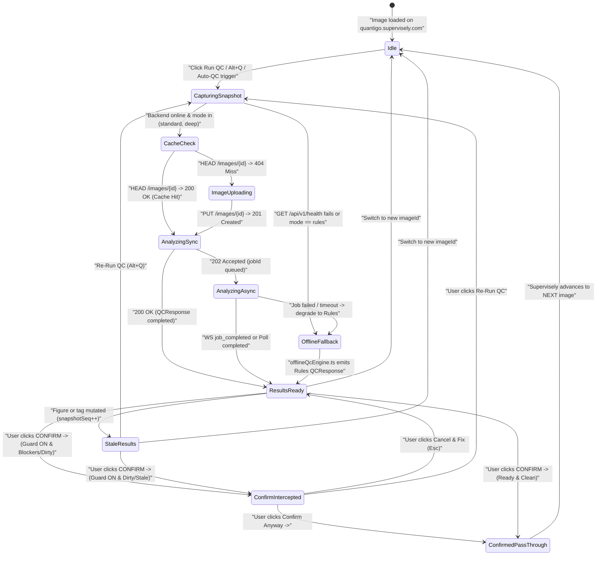

# 03 — Chrome Extension & UI/UX Design: Supervisely Hybrid QC Assistant

**Document Role:** Extension UI/UX, Overlay Rendering & Offline Client Engine Specification  
**Target Interface:** `https://quantigo.supervisely.com/app/images2/` (and `/labeling/*`)  
**Aligned Master Contract:** [01-architecture.md](./01-architecture.md) (`shared/types/qc-contract.ts`) & [02-qc-engine.md](./02-qc-engine.md)  
**Extension Modules Covered:** `TopBarWidget.tsx`, `QcDrawer.tsx`, `CanvasOverlay.tsx`, `ConfirmGuard.tsx`, `shadowHost.ts`, `domObserver.ts`, `offlineQcEngine.ts`, `Popup.tsx`, `Options.tsx`

---

## 1. Visual Integration & Non-Invasive Ergonomics

### 1.1 Supervisely Workspace Anatomy & Spatial Constraints

From direct inspection of `quantigo.supervisely.com/app/images2/`, the Supervisely annotation workspace is organized into six fixed zones:

```text
+---------------------------------------------------------------------------------------------------+
| [Logo] > Dataset > [0% | Job | Labeled 0/5 | SUBMIT] > [Thumb | File | <- | NEXT | CONFIRM ->]     |
|                                  [Synchronize*] [Run QC (Alt+Q) v | Pill] [Live Training] [More]  |  <- Global Top Bar (~48px)
+----+---------------+-------------------------------------------------------+----------------------+
|    | Definitions   |  [file_tab.jpg]           Opacity 50%  ...  16% v     | Objects By Classes 1 |
| L  | CLASSES       |  [Tag: Occlusion]                        +---------+  |   v Human         7  |
| e  |  Animal       |                                          | Minimap |  |     6  Human   0     |
| f  |  Boat         |      +--------------------------------+  | (Red    |  |     5  Human   0     |
| t  |  Building     |      |                                |  |  Rect)  |  |     ...              |
|    |  Bus / Car    |      |     Main Annotation Canvas     |  +---------+  |----------------------|
| T  |  Car1 (Brush) |      |     (5472 x 3648 @ 16% zoom)   |               | Images 5 | Apps      |
| o  |  Fruit (Graph)|      |                                |  [QC Drawer]  |  [thumb] 5472x3648   |
| o  |  Human (Rect) |      |                                |  (Docked /    |  [thumb] 3840x2160   |
| l  |               |      +--------------------------------+   Floating)   |                      |
| s  | CURRENT IMAGE |                                                       |                      |
|    | TAGS          |                                                       |                      |
|    | [x] Occlusion |                                                       |                      |
+----+---------------+-------------------------------------------------------+----------------------+
| Last save: 10 minutes ago                                                Ping: 169ms  Troubleshoot|  <- Bottom Status Bar (~24px)
+---------------------------------------------------------------------------------------------------+
```

**Design Mandate:** Stay completely unobtrusive while drawing (`Bounding Box`, `Polygon`, `Brush`, `Line`, `Keypoint`), never collide with the **top-right Minimap Thumbnail**, never push **`More` / User Avatar** off narrow `1280px` viewports, and never steal pointer or single-key annotation shortcuts.

### 1.2 Exact Placement of Injected Top-Bar Controls (`TopBarWidget.tsx`)

1. **Primary Mount Slot (Workflow Action Cluster):**
   - Mounted directly **to the right of `[Synchronize]`** (immediately adjacent to `[<-] [NEXT ->] [✓ CONFIRM ->]` and `[Synchronize]`, before `[Live Training v]`) inside a dedicated `<div id="sly-qc-topbar-host">` container (`height: 30px`, `display: inline-flex`, `align-items: center`, `gap: 6px`).
   - **Why here:** Annotators look directly at `CONFIRM ->` and `Synchronize` before moving to the next image. Placing the QC trigger and readiness pill adjacent to `Synchronize` makes QC part of the natural `Annotate -> Synchronize -> Run QC -> Confirm` rhythm.
2. **Responsive Narrow-Viewport Adaptation (`<= 1320px`):**
   - Uses a `ResizeObserver` on Supervisely's top bar container.
   - **Full Layout (`>= 1320px`, ~215px wide):** `[⚡ Run QC ⌥Q | ▾]  [● Ready · 96]`
   - **Compact Layout (`< 1320px`, ~124px wide):** `[⚡ QC ⌥Q | ▾]  [● 2B]`
   - **Fallback Anchor Slot (Canvas Sub-Toolbar):** If Supervisely's top bar overflows horizontally (`scrollWidth > clientWidth`), `TopBarWidget.tsx` dynamically docks into the unused dark space in the **Canvas Header Bar** between the active image filename tab and the `Opacity [50%]` controls — guaranteed visible with zero layout clipping.
3. **Top-Bar Widget Anatomy:**

```text
+-----------------------------------+  +---------------------------+
| [Shield/Bolt] Run QC  ⌥Q  |  [v]  |  | (●) Needs Review · 2W     |
+-----------------------------------+  +---------------------------+
|  ^ Primary Click: Run in active mode    ^ Click: Toggle QC Drawer
|    (Default: Standard)                   Colors/states driven by
|    ^ Caret [v]: Mode quick-pick           QCResponse.readiness &
|      (Fast Rules / Standard / Deep        HealthResponse status
|       + Auto-QC toggle [Default: OFF])
```

| Top-Bar Readiness Pill State | Condition (`QCResponse` / `HealthResponse`) | Label Text | Badge Dot & Accent Token |
|---|---|---|---|
| `idle` | No QC run yet on current `imageId` | `QC Idle` | Muted Slate (`#8E99AD`) |
| `running` | `status: "queued" \| "running"` | `Checking... 45%` | Pulsing Cyan (`#38BDF8`) |
| `ready` | `status: "completed"` & `readiness === "ready"` & `!stale` | `Ready · {score}` | Solid Emerald (`#34D399`) |
| `needs_review` | `readiness === "needs_review"` (Warnings/Tips only) | `Review · {W}W` | Solid Amber (`#FBBF24`) |
| `blocked` | `readiness === "blocked"` (Active Blockers > 0 or dirty sync) | `Blocked · {B}B` | Pulsing Crimson (`#F43F5E`) |
| `stale` | Edits occurred after last `snapshotSeq` (`currentSeq > lastAnalyzedSeq`) | `Edited · Re-run` | Dashed Amber (`#F59E0B`) |
| `offline` | `engineCapabilities.degradedReason === "LOCAL_BACKEND_OFFLINE"` | `Offline · Rules` | Slate-Blue (`#94A3B8`) + Bolt-Slash icon |

### 1.3 Supervisely Dark-Theme Color System & Design Tokens

Tokens are sampled directly from `quantigo.supervisely.com/app/images2/` dark mode so injected UI reads as a native Supervisely module:

| Token Name | Hex / RGBA Value | Usage |
|---|---|---|
| `--qc-bg-bar` | `#181B22` | Global top-bar buttons, modal header |
| `--qc-bg-panel` | `#1E232D` | QC Drawer background (matches `Definitions` & `Objects By Classes`) |
| `--qc-bg-elevated` | `#252B37` | Finding cards, dropdown menus, hover rows |
| `--qc-bg-canvas` | `#262A33` | Canvas letterbox backdrop |
| `--qc-border-subtle` | `#2F3643` | Card dividers, drawer outer stroke |
| `--qc-border-strong` | `#3D4657` | Input borders, segmented toggles |
| `--qc-accent-blue` | `#2563EB` | Active tab / focused selection ring (matches Supervisely active class outline) |
| `--qc-accent-indigo` | `#4F6DF5` | Primary CTA button fill (`Run QC` hover / active `Live Training` family) |
| `--qc-text-primary` | `#E5E9F0` | Primary titles, messages, button labels |
| `--qc-text-secondary` | `#8E99AD` | Metadata, rule IDs, timestamps, counts |
| `--qc-text-muted` | `#5B667A` | Disabled states, secondary hints |
| `--qc-sev-blocker` | `#F43F5E` / `rgba(244,63,94,0.15)` | Crimson blocker border/text & tinted pill fill |
| `--qc-sev-warning` | `#FBBF24` / `rgba(251,191,36,0.15)` | Amber warning border/text & `Synchronize` dirty alert |
| `--qc-sev-info` | `#38BDF8` / `rgba(56,189,248,0.14)` | Cyan tips, AI Vision ghost overlays, progress indicator |
| `--qc-sev-ready` | `#34D399` / `rgba(52,211,153,0.14)` | Emerald `Ready to Confirm` badge & checkmarks |
| `--qc-sly-sync-yellow` | `#FACC15` | Native Supervisely yellow `Synchronize` match |
| `--qc-sly-tag-orange` | `#E86F2C` | Native Supervisely `Occlusion` tag pill match |
| `--qc-font-sans` | `-apple-system, BlinkMacSystemFont, "Inter", "Segoe UI", Roboto, sans-serif` | All UI copy & labels (`12px` base, `11px` badges, `13px` headers) |
| `--qc-font-mono` | `"SF Mono", "JetBrains Mono", ui-monospace, monospace` | Numeric scores (`58/100`), IoU (`24%`), coordinates, shortcut keycaps (`⌥Q`) |

### 1.4 Shadow DOM, CSS & Event Isolation Strategy (`shadowHost.ts`)

1. **Isolated Shadow Roots:**
   - The extension creates four lightweight DOM mount anchors:
     - `#sly-qc-topbar-host` (inline inside top toolbar)
     - `#sly-qc-drawer-host` (fixed over workspace container)
     - `#sly-qc-overlay-host` (aligned strictly over Supervisely's main `<canvas>` bounding rect)
     - `#sly-qc-modal-host` (top-layer host for `ConfirmGuard.tsx` modal)
   - Each host attaches `attachShadow({ mode: "open" })` and injects compiled CSS via `shadowRoot.adoptedStyleSheets` (with `<style>` fallback).
   - Root rule `:host { all: initial; font-family: var(--qc-font-sans); color-scheme: dark; box-sizing: border-box; }` completely isolates extension styling from Supervisely's global CSS/AntD/Tailwind rules and prevents extension CSS from leaking onto Supervisely elements.
2. **Non-Blocking Canvas Pointer Isolation:**
   - `#sly-qc-overlay-host` sets `pointer-events: none; user-select: none;` on both host and SVG/Canvas layers so every mouse down, drag, wheel zoom, polygon vertex click, brush stroke, and right-click pan reaches Supervisely's `<canvas>` unmodified.
   - Optional interactive edge/ghost chips (`pointer-events: auto`) automatically revert to `pointer-events: none` whenever `pointerdown` is active on the main canvas OR the active drawing tool (`uiState.activeTool`) is actively mid-stroke/mid-polygon, preventing accidental click interception during annotation.
3. **Keyboard Event Isolation:**
   - Interactive form fields inside Shadow DOM (`<input>`, `<select>`, `<textarea>`) attach `keydown` / `keyup` / `keypress` listeners calling `e.stopPropagation()` (except `Escape`), preventing typed letters (`r`, `b`, `p`, `l`, `e`, `v`, `Space`) from triggering Supervisely's global canvas hotkeys.

---

## 2. Detailed UI Components, Wireframes & State Tables

### 2.1 Floating / Dockable "QC Inspector" Drawer (`QcDrawer.tsx`)

#### Minimap-Safe Docking Modes
1. **Default — Canvas Top-Right Below Minimap (`dockMode: "below_minimap"`):**
   - Dynamically measures the top-right Minimap Thumbnail (`domObserver.ts`) and Right Sidebar (`Objects By Classes` + `Images`) via `ResizeObserver`.
   - Positions drawer at `top = minimapRect.bottom + 8px` (or `canvasRect.top + 12px` if minimap is hidden), `right = rightSidebarWidth + 12px`, `width = 344px`, `maxHeight = canvasRect.bottom - top - 12px`.
   - **Result:** The top-right Minimap Thumbnail (`136x90px`) and its red viewport rectangle remain **100% unobstructed**.
2. **Right-Sidebar Dock (`dockMode: "over_sidebar"`):**
   - Anchors at `top = 88px, right = 8px, width = 320px`, sitting cleanly over the right sidebar (`Objects By Classes` / `Images`) so the entire main annotation canvas is **100% unobstructed** during review.
3. **Floating Draggable (`dockMode: "floating"`):**
   - User drags the header grip (`::::`) anywhere within the viewport (`localStorage` / `chrome.storage.local` remembers `{ dockMode, x, y }`, clamped safely inside window bounds on resize).
4. **Collapsed (`isOpen: false`):**
   - Zero canvas footprint (`display: none`); accessible anytime via Top-Bar pill click or `Alt+Shift+Q`.

#### ASCII Wireframe — QC Inspector Drawer

```text
+----------------------------------------------------------------------+
| ::::  QC INSPECTOR                   [Dock v] [Overlay On] [ _ ] [x] |
+----------------------------------------------------------------------+
| +--------+  BLOCKED (Needs Fixes)      Profile: [quantigo-street v]  |
| |   58   |  2 Blockers · 2 Warn · 1 Tip  Engine: [● Online · MPS   ] |
| |  /100  |  Sync: [!] Unsaved Sync      State:  [Live Store · Sync]  |
| +--------+                                                           |
| Mode: ( Fast Rules ) [ * Standard ] ( Deep AI )       [ Re-Run ⌥Q ]  |
+----------------------------------------------------------------------+
| Severity: [All 5] [● Blockers 2] [▲ Warnings 2] [ℹ Tips 1]           |
| Category: [All] [Workflow] [Tags] [Geom] [Missed] [Class] [Keypoints]  |
| [x] Hide 1 Dismissed                                  [Expand All]   |
+----------------------------------------------------------------------+
| BLOCKERS (2)                                                         |
| +------------------------------------------------------------------+ |
| | ■ BLOCKER · WORKFLOW · 100%                                 [×]  | |
| | Unsaved Annotations (Yellow Synchronize)                         | |
| | Unsaved edits exist in the editor. Click Synchronize before      | |
| | confirming this image.                                           | |
| | Target: [Editor Toolbar]                                         | |
| | [⚡ Highlight Synchronize]                         [Dismiss]     | |
| +------------------------------------------------------------------+ |
| +------------------------------------------------------------------+ |
| | ■ BLOCKER · TAGS · 100%                                     [×]  | |
| | Object Tag Attached to Image                                     | |
| | "Occlusion" is attached to CURRENT IMAGE TAGS instead of         | |
| | occluded object figure(s).                                       | |
| | Target: [Image Tag: Occlusion] [Human #5]                        | |
| | [◎ Locate #5]  [⇄ Move Tag to #5]                 [Dismiss]     | |
| +------------------------------------------------------------------+ |
|                                                                      |
| WARNINGS (2)                                                         |
| +------------------------------------------------------------------+ |
| | ▲ WARNING · TAGS · 88% AI                                   [×]  | |
| | Overlapping Figure Missing Occlusion Tag                         | |
| | Object #2 (Human) overlaps Object #3 (24% IoU) — verify          | |
| | Occlusion tag on background object.                              | |
| | Target: [Human #2] [Human #3]                                    | |
| | [◎ Locate / Focus]  [+ Add Occlusion to #2]       [Dismiss]     | |
| +------------------------------------------------------------------+ |
| +------------------------------------------------------------------+ |
| | ▲ WARNING · MISSED OBJECTS · 87% AI · OFF-SCREEN →          [×]  | |
| | Potential Missed Object Outside Viewport                         | |
| | 1 potential Human missed outside viewport (right edge).          | |
| | Target: [Ghost: Human 87%] [→ Right Edge]                        | |
| | [↗ Pan / Locate]                                  [Dismiss]     | |
| +------------------------------------------------------------------+ |
|                                                                      |
| TIPS (1)                                                             |
| +------------------------------------------------------------------+ |
| | ℹ TIP · GEOMETRY · 100%                                     [×]  | |
| | Brush Mask Edge Bleed Hint (BITMAP_SPILLED_MASK)                 | |
| | Car1 #7 (Brush) bleeds ~65 px² onto adjacent Human #3 boundary.  | |
| | Target: [Car1 #7 (bitmap)]                                       | |
| | [◎ Locate / Focus]                                [Dismiss]     | |
| +------------------------------------------------------------------+ |
+----------------------------------------------------------------------+
| Footer: [16% Zoom · 5472×3648]  [◀ Prev (⌥[)] [Next (⌥])]   298 ms   |
+----------------------------------------------------------------------+
```

#### Drawer Header & Sub-Element State Matrix

| Element | Data Source (`QCResponse` / `UiStateSnapshot` / `HealthResponse`) | Interactive Behavior |
|---|---|---|
| **Score Ring & Readiness Pill** | `overallScore` (`0–100`) & `readiness` (`"ready" \| "needs_review" \| "blocked"`) | Color shifts Emerald (`ready`, 0 active blockers/warnings/missed), Amber (`needs_review`), Crimson (`blocked`). When findings are dismissed, client filters out both dismissed `QCFinding`s and any `MissedObjectOverlay` referenced by `dismissedFinding.missedObjectIds`, then recomputes effective visible `overallScore` (`max(0, 100 - 25*B - min(45, 8*W) - min(10, 2*I))`) & `readiness` (`blocked` if `B>0`, `needs_review` if `W>0 \|\| activeMissed.length>0`, else `ready`) while showing `(n dismissed)` note. |
| **Rule Profile Selector** | `ProfileListResponse.profiles` + `QCResponse.profileId` | Dropdown lets annotator override matched profile for the current project/job and triggers instant re-analysis. |
| **Backend Connection Badge** | `engineCapabilities.device` (`"mps" \| "cpu" \| "none"`) + `degradedReason` | `Online · MPS` (emerald), `Online · CPU` (cyan), `Degraded · Low RAM` (`LOW_SYSTEM_MEMORY_DOWNGRADE` / `cpu` fallback, amber), `Offline · Rules Only` (`LOCAL_BACKEND_OFFLINE`, slate; clicking opens quick start-backend popover). |
| **Sync & Confirm Strip** | `uiState.synchronizeDirty`, `uiState.isConfirmed`, `uiState.stateSource`, `uiState.partialGeometry` | Shows `Synced` (emerald) vs `Unsaved (Synchronize)` (yellow); `Confirmed` vs `Unconfirmed`; `Live Store` vs `Network` vs `DOM Fallback (figures: [], domFigureSummaries populated — click Sync to refresh geometries)`. |
| **Mode Segmented Control** | `QCAnalyzeRequest.mode` (`"rules" \| "standard" \| "deep"`) | Disabled options (`Standard`, `Deep`) are clearly grayed out with tooltip `"Requires local Python backend"` when offline. |
| **Findings Grouping & Filters** | `findings: QCFinding[]` grouped by `severity` (`blocker`, `warning`, `info`), filtered by `category` (`QCCategory`) | Live badge counts reflect non-dismissed findings. Clicking a card highlights & pulses the target figure(s) or ghost box in `CanvasOverlay.tsx`. |
| **Dismiss / Ignore Button** | Keyed by `(image.imageId, finding.fingerprint)` in `chrome.storage.local` | Deterministic `fingerprint` ensures dismissing a warning (e.g., an intentional background overlap) persists across subsequent edits and re-runs unless the underlying geometry/rule changes. |

#### `QuickFixAction` Safe Execution Dispatch Table

Every button rendered on a Finding Card maps strictly to `QuickFixAction.actionType` from `01-architecture.md`:

| `actionType` | Button Style | Execution Behavior (`content/index.ts` & `domObserver.ts`) | Safety Guardrail |
|---|---|---|---|
| `highlight_synchronize` | Amber CTA | Pulses an animated halo around Supervisely's `[Synchronize]` button and scrolls it into view. | Zero mutation; 100% safe. |
| `focus_viewport` | Cyan/Blue CTA | Calls `CanvasOverlay.focusRect(action.focusRect)`. If `slyStoreAdapter` exposes writable pan/zoom, centers viewport; otherwise triggers Minimap radar ping + off-edge directional beacon + selects figure row in `Objects By Classes`. | Never breaks if canvas stage is read-only. |
| `inspect_figure` | Neutral CTA | Selects the figure row in `Objects By Classes` (clicking the DOM row triggers Supervisely's native selection + auto-focus) and activates pulse highlight on `CanvasOverlay`. | Non-destructive selection only. |
| `toggle_class_visibility` | Neutral CTA | Toggles the eye icon in `Definitions` / `Objects By Classes` for the referenced class. | Reversible UI toggle. |
| `move_tag_image_to_object` | Guided Fix | **If `stateSource === "store"` and write adapter confirmed:** executes store action or guided DOM click sequence (uncheck `CURRENT IMAGE TAGS -> tagName`, select `targetFigureIds[0]`, add object tag) and logs undoable action. **Otherwise:** opens 2-step guided highlighter pointing to `[CURRENT IMAGE TAGS]` checkbox and `targetFigureIds[0]`. | Never silently mutates ambiguous targets (`targetFigureIds.length > 1` prompts user to pick target figure). |
| `add_object_tag` / `remove_object_tag` | Guided Fix | Selects `targetFigureIds` and applies tag via store adapter (or highlights tag control in left/object panel with one-click confirm toast if DOM-only). | Requires explicit user click; shows toast `"Verify & click Synchronize"`. |
| `remove_image_tag` | Guided Fix | Unchecks `tagName` in `CURRENT IMAGE TAGS` (or highlights checkbox if selector not found). | Explicit user click only. |
| `confirm_delete_figure` | Destructive Guarded | Selects `targetFigureIds[0]`, pulses red outline on canvas, and displays inline confirmation prompt (`"Delete tiny artifact #7? [Confirm Delete]"`). | **NEVER** deletes without a second explicit confirmation click. |

---

### 2.2 Interactive Canvas Visual Overlay Layer (`CanvasOverlay.tsx`)

#### Full-Resolution Image to Viewport Coordinate Mapping (`5472x3648` at `16%` zoom, etc.)

All server coordinates (`AnnotationFigure`, `QCFinding.focusRect`, `MissedObjectOverlay.bbox`, `polygonPoints`) are in **full-resolution image pixel coordinates** $(x_{img}, y_{img}) \in [0, W] \times [0, H]$.

To keep the overlay pixel-locked during arbitrary Supervisely zooming (`10%`–`800%`), panning, window resizing, and letterboxing (such as a `5472x3648` photo fitted at `16%` inside a `980x653` `<canvas>` with dark padding around it):

1. **Overlay Alignment:** `#sly-qc-overlay-host` tracks the main Supervisely `<canvas>` element's `getBoundingClientRect()` (`left, top, width: Cw, height: Ch` in **CSS pixels**) via `ResizeObserver` + `MutationObserver`. Inside Shadow DOM, it houses two stacked non-blocking layers (`pointer-events: none`):
   - **Raster Layer (`<canvas>`):** Sized `Cw * dpr x Ch * dpr` (CSS `Cw x Ch`), used strictly for `bitmap` mask highlights so in-memory `ImageData` / `createImageBitmap` canvas drawing **bypasses host CSP `img-src`** (`blob:` / `data:` restrictions).
   - **Vector Layer (`<svg width="100%" height="100%" viewBox="0 0 Cw Ch">`):** Positioned directly above the raster canvas for boxes, polygons, polylines, keypoints, and ghost hints.
2. **Single-Transform Scene Group:** All SVG vector overlays live inside a single `<g id="qc-scene-transform" transform="translate(tx, ty) scale(s)">` in full-resolution pixel space `(0..W, 0..H)`, using `vector-effect="non-scaling-stroke"` so highlight borders remain exactly `2px` crisp on screen at any zoom level. (The paired `<canvas>` applies `ctx.setTransform(s * dpr, 0, 0, s * dpr, tx * dpr, ty * dpr)` before drawing bitmaps).
3. **Three-Tier Affine Calibration `(s, tx, ty)`** (updated via `requestAnimationFrame` on wheel/pan/zoom/store events):
   - **Canonical Box Normalization:** Before rendering or computing overlap intersections, every `RectangleGeometry` (`[[x1, y1], [x2, y2]]`) is normalized to `[Math.min(x1, x2), Math.min(y1, y2), Math.max(x1, x2), Math.max(y1, y2)]` so bottom-right-to-top-left dragged boxes render accurately with non-negative `<rect>` dimensions.
   - **Tier 1 (`store` scene transform — exact):** `slyStoreAdapter.ts` reads Supervisely's canvas viewport transform directly (`scale`, `offsetX`, `offsetY` in **CSS pixels** relative to `<canvas>` origin; no `devicePixelRatio` multiplier is applied to CSS-space SVG coordinates). Then:
     $$x_{ui} = x_{img} \cdot s + t_x, \qquad y_{ui} = y_{img} \cdot s + t_y$$
   - **Tier 2 (`minimap` + `zoomPercent` geometric derivation — CSS-pixel calibrated fallback):**
     - Read `zoomPercent` (`s_zoom = zoomPercent / 100` in CSS pixels — e.g., `5472 * 0.16 = 875.5 CSS px` on Retina or standard displays, **without** multiplying by `dpr`) and Minimap red rectangle `visibleNormRect = [xMin, yMin, xMax, yMax]`.
     - Compute visible normalized spans: `span_x = xMax - xMin`, `span_y = yMax - yMin`.
     - **Scale `s`:**
       - If **either** axis is cropped (`span_x < 0.995` or `span_y < 0.995`), derive `s` directly from the cropped axis (preferring the smaller/more constrained span if both are cropped):
         $$s = \begin{cases} \dfrac{C_w}{\text{span}_x \cdot W} & \text{if } \text{span}_x < 0.995 \\ \dfrac{C_h}{\text{span}_y \cdot H} & \text{if } \text{span}_y < 0.995 \end{cases}$$
       - Only when **both** axes fit inside the viewport (`span_x >= 0.995 && span_y >= 0.995`, e.g., `5472x3648 @ 16%` inside `980x653`):
         $$s = \min\left(\frac{\text{zoomPercent}}{100},\; \frac{C_w}{W},\; \frac{C_h}{H}\right)$$
     - **Translation `(tx, ty)` per axis independently:**
       - If axis is cropped (`span_x < 0.995`): $t_x = -x_{\min} \cdot W \cdot s$; if fitted (`span_x >= 0.995`): centered letterbox $t_x = \frac{C_w - W \cdot s}{2}$ (same formula for $t_y$ using `span_y`, $y_{\min}$, $H$, and $C_h$).
   - **Tier 3 (`fallback_full`):** Fits `[0, 0, W, H]` proportionally inside `(Cw, Ch)` and displays a subtle warning chip `"Overlay alignment approximate — toggle minimap on for exact tracking"`.

#### Primitive-Specific Visual Overlays (All 5 Primitives)

| Primitive (`geometryType`) | Highlight & Hover Rendering in `CanvasOverlay.tsx` |
|---|---|
| **Bounding Box (`rectangle`)** | Normalizes `points.exterior` (`[min(x), min(y), max(x), max(y)]`) and renders outer glowing rectangle with pulsing corner brackets. For overlap findings (`figureIds: [figA, figB]`), computes intersection rectangle `[max(x1), max(y1), min(x2), min(y2)]` and renders a diagonal hatch fill (`rgba(251,191,36,0.28)`) inside the overlap zone + `"24% IoU"` pill! |
| **Polygon (`polygon`)** | Renders exterior polygon `<path>` + `even-odd` interior hole paths (`points.interior`) with glowing stroke. Highlights invalid/self-intersecting vertices or duplicate edges with pulsing crimson `6px` vertex rings. |
| **Brush (`bitmap`)** | Client-side decoder inflates `bitmap.data` (base64 -> `Uint8Array` -> browser native `DecompressionStream("deflate")` -> raw PNG bytes) and parses IHDR/IDAT (with `DecompressionStream("deflate")` scanline unfiltering or `createImageBitmap(pngBlob)`) onto an offscreen canvas, recolors foreground alpha pixels into a translucent tinted halo (`#FB7185` or `#FBBF24`), and composites onto the **paired HTML `<canvas>` raster overlay** inside `#sly-qc-overlay-host` at `(origin[0], origin[1])` using `ctx.setTransform(s*dpr, 0, 0, s*dpr, tx*dpr, ty*dpr)` — completely bypassing host CSP `img-src` restrictions (`<svg><image>` is never used). Falls back gracefully to normalized `focusRect` bounding box if bitmap exceeds 16MP or decode fails. |
| **Line (`polyline`)** | Renders animated dashed `<polyline>` (`points.exterior`) with directional start/end dots and crimson halo rings around sharp acute backtrack spikes or near-touching disconnected gaps. |
| **Keypoint (`point` & `graph`)** | Renders skeleton edges from `ClassDefinition.geometryConfig.edges` as dashed lines connecting present `nodes[id].loc` coordinates, glowing rings on existing nodes, and a dashed crimson `×` marker (near parent centroid/label) + node label badge for any missing required template node! |

#### AI-Detected Missed Objects (`MissedObjectOverlay`) & Off-Viewport Radar

```text
+-----------------------------------------------------------------------+
|  [↖ 1 Human (Top-Left)]                            +---------------+  |
|                                                    | Minimap       |  |
|        + - - - - - - - - - +                       |   *  [RedBox] |  |
|        | AI: Human 89%     |  <- Visible Dashed    |             * |  |
|        | Sharp (Non-Bokeh) |     Ghost Box (Cyan)  +---------------+  |
|        + - - - - - - - - - +                                          |
|                                                                       |
|                                         [1 Human Off-Screen →]        |
|                                          (Clamped Edge Badge)         |
+-----------------------------------------------------------------------+
```

1. **In-Viewport Ghost Overlays (`outsideViewport === false`):**
   - Renders dashed cyan (`#38BDF8`, `stroke-dasharray: 6 4`) bounding box (`bbox`) or simplified polygon contour (`polygonPoints`, when `geometryType === "polygon" | "bitmap"`), paired with its `VISION_MISSED_OBJECT` (`severity: "warning"`) finding card.
   - Floating micro-tag above top-left corner: `[✨ Human 89% · Sharp]` (reassuring the user it passed the bokeh filter; out-of-focus background objects are already filtered server-side).
   - Clicking `"Dismiss"` on the linked `VISION_MISSED_OBJECT` finding fades out that ghost box immediately and excludes its `missedObjectIds` from client-side readiness calculation.
2. **Off-Viewport Directional Edge Indicators (`outsideViewport === true`):**
   - Clamped within `12px` of the visible canvas border along `viewportEdgeDirection` (`left`, `right`, `top`, `bottom`, `top-left`, `top-right`, `bottom-left`, `bottom-right`), avoiding the top-right Minimap footprint!
   - Groups adjacent off-screen objects on the same edge into a compact pill: `[1 Missed Human → Right Edge]` (or `[2 Missed Cars ↗ Top-Right]`).
   - **Minimap Radar Dots:** Overlays tiny `5px` pulsing cyan dots directly over Supervisely's top-right Minimap Thumbnail at normalized coordinates `[(bboxCenterX / W) * minimapW, (bboxCenterY / H) * minimapH]` (`pointer-events: none`), letting the annotator see exact off-screen object positions relative to the red viewport box!
3. **Dual-Tier `"Locate / Focus"` Execution:**
   - When the user clicks `[Locate / Focus]` on any finding or off-viewport pill:
     1. If `slyStoreAdapter` provides a writable pan/zoom setter (`viewportPanSupported`), smoothly pans the canvas so `focusRect` is centered with `20%` margin.
     2. If Supervisely's canvas pan controller is read-only, selects the target figure row in `Objects By Classes` (triggering Supervisely's native auto-center for existing figures), flashes a pulsing radar ring on the **Minimap Thumbnail** at the target normalized coordinate, and displays a directional compass arrow in `CanvasOverlay.tsx` pointing straight toward `focusRect`!

---

### 2.3 Pre-Confirm Intercept Guard (`ConfirmGuard.tsx`)

Optional safety toggle (default **`ON`** for active Blockers & Dirty `Synchronize`, configurable in Popup/Options):

- **Capture-Phase Hook (`domObserver.ts`):** Attaches a single persistent capture-phase `click` listener on **`window` / `document`** (`window.addEventListener("click", handleConfirmCapture, { capture: true })`), matching `(e.target as Element)?.closest(...)` against Supervisely's `[✓ CONFIRM ->]` button selector/label so React DOM re-renders never detach the guard.
- **Configured Guard Criteria Helper (`guardPasses(state, guardStrictness)`):**
  - Mode `"blockers_and_dirty_sync"` (default): passes when `!uiState.synchronizeDirty && activeBlockers === 0` (excluding dismissed blockers).
  - Mode `"blockers_and_warnings"`: passes when `!uiState.synchronizeDirty && activeBlockers === 0 && activeWarnings === 0 && activeMissed.length === 0`.
- **Zero-Friction Pass-Through Conditions:**
  - Feature toggle is `OFF`, **OR**
  - `bypassConfirmGuardOnce === true` (user just clicked `Confirm Anyway`), **OR**
  - `guardPasses(state, guardStrictness)` is `true` AND (`lastAnalyzedSeq === currentSnapshotSeq` or `runQcOnConfirm === false`).
- **Intercept Modal Wireframe (Triggered ONLY when guard fails or edits are stale):**

```text
+-------------------------------------------------------------------+
|  ⚠  Review Required Before Confirming Image                  [×]  |
+-------------------------------------------------------------------+
|  a1bc2acd631e394d2fd0141131b7edfe.jpg has unresolved blockers:    |
|                                                                   |
|  ■ Unsaved Edits: Yellow "Synchronize" button has not been saved  |
|  ■ Tag Scope: "Occlusion" is attached to Image instead of Object  |
|                                                                   |
|  (i) 1 Warning also detected (Human #2 overlap missing Occlusion) |
|                                                                   |
|  [  Cancel & Fix (Esc)  ]   [ Re-Run QC ]   [ Confirm Anyway -> ] |
+-------------------------------------------------------------------+
```

- **`[Cancel & Fix]`:** Closes modal, opens QC Drawer, highlights `Synchronize` (if dirty) or focuses first blocker.
- **`[Re-Run QC]`:** Runs fresh QC (`snapshotSeq`), auto-proceeding with confirm whenever `guardPasses(newState, guardStrictness)` evaluates to `true` (e.g., remaining tips/warnings do not block when strictness is `"blockers_and_dirty_sync"`).
- **`[Confirm Anyway ->]`:** Sets `bypassConfirmGuardOnce = true`, closes modal, and programmatically re-triggers Supervisely's `CONFIRM ->` button cleanly without re-intercepting.

---

### 2.4 Extension Toolbar Popup (`Popup.tsx`) & Options Page (`Options.tsx`)

#### Extension Toolbar Popup (`360 × 460 px`, Dark Theme)

```text
+--------------------------------------------------+
| [🛡] Supervisely QC Assistant          v1.0.0    |
|--------------------------------------------------|
| LOCAL BACKEND (127.0.0.1:8765)                   |
|  ● Online · Apple Silicon (MPS)                  |
|  Models: yolo11m-coco, bokeh-v1, depth-v2-small  |
|  Image Cache: 142 MB / 1.0 GB (18 images)        |
|  (If Offline: [Copy Start Command]  uvicorn ...) |
|--------------------------------------------------|
| QC EXECUTION MODE                                |
|  ( ) Fast Rules        Deterministic (<100ms)    |
|  (•) Standard (Rec.)   Rules + Vision (<1s)      |
|  ( ) Deep AI           SAM2 / Pose / Open-Vocab  |
|--------------------------------------------------|
| WORKFLOW AUTOMATION                              |
|  [ ] Auto-run Fast Rules on image switch         |
|  [ ] Auto-run active mode after Synchronize      |
|  [x] Pre-Confirm Guard (Blockers & Dirty Sync)   |
|  [x] Canvas Ghost Overlay & Minimap Radar Dots   |
|--------------------------------------------------|
| ACTIVE PROFILE: quantigo-street-bbox-v1          |
|  Matched by: Job title /Project ID               |
|                                                  |
| [ Run QC on Active Tab ]   [ Settings & Rules ]  |
+--------------------------------------------------+
```

#### Extension Options Page (`Options.tsx` — Full-Tab Settings & Rule Profile Studio)

Organized into 4 clean navigation sections synced with `GET/PUT/DELETE /api/v1/profiles` and `chrome.storage.local`:

1. **Connection & Bridge Security:**
   - **Backend Host/Port:** `127.0.0.1` (locked loopback) + Port input (`8000–9999`, default `8765`).
   - **Bridge Auth Token (`X-QC-Bridge-Token`):** Password-masked 64-char hex input (read from `~/.config/supervisely-qc/bridge_token`) + `[Test Connection]` button hitting `GET /api/v1/health` (unauthenticated) + `GET /api/v1/profiles` (authenticated, verifying token parity).
   - **Cache Controls:** Displays `HealthResponse.cacheStats` (`imageCount`, `diskBytes / maxDiskBytes`, auto-evicted at 1 GB / 24h TTL on disk) + `[Clear Local Extension Dismissals]` (`chrome.storage.local`).
2. **Engine & Execution Preferences:**
   - Default `QCMode`: **`standard`** (`rules | standard | deep`), `asyncIfHeavy` toggle, Manual Trigger by default (`autoRunOnImageSwitch: false`, `autoRunAfterSync: false` — opt-in Auto-QC debounce delay `300ms–2000ms` when enabled), Confirm Guard strictness (`Blockers + Dirty Sync` vs `Blockers + Warnings`).
3. **Rule Profile Studio (1:1 Mapping to `RuleProfile` Schema):**
   - **Profile Picker Bar:** Select built-in or custom profiles (`default`, `quantigo-street-bbox-v1`, etc.), `[+ Duplicate / New]`, `[Import JSON/YAML]`, `[Export JSON/YAML]`, `[Delete]` (disabled when `isBuiltin === true`).
   - **Profile Matchers:** `jobTitleRegex` regex tester, `projectIds[]`, `datasetIds[]`.
   - **Workflow & Tag Rules:**
     - Toggles: `blockOnUnsavedSync`, `warnOnEmptyImageWithoutConfirm`, `flagForegroundOcclusionFalsePositive`.
     - Tag Lists: `imageOnlyTags` chips, `objectOnlyTags` chips (e.g., `Occlusion`).
     - Sliders: `occlusionOverlapIouThreshold` (`0.00–1.00`, default `0.10`), `occlusionCoverRatioThreshold` (`0.00–1.00`, default `0.15`).
   - **Geometry & Keypoint Rules:**
     - Numeric inputs/sliders: `minBoxAreaPx` (`64`), `minPolygonVertices` (`3`), `minPolylineVertices` (`2`), `minMaskAreaPx` (`32`), `maxDisconnectedMaskComponents` (`8`), `edgeSnapMarginPx` (`3`), `minBoxIouTightness` (`0.72`), toggle `requireRequiredGraphNodes`.
   - **Vision & Bokeh Rejection Rules:**
     - `missedObjectMinConfidence` slider (`0.10–0.95`, default `0.45`).
     - `minLaplacianSharpness` slider (`5–150`, default `35.0`) + `ignoreBackgroundBokeh` toggle (prevents false prompts on blurred background `Building` regions).
     - `enableDepthOcclusionOrdering` toggle.
4. **Per-Class Override Matrix (`classOverrides[classTitle]`):**
   - Table listing all classes from active `ProjectOntology` (or custom class names like `Building`, `Bus`, `Human`, `Car1`, `Fruit`):
     - `Enabled` toggle (disable absent classes in a subset job, e.g., `Bus` in a pedestrian-only task)
     - `Suppress Missed Prompts` toggle (e.g., `true` for `Building` on street-portrait jobs)
     - `Min Area (px²)`, `Min Sharpness`, `Detector Confidence` override sliders
     - `Required Tags` & `Forbidden Tags` multi-value chip inputs.
   - **Save Strategy:** Calls `PUT /api/v1/profiles/{profileId}` via MV3 Service Worker when backend is online, and caches active profile snapshot in `chrome.storage.local` so Offline Mode enforces the exact same thresholds (`workflowRules`, `tagRules`, `geometryRules`, `classOverrides`).

---

## 3. Client-Side Offline Fallback Mode (`offlineQcEngine.ts`)

When `GET /api/v1/health` fails or times out (`800ms` timeout via `serviceWorker.ts`), the extension automatically executes `offlineQcEngine.ts` in pure TypeScript—requiring **zero** network round-trips or Python backend—and emits a **100% schema-identical `QCResponse`** (`mode: "rules"`, `engineCapabilities: { device: "none", modelsUsed: [], degradedReason: "LOCAL_BACKEND_OFFLINE" }`) using the exact same `ruleId`s, `fingerprint` scheme, and `overallScore` formula (`max(0, 100 - 25*blocker - min(45, 8*warning) - min(10, 2*info))`) as [02-qc-engine.md](./02-qc-engine.md).

### 3.1 Deterministic Checks Supported Offline (Pure JS)

| Category | Primitive(s) | Offline Pure-JS Check Logic & Aligned `ruleId`s | Severity |
|---|---|---|---|
| **Workflow** | All | **`WORKFLOW_UNSAVED_SYNC`:** Flags `uiState.synchronizeDirty === true` when `workflowRules.blockOnUnsavedSync` is true. | `blocker` |
| **Workflow** | All | **`WORKFLOW_EMPTY_UNCONFIRMED`:** Flags when `warnOnEmptyImageWithoutConfirm` is true, `!uiState.isConfirmed`, and effective object count is `0` (`figures.length === 0` normally, or `sum(domFigureSummaries.figureCount) === 0` under `"dom_fallback"` where `figures` is strictly `[]`). | `warning` |
| **Tags** | All | **`TAG_SCOPE_IMAGE_MISPLACED` / `TAG_SCOPE_OBJECT_MISPLACED` / `TAG_CLASS_INCOMPATIBLE`:** Checks `imageTags` against `tagRules.objectOnlyTags` (e.g., `Occlusion` attached to `CURRENT IMAGE TAGS`) and `TagDefinition.applicableType === "objectsOnly"`. Also checks figure `tags` against `imageOnlyTags` / `"imagesOnly"` and `TagDefinition.classes` / `forbiddenTags`. | `blocker` |
| **Tags** | All | **`TAG_REQUIRED_MISSING`:** Enforces `classOverrides[classTitle].requiredTags` on each figure. | `warning` |
| **Tags / Geometry** | `rectangle` (+ derived bbox of `polygon`, `bitmap`) | **`BBOX_OCCLUSION_MISSING_TAG` / `BBOX_FOREGROUND_OCCLUSION_FP`:** Computes pairwise bbox IoU (`>= occlusionOverlapIouThreshold`) and asymmetric IoS cover ratio (`>= occlusionCoverRatioThreshold`), applying Layer 1 bottom-edge/area/IoS heuristic (`confidence: 0.75` without Depth Anything V2) to flag presumed occluded boxes lacking `Occlusion` and isolated unobstructed boxes wrongly tagged `Occlusion`. | `warning` |
| **Classification** | All | **`CLASS_DISABLED_OR_OFF_JOB`:** Flags any figure (or `domFigureSummaries` entry with `figureCount > 0` under `"dom_fallback"`) whose `classTitle` is excluded from `ontology.jobClassesToLabel` or disabled via `classOverrides[classTitle].enabled === false`. | `warning` |
| **Global Geometry** | All 5 | **`GEOM_OUT_OF_BOUNDS` / `GEOM_DUPLICATE_FIGURE` / `GEOM_EXTREME_MICRO_CLICK` / `GEOM_CANVAS_WIDE_OUTLIER`:** Skipped cleanly when `stateSource === "dom_fallback"` (`figures: []`). Otherwise checks coordinates against `[-1.0, W + 1.0] x [-1.0, H + 1.0]` (`blocker`); per-primitive duplicate detection (`blocker` same class / `warning` cross-class): rect/poly `IoU >= 0.90`, bitmap mask `IoU >= 0.90`, polyline bidirectional Chamfer mean distance `<= 4.0 px` & length ratio `>= 0.90`, graph/point mean matched-node distance `<= 6.0 px`; micro-click artifacts (`bbox_w < s_min` or `bbox_h < s_min` where `s_min = min(15, max(8, 0.025 * min(W, H)))`, or area `< effectiveMinArea = max(minBoxAreaPx, classOverride?.minAreaPx ?? 0, 1e-5 * W * H)`, `blocker`); canvas-wide boxes (`area > 0.90 * W * H`, `warning`). | `blocker` / `warning` |
| **Bounding Box** | `rectangle` | **`BBOX_BORDER_TRUNCATION`:** Flags near-miss edge gaps (`edgeSnapMarginPx < gap <= max(12px, 0.005 * min(W, H))`) and touching border truncations (`<= edgeSnapMarginPx`). | `info` / `warning` |
| **Polygon** | `polygon` | **`POLY_INSUFFICIENT_VERTICES` / `POLY_DEGENERATE_AREA` / `POLY_SELF_INTERSECTION` / `POLY_HOLE_INVALID`:** Checks `exterior.length >= minPolygonVertices` and holes `>= 3`; winding-independent area `Math.abs(shoelaceSignedArea) >= effectiveMinArea` (both CW and CCW rings valid); pure-JS $O(N^2)$ segment self-intersection on exterior/hole rings; hole bbox contained within exterior bbox. | `blocker` |
| **Brush (Bitmap)** | `bitmap` | **`BITMAP_DECODE_ERROR` / `GEOM_OUT_OF_BOUNDS` / `GEOM_EXTREME_MICRO_CLICK`:** Inflates `bitmap.data` using browser `DecompressionStream("deflate")`, parses PNG IHDR/IDAT pixels, verifies non-zero mask pixel count `>= max(minMaskAreaPx, effectiveMinArea)` and `[origin[0], origin[1], origin[0]+maskW, origin[1]+maskH]` within `[-1.0, W + 1.0] x [-1.0, H + 1.0]`. *(Heavy multi-megapixel morphological checks `BITMAP_DISCONNECTED_ISLANDS`, `BITMAP_UNEXPECTED_INTERNAL_HOLES`, `BITMAP_JAGGED_BOUNDARY` run on Python backend).* | `warning` / `blocker` |
| **Line (Polyline)** | `polyline` | **`LINE_INSUFFICIENT_POINTS` / `LINE_ZERO_LENGTH_SEGMENT` / `LINE_ACUTE_BACKTRACK_SPIKE`:** Checks `>= minPolylineVertices`, consecutive duplicate points (`dist < 1px`), and acute backtrack folding angles (`angle < 25°`). | `blocker` / `warning` |
| **Keypoint** | `point`, `graph` | **`KP_MISSING_REQUIRED_NODES` / `GEOM_OUT_OF_BOUNDS`:** Compares `figure.nodes` keys against `ClassDefinition.geometryConfig.nodes` when `requireRequiredGraphNodes` is true; validates every non-disabled node `loc` within `[-1.0, W + 1.0] x [-1.0, H + 1.0]`; flags sentinel `[0, 0]` nodes. | `blocker` / `warning` |

### 3.2 Capabilities Gracefully Disabled Offline

- **Layer 2 Computer Vision:** AI missed-object detection (`missedObjects: []`), off-viewport pedestrian radar, Laplacian variance bokeh blur suppression (`Building`), SAM2 mask/box tightness IoU audit, and depth-based foreground-vs-background occlusion ordering.
- **UX Transparency:** Top bar reads `Offline · Rules`; drawer header displays a compact amber/slate banner (`"Local Vision Backend Offline — Deterministic Rules Active"` with a 1-click `[Copy Launch Command]` button); `Standard` and `Deep` mode buttons appear disabled with explanation tooltip.

---

## 4. UX Flows, State Machine & Keyboard Shortcut Map

### 4.1 End-to-End Extension & UI State Machine



### 4.2 Collision-Free Keyboard Shortcut Map

Supervisely binds single-letter and standard editing hotkeys globally on `window` (`R` Rectangle, `V` Select/Move, `B` Brush, `E` Eraser, `P` Polygon, `L` Polyline/Line, `Space`, `Enter`, `Delete`/`Backspace`, `Esc`, `H` Hide labels, `1–9` Class numbers, `Cmd/Ctrl+Z`).

To guarantee **zero collisions** on macOS Chrome (including the macOS `Option` dead-key/special-character behavior where `Option+Q` produces `event.key === "œ"` instead of `"q"`), all extension shortcuts match on **physical `KeyboardEvent.code`** with `Alt` (`Option ⌥`) modifiers and ignore events when an editable `<input>`/`<textarea>` outside Shadow DOM is focused:

| Shortcut (macOS / Win) | Matching Condition (`e.code`) | Action | Collision Safety Check |
|---|---|---|---|
| `Option + Q` (`Alt+Q`) | `e.altKey && !e.ctrlKey && !e.metaKey && !e.shiftKey && e.code === "KeyQ"` | Run QC on active image (in selected `mode`) | `Alt` chord never used by Supervisely (`Q` alone isn't bound either). Calls `e.preventDefault()` to suppress `"œ"` insertion. |
| `Option + Shift + Q` | `e.altKey && e.shiftKey && !e.ctrlKey && !e.metaKey && e.code === "KeyQ"` | Toggle QC Inspector Drawer open / collapsed | Zero collision with Supervisely or Chrome default tabs. |
| `Option + O` (`Alt+O`) | `e.altKey && !e.shiftKey && !e.ctrlKey && !e.metaKey && e.code === "KeyO"` | Toggle Canvas Ghost & Highlight Overlay visibility | Lets annotator hide all QC visuals instantly while drawing dense masks. |
| `Option + [` / `Option + ]` | `e.altKey && !e.ctrlKey && !e.metaKey && e.code === "BracketLeft" \| "BracketRight"` | Focus Previous / Next unresolved finding & call Locate/Focus | Supervisely uses bare `[` / `]` for brush size; requiring `Alt` keeps brush sizing untouched! |
| `Option + Shift + D` | `e.altKey && e.shiftKey && !e.ctrlKey && !e.metaKey && e.code === "KeyD"` | Dismiss currently focused QC finding | Safe chord; avoids `Ctrl+D` / `Cmd+D` (browser bookmark). |
| `Esc` (Contextual Only) | `e.code === "Escape"` **ONLY** when Confirm Guard modal is open OR focus is inside QC Drawer | Closes Confirm Guard modal or collapses Drawer | **Never** intercepts `Esc` when focus is on Supervisely canvas (`Esc` passes straight through to cancel active polygon/brush strokes). |
