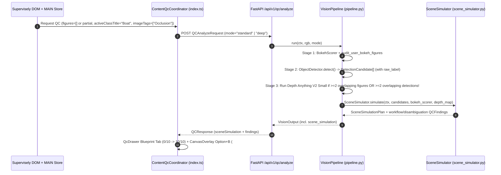

# 05 — Incremental v2 Plan: Pre-Annotation Scene Simulation & Annotation Blueprint ("Simulate & Guide")

**Document Status:** Incremental Feature Plan (Builds cleanly atop the implemented v1 Hybrid QC Assistant in [01-architecture.md](./01-architecture.md) .. [04-qa-verification.md](./04-qa-verification.md))  
**Target Codebase:** `/Users/mrongsubho/Documents/Termninal/SuerpvicelyQC/`  
**Default Execution Mode:** `standard` (`YOLO11s` + Bokeh Gate + `Depth Anything V2 Small`), Manual Trigger (`Option + Q` / `Run QC`)

---

## 1. Problem Statement & Motivating Scenario

The implemented v1 Hybrid QC System audits *existing* annotations (`request.figures`). However, when an annotator opens a **fresh image (`0` objects)** or a partially annotated image (such as `Group_of_Horses_4K_Image.jpg`, `3840×2160` at `22%` zoom in `Bounding Box_Task1_Nov 12`), four pre-annotation questions remain unanswered before drawing starts:

1. **Ontology Class & Subclass Selection (`Boat` vs `Animal` vs `Horse`):** The `Definitions -> CLASSES` panel contains 10 classes (`Animal`, `Boat`, `Building`, `Bus`, `Car`, `Car1`, `Fruit`, `Horse`, `Human`, `Sofa`), and the annotator may accidentally have `Boat` highlighted, or feel unsure whether to label horses as generic `Animal` vs specific `Horse`.
2. **Exact Object Count Prescription:** How many target objects exist in the frame that satisfy `ontology.classes` and pass bokeh filtering (e.g., `10 Horse` rectangles, while ignoring background trees/foliage and unused classes)?
3. **Simulated Pairwise Occlusion & Tag Prediction (`Occlusion` Scope):** Before drawing anything, which specific objects (`#1 .. #10` left-to-right) are unobstructed foreground clear (`foreground_clear` — **no `Occlusion` tag**) vs. occluded behind a foreground object (`occluded` — **requires `Occlusion` object tag**, naming the occluder index `#j`), and should an accidentally checked image-level `CURRENT IMAGE TAGS -> Occlusion` checkbox be removed?
4. **Live Progress Checklist (`0/N -> N/N`):** As the annotator draws boxes and re-runs QC (`Option + Q`), matched candidates check off automatically rather than shouting generic `VISION_MISSED_OBJECT` warnings.

This document specifies the exact contract, backend vision, and Chrome extension UI additions required to deliver **Pre-Annotation Scene Simulation & Annotation Blueprint ("Simulate & Guide")** cleanly without breaking v1 parity.

---

## 2. Architecture & Data Flow Delta



> [!IMPORTANT]
> **Critical v1 Pipeline Delta (`backend/app/vision/pipeline.py` lines 322–347):**
> In v1, Stage 3 (`infer_depth_fn`) only runs when `len(two_d_figs) >= 2`. On a fresh image (`len(request.figures) == 0`), `len(two_d_figs)` is `0`, so depth inference would be skipped! Stage 3 MUST also trigger when `ctx.profile.vision_rules.enable_depth_occlusion_ordering` is `True` and `len(candidates) >= 2` contain at least one overlapping candidate pair (`iou >= occlusion_overlap_iou_threshold` or `max(ios) >= occlusion_cover_ratio_threshold`).

---

## 3. Canonical Contract Additions (Pydantic v2 + TypeScript + Schema Parity)

Because [`scripts/sync_contracts.py`](file:///Users/mrongsubho/Documents/Termninal/SuerpvicelyQC/scripts/sync_contracts.py) enforces strict 1:1 field and literal union parity across Pydantic v2, JSON Schema, and TypeScript (`extra="forbid"`, `CamelModel`), all 3 files MUST be updated together and verified via `python3 scripts/sync_contracts.py --check`.

### 3.1 `backend/app/schemas/qc.py`
1. Extend `QuickFixActionType` (line 231) and `QuickFixAction` (line 277):
   - Add `"select_sidebar_class"` to `QuickFixActionType`.
   - Add `class_title: str | None = None` to `QuickFixAction`.
2. Add 4 `CamelModel` classes:
   ```python
   class SimulatedTagRecommendation(CamelModel):
       tag_name: str
       value: str | int | float | bool | None = None
       reason: str
       confidence: float = Field(ge=0.0, le=1.0)


   class SimulatedObjectCandidate(CamelModel):
       sim_id: str
       sim_index: int = Field(ge=1)
       class_title: str
       recommended_shape: GeometryType
       bbox: BoundingBoxTuple
       polygon_points: list[list[Point2D]] | None = None
       confidence: float = Field(ge=0.0, le=1.0)
       sharpness_score: float = Field(ge=0.0)
       visibility_status: Literal["foreground_clear", "occluded", "border_truncated"]
       occluded_by_sim_indices: list[int] = Field(default_factory=list)
       overlap_iou_max: float = Field(ge=0.0, le=1.0)
       overlap_cover_ratio: float = Field(ge=0.0, le=1.0)
       recommended_object_tags: list[SimulatedTagRecommendation] = Field(default_factory=list)
       outside_viewport: bool
       viewport_edge_direction: ViewportEdgeDirection | None = None
       matched_figure_id: str | None = None


   class SimulatedClassSummary(CamelModel):
       class_title: str
       recommended_shape: GeometryType
       total_count: int = Field(ge=0)
       completed_count: int = Field(ge=0)
       remaining_count: int = Field(ge=0)
       foreground_clear_count: int = Field(ge=0)
       occluded_count: int = Field(ge=0)
       border_truncated_count: int = Field(ge=0)
       tag_counts: dict[str, int] = Field(default_factory=dict)


   class SceneSimulationPlan(CamelModel):
       total_target_objects: int = Field(ge=0)
       completed_target_objects: int = Field(ge=0)
       primary_target_classes: list[str] = Field(default_factory=list)
       class_summaries: list[SimulatedClassSummary] = Field(default_factory=list)
       candidates: list[SimulatedObjectCandidate] = Field(default_factory=list)
       recommended_image_tags: list[SimulatedTagRecommendation] = Field(default_factory=list)
       misplaced_image_tags: list[str] = Field(default_factory=list)
       ignored_ontology_classes: list[str] = Field(default_factory=list)
       disambiguation_notes: list[str] = Field(default_factory=list)
       active_sidebar_class_warning: str | None = None
   ```
3. Extend `QCResponse` (line 334):
   - Add `scene_simulation: SceneSimulationPlan | None = None`.

### 3.2 `shared/types/qc-contract.ts`
1. Add `"select_sidebar_class"` to `QuickFixActionType` (line 214) and `classTitle?: string;` to `QuickFixAction` (line 225).
2. Add exported TypeScript interfaces `SimulatedTagRecommendation`, `SimulatedObjectCandidate`, `SimulatedClassSummary`, and `SceneSimulationPlan` matching the exact camelCase property names generated by `CamelModel`.
3. Add `sceneSimulation?: SceneSimulationPlan | null;` to `QCResponse` (line 278).

### 3.3 `scripts/sync_contracts.py`
1. Import `SimulatedTagRecommendation`, `SimulatedObjectCandidate`, `SimulatedClassSummary`, `SceneSimulationPlan` from `app.schemas.qc`.
2. Append all 4 classes to `CONTRACT_MODELS` (lines 52–79).
3. Add `"select_sidebar_class"` to `union_checks["QuickFixActionType"]` (lines 174–184).
4. Execute `python3 scripts/sync_contracts.py` to regenerate [`shared/schemas/qc-contract.schema.json`](file:///Users/mrongsubho/Documents/Termninal/SuerpvicelyQC/shared/schemas/qc-contract.schema.json).

---

## 4. Backend Vision & Orchestrator Design Deltas

### 4.1 Preserve Raw Detector Label (`backend/app/vision/tiling.py` & `detector.py`)
- In [`backend/app/vision/tiling.py`](file:///Users/mrongsubho/Documents/Termninal/SuerpvicelyQC/backend/app/vision/tiling.py#L12-L19), add `raw_label: str = ""` to `DetectionCandidate`.
- In [`backend/app/vision/detector.py`](file:///Users/mrongsubho/Documents/Termninal/SuerpvicelyQC/backend/app/vision/detector.py#L154-L216), populate `raw_label=raw_label` on every `DetectionCandidate` emitted across Pass 1 (`1280px`), Pass 2 (`2x2` tiles), and Deep Open-Vocab (`yolov8s-worldv2`).
- Note how `_COCO_TO_ONTOLOGY_ALIASES` (lines 17–36) already maps `"horse": ("Horse", "Animal")` — prioritizing `"Horse"` over `"Animal"`, while `YOLO-Worldv2` with `ov_model.set_classes(ontology_titles)` may emit both `"Horse"` and `"Animal"` on the same herd if both appear in `ontology.classes`. Having `raw_label` allows `SceneSimulator` to deduplicate superclass/subclass overlaps definitively.

### 4.2 Shared Pairwise Depth Helper (`backend/app/vision/occlusion_depth.py`)
- Extract a reusable pure-array helper inside [`backend/app/vision/occlusion_depth.py`](file:///Users/mrongsubho/Documents/Termninal/SuerpvicelyQC/backend/app/vision/occlusion_depth.py#L72-L141):
  ```python
  def resolve_pair_depth_order(
      depth_map: np.ndarray,
      img_w: int,
      img_h: int,
      bbox_a: BoundingBoxTuple,
      bbox_b: BoundingBoxTuple,
      delta_depth: float,
  ) -> Literal["a_foreground", "b_foreground", "ambiguous"]:
  ```
- Both `compute_depth_occlusion_ordering(...)` (for user `two_d_figs`) and `SceneSimulator` (for `DetectionCandidate` pairs) call `resolve_pair_depth_order(...)` so exclusive-core inverse-depth comparison ($d(A \setminus B)$ vs $d(B \setminus A)$ vs $d(A \cap B)$) is never duplicated.

### 4.3 New Module: `backend/app/vision/scene_simulator.py`
Implement `SceneSimulator.simulate(ctx: RuleContext, candidates: list[DetectionCandidate], bokeh_scorer: BokehScorer, depth_map: np.ndarray | None) -> tuple[SceneSimulationPlan, list[QCFinding]]`:

1. **Candidate Quality & Bokeh Filtering:**
   - Filter `candidates` by area `>= max(16.0, min_relative_area * W * H)`, class override `enabled != False`, confidence `>= max(missed_object_min_confidence, override.detector_confidence or 0.0)`, and `bokeh_scorer.score_roi(det.bbox)` rejecting background bokeh (`relative_sharpness < 0.32 and sharpness_score < 8.0`).
2. **Subclass vs. Superclass Disambiguation & Ontology Pruning:**
   - Define `_SUPERCLASS_TO_SUBCLASSES` (e.g., `"animal": {"horse", "dog", "cat", "bird", "sheep", "cow"}`, `"vehicle": {"car", "car1", "bus", "truck", "bicycle", "motorcycle", "boat"}`).
   - Cross-class NMS (`iou >= 0.65`): if an overlapping pair maps one detection to a superclass (`Animal`) and the other to a specific subclass (`Horse`) in `ontology.classes`, keep the specific subclass (`Horse`), suppress the duplicate superclass detection, and add `"Ontology has both 'Horse' and 'Animal' — using specific class 'Horse'."` to `disambiguation_notes`.
   - Use `image.file_name` keyword hints (e.g., `horse` in `Group_of_Horses_4K_Image.jpg`) as an additional tie-breaker/note in `disambiguation_notes`.
   - Populate `ignored_ontology_classes` with every active `ontology.classes[i].title` absent from surviving target classes (e.g., `["Animal", "Boat", "Building", "Bus", "Car", "Car1", "Fruit", "Human", "Sofa"]`).
3. **Left-to-Right Visual Indexing (`simIndex: 1..N`):**
   - Sort surviving candidates deterministically by `(cand.bbox[0], cand.bbox[1])` (or slight `16px` row bucket on `yMin` if multi-row crowds) and assign `sim_index = 1..N`, `sim_id = f"sim_{sim_index:02d}"`.
   - Resolve `recommended_shape` from `ClassDefinition.shape` in `ctx.request.ontology.classes` (defaulting to `"rectangle"` if missing).
4. **Simulated Overlap, Depth Ordering & `Occlusion` Tag Prediction:**
   - Iterate pairwise across `(S_i, S_j)` (`i < j`):
     - Compute `iou, ios_i, ios_j, _ = bbox_iou_and_ios(S_i.bbox, S_j.bbox)` from [`app.rules.context`](file:///Users/mrongsubho/Documents/Termninal/SuerpvicelyQC/backend/app/rules/context.py).
     - Check overlap trigger: `iou >= tag_rules.occlusion_overlap_iou_threshold` (`0.10`) or `max(ios_i, ios_j) >= tag_rules.occlusion_cover_ratio_threshold` (`0.15`).
     - If triggered:
       - If `depth_map is not None`, call `resolve_pair_depth_order(...)`.
       - If `depth_map is None` or `"ambiguous"`, apply the ground-plane perspective heuristic ($y_{\max}$ weight `0.55`, $\log(\text{Area}_B/\text{Area}_A)$ weight `0.35`, IoS asymmetry weight `0.10`).
       - Record the closer candidate's `sim_index` in the occluded candidate's `occluded_by_sim_indices` list, set `visibility_status = "occluded"`, track `overlap_iou_max` and `overlap_cover_ratio`, and add `SimulatedTagRecommendation(tag_name="Occlusion", value=None, reason=..., confidence=...)` if `"Occlusion"` is valid for object tagging in `ontology.tags` or `profile.tag_rules.object_only_tags`.
   - For non-occluded candidates touching any image boundary within `profile.geometry_rules.edge_snap_margin_px`, set `visibility_status = "border_truncated"` (and recommend `"Truncated"` if defined in `ontology.tags`).
   - Otherwise keep `visibility_status = "foreground_clear"` with `recommended_object_tags = []`.
5. **Hungarian Completion Matching Against `ctx.normalized_figures`:**
   - If `ctx.normalized_figures` is non-empty, compute pairwise IoU between surviving `SimulatedObjectCandidate`s and compatible `NormalizedFigure`s (using `scipy.optimize.linear_sum_assignment` on `(1 - IoU)` matrix, accepting pairs with `IoU >= 0.50`).
   - Set `cand.matched_figure_id = nf.figure.figure_id` for matched items and aggregate `SimulatedClassSummary` (`total_count`, `completed_count`, `remaining_count`, `foreground_clear_count`, `occluded_count`, `border_truncated_count`, `tag_counts`).
6. **Workflow & Misplaced Image Tag Diagnostics:**
   - Check `request.image_tags` against `profile.tag_rules.object_only_tags` and `TagDefinition.applicable_type == "objectsOnly"` -> populate `misplaced_image_tags` (e.g., `["Occlusion"]`).
   - Check `request.ui_state.active_class_title` and `request.ui_state.active_tool`: if `total_target_objects > 0` and (`active_class_title` is set and `active_class_title not in primary_target_classes`, OR active tool mismatches `recommended_shape`), populate `active_sidebar_class_warning` and emit:
     - **`WORKFLOW_WRONG_ACTIVE_CLASS_OR_TOOL`** (`severity="warning"`, `category="workflow"`, `suggested_fixes=[QuickFixAction(action_type="select_sidebar_class", class_title=primary_target_classes[0], label=f"Switch Sidebar to {primary_target_classes[0]}")]`).
   - **Coexistence with `VISION_MISSED_OBJECT` on Fresh `0`-Figure Images:** When `len(ctx.normalized_figures) == 0` and `plan.total_target_objects > 0`, suppress redundant individual `VISION_MISSED_OBJECT` cards in [`filter_and_build_missed_objects`](file:///Users/mrongsubho/Documents/Termninal/SuerpvicelyQC/backend/app/vision/pipeline.py#L42-L160) so the Blueprint checklist serves as the single structured guide (while keeping `missed_objects` populated once partial annotation begins so unlabelled remaining objects still show directional edge pills if zoomed in!).

### 4.4 Pipeline & Orchestrator Wiring
1. **[`backend/app/vision/pipeline.py`](file:///Users/mrongsubho/Documents/Termninal/SuerpvicelyQC/backend/app/vision/pipeline.py):**
   - Extend `VisionOutput` (lines 29–40) with `scene_simulation: SceneSimulationPlan | None = None`.
   - Update Stage 3 condition (line 328) so `infer_depth_fn` executes when `(len(two_d_figs) >= 2 or _has_overlapping_pair(candidates, ctx))` when `enable_depth_occlusion_ordering` is `True`.
   - Call `SceneSimulator().simulate(ctx, candidates, bokeh_scorer, depth_map)` after Stage 3 and extend `findings` + set `scene_simulation`.
   - On fresh `0`-figure images with valid `scene_simulation`, avoid duplicate per-object `VISION_MISSED_OBJECT` warning card flooding.
2. **[`backend/app/services/qc_orchestrator.py`](file:///Users/mrongsubho/Documents/Termninal/SuerpvicelyQC/backend/app/services/qc_orchestrator.py):**
   - Initialize `scene_simulation: SceneSimulationPlan | None = None` alongside `missed_objects` (line 121), assign `scene_simulation = vis_out.scene_simulation`, and pass `scene_simulation=scene_simulation` into `QCResponse(...)` (lines 198–223).

---

## 5. Chrome Extension UI & DOM Integration Deltas

### 5.1 Active Class Extraction & Quick Fix (`extension/src/content/domObserver.ts`)
1. **`extractDomState()` ([lines 251–299](file:///Users/mrongsubho/Documents/Termninal/SuerpvicelyQC/extension/src/content/domObserver.ts#L251-L299)):**
   - Replace hardcoded `activeTool: null, activeClassTitle: null` with live DOM extraction from Supervisely's left `Definitions -> CLASSES` panel (`[data-qc-role="classes"]`, `[class*="classes"]`, looking for selected/active border `#2563eb`, `.active`, `.selected`, or `[aria-selected="true"]`) and active tool button (`[data-qc-tool].active` / blue highlighted tool icon).
2. **`executeQuickFix()` ([lines 313–413](file:///Users/mrongsubho/Documents/Termninal/SuerpvicelyQC/extension/src/content/domObserver.ts#L313-L413)):**
   - Handle `fix.actionType === "select_sidebar_class"`: search `Definitions -> CLASSES` rows for `fix.classTitle`, scroll into view + pulse + `.click()`, and invoke `callbacks.onToast(...)` instructing or triggering the matching tool hotkey (`R` for `rectangle`, etc.).

### 5.2 Blueprint Guide Shortcut & State (`extension/src/content/index.ts`)
- In `ContentQcCoordinator` ([`index.ts`](file:///Users/mrongsubho/Documents/Termninal/SuerpvicelyQC/extension/src/content/index.ts#L80-L121)):
  - Add `private showBlueprintGuides = true;` and a candidate highlight helper `focusSimulatedCandidate(bbox: BoundingBoxTuple)`.
  - In the `keydown` handler (lines 270–289), add `else if (evt.code === "KeyB")`: `evt.preventDefault(); this.showBlueprintGuides = !this.showBlueprintGuides; this.showToast(...); this.renderAll();` (uses `Option + B` cleanly without colliding with Supervisely's bare `B` Brush shortcut).
  - Pass `sceneSimulation: this.response?.sceneSimulation ?? null` and `showBlueprintGuides: this.showBlueprintGuides` into both `CanvasOverlay` (line 634) and `QcDrawer` (line 668).

### 5.3 Blueprint Tab & Checklist (`extension/src/content/ui/QcDrawer.tsx`)
- Update [`QcDrawer.tsx`](file:///Users/mrongsubho/Documents/Termninal/SuerpvicelyQC/extension/src/content/ui/QcDrawer.tsx#L12-L43):
  - Extend `type FilterTab = "all" | "blueprint" | QCSeverity | "missed";`.
  - Add `sceneSimulation?: SceneSimulationPlan | null`, `showBlueprintGuides: boolean`, `onToggleBlueprintGuides: () => void`, `onLocateRect: (bbox: BoundingBoxTuple) => void`, and `onSelectSidebarClass: (classTitle: string) => void` to `QcDrawerProps`.
  - Add chip `[Blueprint ({completed}/{total})]` inside `.qc-filter-row` (line 264) when `sceneSimulation` is present, and automatically switch `filterTab` to `"blueprint"` when a response arrives for a fresh `0`-figure image (`sceneSimulation.totalTargetObjects > 0 && sceneSimulation.completedTargetObjects === 0`).
  - Render inside `.qc-findings-list` when `filterTab === "blueprint"`:
    - **Target Prescription Header:** e.g. `10 × Horse (rectangle) · 4 Clear · 6 🏷 Occlusion` + `[Guides: ON/OFF (⌥B)]` toggle.
    - **Active Sidebar Class Warning Banner:** Shown when `activeSidebarClassWarning` exists, with 1-click `[Switch Sidebar to "${primary}"]` CTA.
    - **Misplaced Image Tags / Disambiguation Notes:** Warns if `Occlusion` is checked in `CURRENT IMAGE TAGS` and notes suppressed generic superclasses (`Animal`).
    - **Left-to-Right Object Checklist (`#1 .. #N`):** Lists each `SimulatedObjectCandidate` with `[✓]`/`[ ]` completion state (`matchedFigureId !== null`), Cyan `"Clear — No Tag"` vs Orange `"🏷 Occlusion (behind #1, #3 · 38%)"` badge, and `[Locate]` button.

### 5.4 Numbered Color-Coded Overlays (`extension/src/content/ui/CanvasOverlay.tsx`)
- Update [`CanvasOverlay.tsx`](file:///Users/mrongsubho/Documents/Termninal/SuerpvicelyQC/extension/src/content/ui/CanvasOverlay.tsx#L145-L160):
  - Add `sceneSimulation?: SceneSimulationPlan | null;` and `showBlueprintGuides?: boolean;` to `CanvasOverlayProps`.
  - Render inside `<svg>` (non-blocking `pointer-events: none`, projected cleanly via `projectBboxToCssRect(cand.bbox, transform)`):
    - **Unmatched in-viewport candidates (`!cand.matchedFigureId && !cand.outsideViewport`):**
      - `visibilityStatus === "occluded"`: Orange/Amber dashed rect (`stroke="#f59e0b"`, `fill="rgba(245, 158, 11, 0.08)"`) + badge `#{simIndex} {classTitle} · 🏷 Occ (behind #{occludedBySimIndices.join(",")})`.
      - `visibilityStatus === "foreground_clear"` / `"border_truncated"`: Cyan dashed rect (`stroke="#38bdf8"`, `fill="rgba(56, 189, 248, 0.07)"`) + badge `#{simIndex} {classTitle} · Clear`.
    - **Matched candidates (`cand.matchedFigureId !== null`):**
      - Hide dashed outline to keep user boxes clean; draw compact emerald `[✓ #{simIndex}]` corner pill in `#34d399`.
  - Render `offViewport` candidates into `.qc-edge-pill` / `#qc-minimap-radar` when zoomed in on a large image (`Group_of_Horses_4K_Image.jpg` zoomed > 100%).

---

## 6. Verification & Acceptance Test Matrix

| Suite & File | Test Case | Expected Verified Result |
|---|---|---|
| **Contract Parity** (`python3 scripts/sync_contracts.py --check` & `tests/contract/test_contract_parity.py`) | Export schema + verify TS parity | `0` parity errors across `SceneSimulationPlan`, `SimulatedObjectCandidate`, `SimulatedClassSummary`, `SimulatedTagRecommendation`, `QuickFixActionType`, and `QCResponse`. |
| **Backend Simulation Unit** (`tests/backend/api/test_scene_simulator.py`) | **Case A — Fresh 10-Horse Scene:** `figures=[]`, `width=3840, height=2160`, `fileName="Group_of_Horses_4K_Image.jpg"`, `activeClassTitle="Boat"`, `imageTags=["Occlusion"]`, ontology `{Animal, Boat, ..., Horse}` | `primaryTargetClasses == ["Horse"]`; `ignoredOntologyClasses` includes `"Animal"`, `"Boat"`, etc.; `candidates` length `== 10` ordered `#1..#10` left-to-right; occluded horses receive `Occlusion` tag naming foreground `#j`; foreground horses get `recommendedObjectTags == []`; `misplacedImageTags == ["Occlusion"]`; `WORKFLOW_WRONG_ACTIVE_CLASS_OR_TOOL` emitted with `select_sidebar_class`. |
| **Backend Progress Matching** (`tests/backend/api/test_scene_simulator.py`) | **Case B — Partial Progress:** 4 of 10 horse figures already drawn (`IoU >= 0.50`) | `completedTargetObjects == 4`, `remainingCount == 6`, those 4 candidates have `matchedFigureId` populated. |
| **Pipeline Stage 3 Depth Trigger** (`tests/backend/api/test_vision_pipeline.py`) | **Case C — `figures=[]` Depth Call:** `VisionPipeline.run()` on fresh image with `>=2` overlapping detections | `infer_depth_map` executes even though `len(two_d_figs) == 0`, populating depth-ordered occlusion predictions. |
| **Extension UI & Interactions** (`tests/extension/unit/sceneBlueprint.test.tsx` + Playwright) | Blueprint tab rendering, `Option+B` guide toggle, `select_sidebar_class` click | Drawer auto-opens Blueprint `[0/10]`, `CanvasOverlay` renders Cyan vs Amber dashed guides toggled via `Alt+B` (`e.code === "KeyB"`), and clicking `Switch Sidebar to Horse` selects `Horse` in `Definitions -> CLASSES`. |
